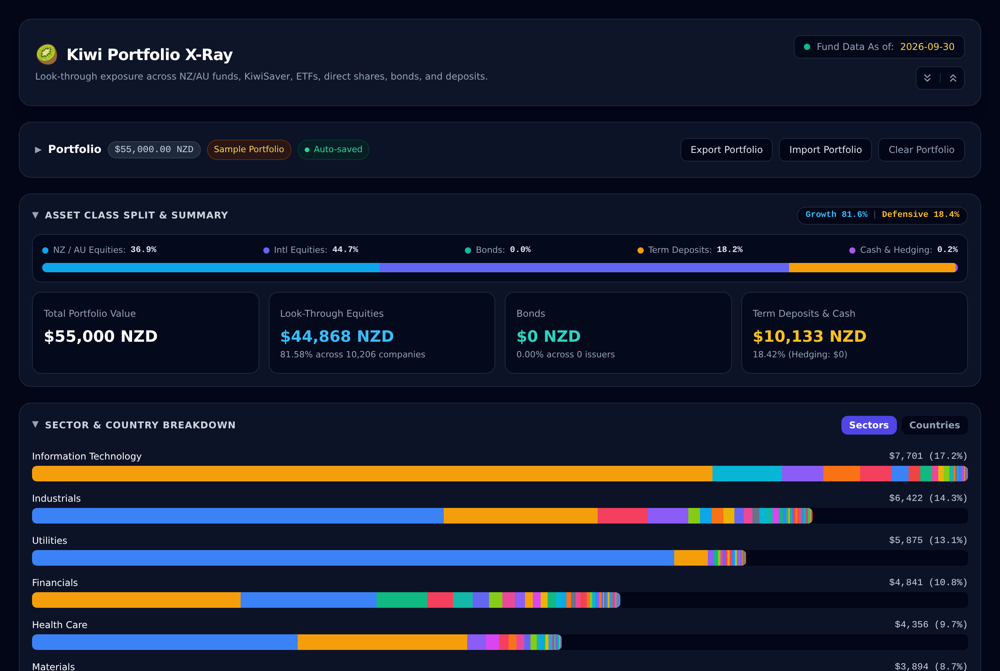
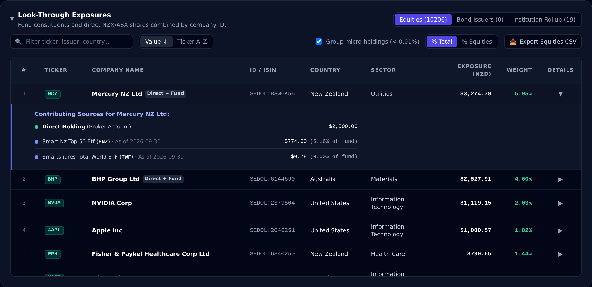
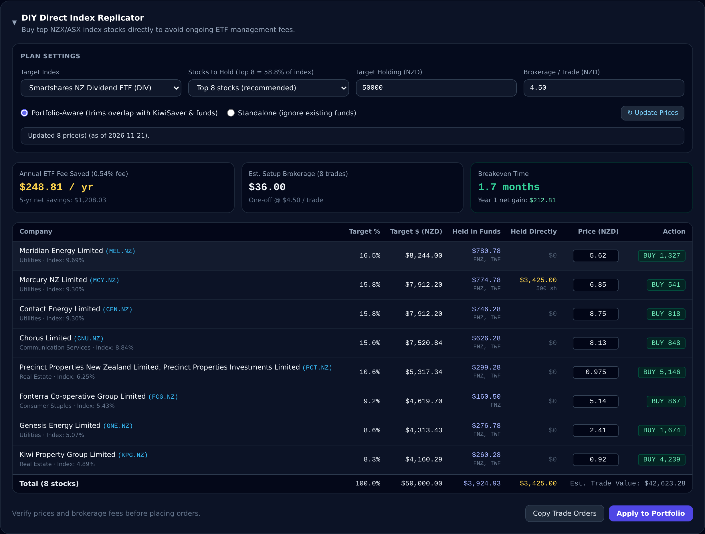
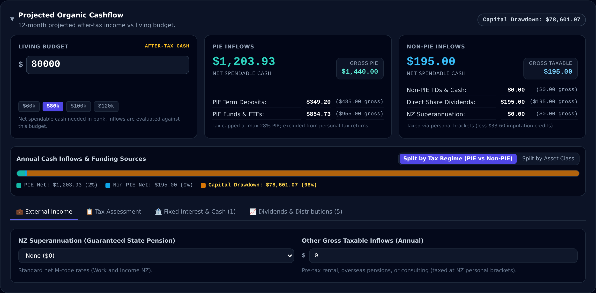

# Kiwi Portfolio X-Ray

A static, browser-based portfolio look-through analyzer for New Zealand retail investors holding portfolios across KiwiSaver schemes, unlisted managed funds, NZX/ASX ETFs, direct shares, bonds, and bank term deposits.

**Live App:** https://susanjanenz.github.io/kiwi-portfolio-xray/



> [!WARNING]
> **Disclaimer — Not Financial or Tax Advice**
>
> Kiwi Portfolio X-Ray is an independent, educational personal project provided **"as is"** without warranty of any kind. Nothing in this application or repository constitutes financial, investment, legal, or tax advice (including NZ PIE, RWT, PIR, imputation credit, or FIF tax calculations).
>
> - Fund holdings and constituent weights are compiled from publicly available periodic filings (such as the NZ Companies Office Disclose Register / Sorted Smart Investor and overseas ETF issuer disclosures) and may lag current holdings, omit minor positions, or contain mapping/classification approximations.
> - Always verify holdings, prices, and tax obligations against official fund documents, your broker, Inland Revenue (IRD), or a licensed financial adviser before making investment or tax decisions.

## Privacy & Zero Backend

All portfolio numbers you enter stay **100% in your browser** (`localStorage` / IndexedDB). There is no backend server, no user accounts, and no tracking or analytics. Because data is stored locally per browser/device, it does not automatically sync across devices — use **Export JSON** / **Import JSON** in the app to back up or transfer your portfolio between devices.

## Key Capabilities

* **3-Tier Portfolio Input:** Track (1) NZX/ASX exchange-traded shares & listed ETFs (units × price), (2) Managed funds & KiwiSaver in NZD, and (3) Fixed interest & cash (bonds, PIE/RWT term deposits, cash).
* **Recursive Feeder Fund Unwrapping:** Unpacks NZ feeder ETFs (e.g. Smartshares `TWF`, `USF`, `ESG`, `EMF`, Kernel Emerging Markets) into their underlying Vanguard, iShares, and SPDR holdings.
* **Cross-Fund Look-Through & Asset Split:** Aggregates overlapping company, sector (GICS), country, and bank/issuer exposure across funds and direct holdings, and splits multi-asset funds into true Equities, Fixed Interest, Term Deposits, and Cash.
* **Retirement Cashflow & Bucket Rebalancer:** Models forward dividend/interest income (with NZ PIR / RWT tax estimates) and minimum-turnover withdrawal rebalancing across user-defined buckets.
* **DIY Direct Index Replicator:** Models direct NZX/ASX stock portfolios replicating popular index ETFs (`DIV`, `FNZ`, `TNZ`, `ASD`, `OZY`), compares ETF fee savings vs. brokerage breakeven, subtracts existing fund & direct holdings to avoid double-ups, and generates actionable buy/sell share orders.
* **Crowdsourced Fund Requests:** Paste a Sorted Smart Investor URL for an unlisted NZ fund to model it immediately with a fallback split and optionally submit a GitHub Issue for automated ingestion.

## Screenshots

### Cross-Fund Look-Through Exposure
See every underlying company you own across KiwiSaver, managed funds, ETFs, and direct shares — with `[Direct + Fund]` overlap badges:



### DIY Direct Index Replicator
Replicate popular NZX/ASX ETFs (`DIV`, `FNZ`, `TNZ`, `ASD`, `OZY`) directly, subtract existing fund & direct holdings, and check brokerage breakeven:



### Projected Organic Cashflow
Estimate 12-month after-tax PIE and non-PIE income against your living budget:



## Local Development

```bash
npm install
npm run dev
```
