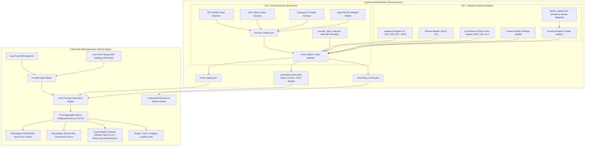
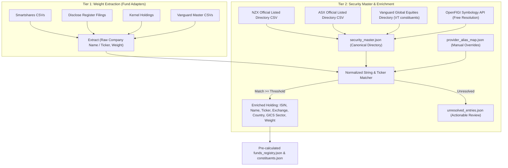

# NZ Portfolio Look-Through Analyzer

* **Author:** SusanJaneNZ
* **Status:** Draft
* **Date:** 2026-11-08

---

## Overview

The NZ Portfolio Look-Through Analyzer is a static, browser-based web application hosted on GitHub Pages. It enables New Zealand retail investors to evaluate their combined portfolio across multiple funds according to their personal dollar allocations, providing a single consolidated look-through of their true underlying company, sector, and country exposures.

Fund providers in New Zealand do not provide look-through aggregation even within their own platforms. For example, an investor holding 40% in a Kernel NZ equity fund and 60% in a Kernel Australian equity fund sees their balance divided by fund, but the platform does not combine these holdings to show consolidated company exposures. If aggregated, the investor would discover that dual-listed equities (such as Chorus or major banks) appear in both funds, resulting in a significantly higher true concentration than expected. This visibility gap exists whether an investor holds funds through a single manager or diversifies across multiple platforms (such as NZX-listed Smartshares ETFs and Kernel unlisted index funds).

Evaluating all holdings weighted by the investor's actual capital allocation provides foundational visibility across the entire portfolio. Where funds wrap overseas master funds (such as Smartshares feeder wrappers holding Vanguard US ETFs) or share common equities across regional borders, the tool unpacks the feeder structures and reconciles overlapping company positions. Reconciling overlapping holdings and unwrapping multi-tier feeders is a critical capability, but the primary function is enabling investors to see their complete consolidated asset allocation across all combined funds at their personal investment amounts.

This tool resolves multi-fund portfolios by unpacking feeder funds to their constituent holdings, normalizing taxonomies and ticker identifiers to a canonical primary key (ISIN), scaling positions by the user's specific fund balances, and aggregating any shared equities. The calculation engine runs entirely client-side in the browser against build-time pre-compiled static datasets, preserving user privacy with no backend database or account requirements.

---

## The Problem

1. **Intra-Provider Aggregation Blind Spots:** Fund managers and investment platforms do not combine underlying constituents across their own funds for a single investor. An investor holding both an NZ index fund and an Australian index fund with the same provider receives per-fund reporting, obscuring aggregated company exposures. Dual-listed companies (such as Chorus or dual-listed banks appearing in both NZ and Australian indices) are duplicated without total visibility, creating hidden single-company concentrations even when investing entirely within a single provider's product line.
2. **Feeder Fund Opacity:** Smartshares global equity funds (such as Total World `TWF` or US 500 `USF`) operate as feeder wrappers around overseas master ETFs (such as Vanguard `VT` and `VOO`). In statutory New Zealand reporting, fund managers list only the wrapper asset as a single line item, obscuring the thousands of underlying company equities.
3. **Fragmented and Disconnected Data Sources:** Fund constituent data is published in inconsistent, non-standardized formats across multiple sources:
   - New Zealand Disclose Register statutory XML/CSV filings.
   - Smartshares direct NZ/AU equity holding CSV exports.
   - Kernel Wealth monthly constituent portfolio tables.
   - Vanguard US master fund holdings CSV files.
4. **Identifier Collisions and Inconsistencies:** Ticker symbols collide across global and local exchanges (e.g., identical tickers on NZX, ASX, and US markets), and dual-listed companies (e.g., Fisher & Paykel Healthcare on NZX and ASX) appear under disparate identifiers without a unified identifier.
5. **Taxonomy Incompatibilities:** Providers classify holdings under conflicting industry sector models (e.g., FTSE ICB versus S&P Dow Jones GICS), making sector aggregation inaccurate without systematic mapping.
6. **Denominator Distortion from Cash and Hedging:** Index funds routinely hold between 0.2% and 2.5% in cash reserves, and currency-hedged funds hold forward foreign exchange derivative contracts. Naively dropping these assets distorts the 100% portfolio base denominator and misrepresents equity weights.
7. **Browser Performance Bottlenecks:** A single broad global index fund like Vanguard `VT` contains over 9,800 individual stock holdings. Parsing multiple large CSV exports client-side in the browser exhausts device memory and leads to mobile browser crashes.

---

## Goals

* **Recursive Feeder Fund Unwrapping:** Recursively resolve feeder fund wrappers to their underlying master fund constituents, scaling individual equity weights proportionally to the parent fund's allocation.
* **Unified Canonical Identification (ISIN):** Use ISO 6166 International Securities Identification Numbers (ISIN) as the primary key for all company holdings, backed by a static build-time alias dictionary to map local exchange tickers and provider-specific names.
* **Standardized Sector Taxonomy:** Normalize all constituent industry sectors to the 11 standard GICS Level 1 sectors (*Energy, Materials, Industrials, Consumer Discretionary, Consumer Staples, Health Care, Financials, Information Technology, Communication Services, Utilities, Real Estate*).
* **Denominator Integrity and Asset Segregation:** Preserve total invested New Zealand Dollars (NZD) as the 100% calculation baseline. Segregate liquidity buffers, currency hedging contracts, and cash reserves into a dedicated asset view.
* **Post-Aggregation Micro-Holding Consolidation:** Filter individual positions smaller than $0.01\%$ across the total portfolio into an `"Other Micro-Holdings"` category only after cross-fund aggregation, retaining exact country and sector totals for macro reporting.
* **Subcategory Stacked Visualizations:** Render horizontal stacked bar charts showing sector exposures sub-categorized by country, and country exposures sub-categorized by sector, with hover inspection tooltips.
* **Static Client-Side Execution:** Run all aggregation and look-through calculations in-browser via static files generated by a build-time GitHub Actions ingestion pipeline.
* **Direct Equity Holding Integration:** Allow users to enter direct NZX and ASX company shareholdings in NZD, seamlessly combining them with fund look-through holdings in the consolidated company table, sector charts, and country charts.
* **Local Persistence & Data Portability:** Persist portfolio inputs in browser `LocalStorage` with explicit JSON and CSV export/import for manual backup and transfer.

---

## Non-Goals

* **No Server Infrastructure or Cloud Database:** The application will not use server-side runtimes, APIs, user authentication systems, or remote database storage.
* **No Direct-Indexing or Automated Trade Execution:** The tool will not generate trade orders, compute rebalancing purchase sizing, or connect to brokerage APIs.
* **No Tax Calculations:** The tool will not calculate Foreign Investment Fund (FIF) fair dividend rate (FDR), comparative value (CV), or dividend imputation credits.
* **No Real-Time or Intraday Pricing:** Portfolio calculations rely on fund disclosure reporting periods and static holdings datasets, not real-time streaming market prices.

---

## Open Questions

* **Upstream CSV Schema & Source Drift:** What automated schema validation or alerts should trigger in the GitHub Actions build pipeline when upstream provider CSV files change column headers, URL paths, or reporting structures without notice?
* **Security Master Refresh & Symbology Rate Limits:** What build-time fallback or caching strategy should be implemented when querying the OpenFIGI API for newly discovered international tickers during security master compilation to prevent rate-limiting or CI timeouts?

---

## Critical User Journeys (CUJs)

### CUJ 1: Portfolio Input and Look-Through Generation

* **Given**: A user holding Smartshares Total World (`TWF`), Smartshares NZ Top 50 (`FNZ`), and Kernel Global 100.
* **When**: The user enters their NZD investment balances for each fund into the portfolio allocation table.
* **Then**: The system unpacks the underlying holdings with correct fund weighting, aggregates any shared company stocks across funds, updates the horizontal stacked sector/country charts, and populates the searchable company holdings table.

### CUJ 2: Duplicate Exposure and Overlap Inspection

* **Given**: A user holds both Smartshares US 500 (`USF`) and Smartshares Total World (`TWF`), both wrapping Vanguard US funds (`VOO` and `VT`).
* **When**: The user searches for a specific company (e.g., Microsoft or Apple) in the consolidated holdings table.
* **Then**: The table displays the consolidated percentage and NZD exposure for that company, with an expandable breakdown showing the exact contribution originating from `USF` versus `TWF`.

### CUJ 3: Data Export and Restoration

* **Given**: A user has configured their fund allocations on a desktop browser.
* **When**: The user clicks "Export Portfolio", transfers the generated JSON file to a mobile device, and clicks "Import Portfolio".
* **Then**: The mobile browser loads the exact portfolio balances without requiring a user account or network synchronization.

### CUJ 4: Combined Fund and Direct Equity Analysis

* **Given**: A user holds \$20,000 in Smartshares NZ Top 50 (`FNZ`) and also holds \$10,000 in Mercury NZ (`NZX:MCY`) shares directly via a broker.
* **When**: The user inputs their `FNZ` balance and uses the direct equity search to add their Mercury holding at \$10,000 NZD.
* **Then**: The system incorporates Mercury at 100% equity weight for the direct allocation, includes the \$10,000 in the total portfolio denominator, aggregates it with Mercury's constituent portion inside `FNZ`, updates the Utilities sector and New Zealand country allocations, and displays an expandable row showing the exposure breakdown between "Direct Holding" and "Smartshares FNZ".

---

## Technical Plan (Architecture)

The system consists of two decoupled subsystems: an upstream build-time ingestion pipeline running in GitHub Actions and a static client-side single-page application hosted on GitHub Pages.



### 1. Upstream Build-Time Ingestion Pipeline

The upstream pipeline runs in GitHub Actions on a monthly cron schedule and on commits touching data extraction scripts or mapping dictionaries. It downloads raw disclosures, extracts underlying holdings, normalizes taxonomy and security identifiers, unwraps feeder structures, and outputs static, minified JSON assets committed to the repository's public distribution folder.

#### A. Two-Tier Ingestion and Enrichment Architecture
Fund disclosures rarely provide complete metadata; providers like Kernel and Smartshares typically report only company names, local ticker symbols, and weights, omitting canonical ISINs, country classifications, and GICS sectors. Furthermore, commercial financial APIs that provide comprehensive look-through data (e.g., Morningstar Direct, Refinitiv) require prohibitive licensing fees (\$15,000–\$50,000/yr), while free financial APIs do not index unlisted New Zealand funds or provide redistributable constituent datasets.

To resolve this limitation without relying on unauthorized scraping of third-party retail sites (e.g., StockAnalysis.com), the pipeline decouples raw weight extraction from security metadata enrichment:



#### B. Tier 1: Source Data Weight Extraction Adapters
We do not require a bespoke parser for every fund. Fund managers and master ETF issuers publish constituent holdings using standardized platform schemas. The pipeline implements five modular extraction adapters that cover the complete catalog of Smartshares and Kernel funds:

1. **Vanguard US Constituent CSV Adapter:** Parses Vanguard's standard institutional/retail ETF CSV schema (`Holdings_details_*.csv`). A single generic adapter processes all wrapped Vanguard ETFs, including:
   - `VT` (Total World)
   - `VOO` (S&P 500)
   - `VGK` (FTSE Europe)
   - `VPL` (FTSE Pacific)
   - `VWO` (FTSE Emerging Markets)
2. **iShares (BlackRock) Constituent CSV Adapter:** Parses BlackRock's standard ETF portfolio export schema (`*_holdings.csv`). Handles master funds wrapped by Smartshares ESG or regional funds, including:
   - `IWLD` (iShares Core MSCI World Ex Australia ESG ETF)
   - `IVV` (iShares Core S&P 500 ETF)
3. **Smartshares NZ/AU Direct Funds Adapter:** Ingests monthly statutory holdings CSV exports covering direct NZX and ASX equity funds (`FNZ` NZ Top 50, `MDZ` NZ Mid Cap, `NZG` NZ Dividend, `OZY` Australian Top 20, `ASD` Australian Dividend).
4. **Kernel Wealth Monthly Portfolio Adapter:** Ingests monthly portfolio holding exports for unlisted index funds (`Kernel NZ 50`, `Kernel S&P Australian Leaders`, `Kernel S&P Global 100`, `Kernel High Dividend`).
5. **Smartshares Feeder Wrappers (Disclose Register):** Parses statutory scheme disclosures from the NZ Companies Office Disclose Register to extract parent wrapper asset weights, cash buffer ratios, and currency hedging contract allocations.

#### C. Declarative Feeder Configuration (`feeder_registry.json`)
To avoid writing code whenever a new feeder fund is tracked, feeder relationships are declared in a static configuration registry that pairs the local fund code with the master ETF parser:
```json
{
  "TWF": { "name": "Smartshares Total World ETF", "master_provider": "vanguard", "master_ticker": "VT" },
  "USF": { "name": "Smartshares US 500 ETF", "master_provider": "vanguard", "master_ticker": "VOO" },
  "EUF": { "name": "Smartshares Europe ETF", "master_provider": "vanguard", "master_ticker": "VGK" },
  "APA": { "name": "Smartshares Asia Pacific ETF", "master_provider": "vanguard", "master_ticker": "VPL" },
  "EMF": { "name": "Smartshares Emerging Markets ETF", "master_provider": "vanguard", "master_ticker": "VWO" },
  "ESG": { "name": "Smartshares Global Equities ESG ETF", "master_provider": "ishares", "master_ticker": "IWLD" }
}
```
Adding support for additional feeder funds requires only adding a declarative line to `feeder_registry.json` pointing to an existing adapter.

#### D. Tier 2: Security Master Enrichment & Canonical Resolution
Security metadata (ISIN, Country, GICS Sector) is resolved through a multi-tiered lookup engine:
1. **Security Master Reference Dataset (`security_master.json`):**
   Compiled from official, legally permissible open sources:
   - **NZX Official Listed Directory:** Public listings export providing canonical ISIN, company name, NZX ticker, and GICS sector for all NZ-listed equities.
   - **ASX Official Listed Directory:** Public listings export providing ISIN, company name, ASX ticker, and GICS sector for all Australian-listed equities.
   - **Vanguard Global Directory:** Vanguard's global master constituent exports (`VT`) provide verified ISINs, country of origin, and ICB/GICS mappings for ~10,000 global companies.
   - **OpenFIGI API:** Free symbology lookup service (Bloomberg Open Symbology) used during staging builds to resolve ambiguous international tickers to canonical ISINs.
2. **Normalization & Fuzzy Matching Engine:**
   - **String Normalization:** Cleans corporate legal suffixes (`Limited`, `Ltd`, `Inc`, `Corp`, `PLC`), strips punctuation and non-alphanumeric characters, and converts to uppercase tokens.
   - **Heuristic Matching:** Performs exact ticker match with exchange qualification (e.g., `NZX:FPH` vs `ASX:FPH`). If tickers are absent, runs token-sort Levenshtein distance matching against `security_master.json`.
   - **Confidence Threshold:** High-confidence matches ($\ge 90\%$) are accepted automatically. Borderline matches or unmatched rows are diverted to `unresolved_entries.json`.
3. **Manual Override Mapping (`provider_alias_map.json`):**
   Provides an explicit, human-editable override table for idiosyncratic names or unlisted instruments:
   ```json
   {
     "Kernel:NZ_50": {
       "Chorus": "NZCNUE0001S2"
     }
   }
   ```

#### E. Sector Taxonomy Normalization
Fund disclosures using alternative classification frameworks (e.g., FTSE ICB in Vanguard disclosures) are mapped to the 11 standard GICS Level 1 sectors:
1. Energy
2. Materials
3. Industrials
4. Consumer Discretionary
5. Consumer Staples
6. Health Care
7. Financials
8. Information Technology
9. Communication Services
10. Utilities
11. Real Estate

#### F. Feeder Unwrapping and Output Generation
* For feeder funds, the pipeline recursively scales master fund constituents by the wrapper fund's equity proportion:
  $$\text{Constituent Weight in Feeder} = \text{Constituent Weight in Master} \times (1 - \text{Cash Buffer} - \text{Hedging Ratio})$$
* Pre-calculated holdings are written to two static JSON structures:
  * `funds_registry.json`: Metadata for each supported fund (ID, name, provider, asset class, reporting date, cash ratio, hedging ratio).
  * `constituents.json`: Key-value map indexing each fund ID to its normalized constituent array (`[{ isin, name, ticker, country, gics_sector, weight }]`).

---

### 2. Client-Side Look-Through Calculation Engine

The web application executes all calculations in memory in the client browser using pure mathematical functions without external network calls.

#### A. Calculation Mechanics & Denominator Baseline
Let the user's entered balance for fund $f$ be $B_f$ in NZD, and the user's entered market value balance for direct company holding $k$ be $H_k$ in NZD (where $k$ is an individual stock selected from `security_master.json`).

1. **Total Invested Denominator ($D$):**
   $$D = \sum_{f} B_f + \sum_{k} H_k$$
   All calculations maintain $D$ as the fixed denominator to prevent equity weight inflation from cash or derivative reserves.

2. **Consolidated Company Exposure ($E_i$):**
   For each unique security $i$ (identified by ISIN):
   $$E_i = \sum_{f} \left( B_f \times w_{f, i} \right) + \begin{cases} H_i & \text{if security } i \text{ is held directly} \\ 0 & \text{otherwise} \end{cases}$$
   Where $w_{f, i}$ is the proportional weight of company $i$ in fund $f$.

3. **Consolidated Portfolio Weight ($P_i$):**
   $$P_i = \frac{E_i}{D}$$

4. **Liquidity and Currency Hedging Segregation:**
   $$\text{Cash NZD} = \sum_{f} \left( B_f \times c_f \right), \quad \text{Hedging Contracts NZD} = \sum_{f} \left( B_f \times h_f \right)$$
   Where $c_f$ and $h_f$ are the cash and currency-hedging ratios of fund $f$. Direct equity holdings carry $0\%$ cash/hedging ratios ($100\%$ equity).

#### B. Post-Aggregation Micro-Holding Consolidation
* A broad global index fund introduces thousands of fractional equity holdings. To prevent browser rendering lag while preserving mathematical accuracy, filtering is applied **strictly after** cross-fund aggregation:
  * If $P_i < 0.0001$ ($0.01\%$ of total portfolio), the position is grouped into an `"Other Micro-Holdings"` row in the company look-through table. Direct equity holdings with meaningful allocations ($>0.01\%$) naturally appear above this threshold.
  * For macro country and sector calculations, the exact exposure $E_i$ is credited to company $i$'s designated country $C_i$ and sector $S_i$. Macro allocation charts reflect 100% of the underlying equities without loss of precision.

---

### 3. User Interface & Visualization Architecture

The user interface is structured around three primary visual components:

#### A. Portfolio Input Table
* **Fund Allocations Section:** Clean numeric inputs for each fund in NZD, displaying individual fund percentages of total entered capital.
* **Direct Equities Section:** Autocomplete search input backed by `security_master.json` enabling users to search NZX and ASX tickers or company names (e.g., `MCY.NZ`, `FPH.NZ`, `BHP.AX`) and enter their current total NZD holding value.
* Quick preset actions: Clear all, Load example portfolio, Export JSON/CSV, Import JSON/CSV.

#### B. Horizontal Stacked Subcategory Bar Charts
Matching prototype layout and density requirements:
1. **Sector Allocation Broken Down by Country:** Each horizontal bar represents one of the 11 GICS sectors. The bar length represents total sector percentage, divided internally into colored sub-segments for each contributing country. Both fund constituents and direct shares feed into their respective GICS sector.
2. **Country Allocation Broken Down by Sector:** Each horizontal bar represents a country exposure, divided internally into colored sub-segments for each contributing sector.
3. **Interactive Hover Tooltips:** Hovering over any sub-segment displays an inspection popover showing:
   * Category name and subcategory name.
   * Total dollar exposure in NZD.
   * Percentage of total portfolio and percentage within that parent category.

#### C. Virtualized Company Look-Through Table
* Searchable by company name, ticker, or ISIN.
* Sortable by total NZD value or portfolio percentage.
* Expandable rows: Clicking a row reveals which funds contribute to that company holding, the dollar amount from each fund, the fund-level percentage, and displays a dedicated **"Direct Holding"** source row if the user also holds shares directly.
* Toggle: View allocations as **"% of Total Portfolio"** (inclusive of cash/bonds) or **"% of Equities"**.

---

### 4. Persistence and Data Portability

* **Browser LocalStorage Adapter:** Saves entered fund allocations under a versioned storage key (`nz_unwrapper_portfolio_v1`). State is reloaded automatically on subsequent page visits.
* **JSON Export/Import:** Generates and parses a standard JSON schema containing timestamp, schema version, and fund balance key-value pairs.
* **CSV Export:** Exports a spreadsheet-compatible breakdown of consolidated holdings, sectors, and fund allocations for external analysis.

---

### 5. Administrator Verification & Mapping Tooling (GitHub Actions CI)

To ensure that new or modified provider CSV disclosures can be audited before being committed to production, the architecture implements an automated CI verification workflow running on GitHub Actions (**Architectural Decision: Automated GitHub Actions CI / Workflow Dispatch**).

When an administrator introduces a new fund disclosure or updates an existing one:
1. **Staging & Trigger**:
   - The administrator commits candidate CSV files (either individually or in small batches) to `data/staging/` or triggers the workflow manually via `workflow_dispatch`.
   - The validation workflow runs without touching production distribution files.
2. **Validation & Diagnostics**:
   - **Header Schema Check:** Verifies expected column names against known provider disclosure formats.
   - **Weight Sum Integrity:** Validates that constituent weights sum to $100\% \pm 0.5\%$, identifying cash or derivative discrepancies.
   - **ISIN Resolution Audit:** Flags any company row where the local ticker or name fails to resolve against `provider_alias_map.json`.
   - **Taxonomy Validation:** Flags unmapped industry sectors that do not conform to the 11 GICS Level 1 sectors.
3. **Actionable Summary & Guidance**:
   - The workflow writes a structured Markdown validation report to the GitHub Actions Job Summary and PR comments.
   - Outlines why rejected rows fell short with instructions on expected fields and primary source registries (e.g., NZX announcements, ASX issuer lists, Disclose Register).
   - Automatically generates ready-to-paste JSON snippet blocks to append to `provider_alias_map.json`. Once committed, the staging file is promoted to production data.

---

### 6. Date & Freshness Management

Because fund managers publish holdings on divergent schedules (e.g., monthly for Vanguard US and Smartshares direct funds, quarterly or semi-annually for statutory Disclose Register filings), constituents across an investor's portfolio will inherently reflect different effective dates. The system tracks and exposes this multi-cadence freshness explicitly at three levels:

#### A. Per-Fund Metadata Schema
Each fund entry in `funds_registry.json` tracks temporal metadata:
* `effective_date`: The official "as of" date of the underlying constituent disclosure (e.g., `2026-10-31`).
* `ingestion_timestamp`: The UTC timestamp when the GitHub Actions pipeline compiled the static dataset.
* `cadence`: Expected reporting cadence (`monthly`, `quarterly`, `semi-annual`).
* `is_stale`: Boolean flag asserted if current date exceeds the expected cadence by more than 45 days.

#### B. Portfolio-Level Freshness Envelope
When the user enters their fund balances, the calculation engine computes the portfolio's freshness envelope across all held funds:
* **As-Of Date Range:** Defined by the oldest constituent reporting date ($\min_{f \in \text{Held}} \text{effective\_date}_f$) and newest constituent reporting date ($\max_{f \in \text{Held}} \text{effective\_date}_f$).
* **Freshness Spread:** The delta in days between the newest and oldest held fund disclosures.

#### C. User Interface Freshness Indicators
* **Global Header Badge:** Displays the consolidated portfolio as-of range (e.g., *"Holdings As Of: 30 Sep 2026 – 31 Oct 2026"*).
* **Fund Allocation Table:** Includes an "As Of" date column adjacent to each fund input, with a visual stale indicator if an individual fund's data exceeds 90 days.
* **Company Look-Through Breakdown:** In the expanded row showing contributing funds for a specific company, each fund line item displays its respective constituent reporting date so the user can verify data alignment.


---

## Alternatives Considered

### Alternative A: In-Browser Raw CSV Parsing (No Build Pipeline)

* **Mechanism**: Users upload raw provider CSV files directly in the browser. JavaScript parses them client-side on each page load.
* **Pros**: No build infrastructure required; users always use the most current disclosure file they have.
* **Cons**: Vanguard `VT` alone contains 9,800+ rows. Parsing multiple large CSVs simultaneously in browser memory causes UI freezing and crashes on mobile devices. Requires users to source, download, and manage raw disclosure files themselves — a significant usability burden. Each provider uses a different CSV schema, pushing format-handling complexity into the browser bundle.
* **Reason for Rejection**: Rejected by author — browser memory and performance constraints make this unworkable at the constituency scale of broad global index funds, and placing data sourcing on end-users creates an unreliable dependency.

---

### Alternative B: Google Sheets / Excel Shared Workbook

* **Mechanism**: A shared collaborative spreadsheet performs look-through aggregation via formulas and manual data entry. Users copy their balances into designated cells.
* **Pros**: No software deployment; familiar to non-technical users; easy to share.
* **Cons**: Multi-tier recursive feeder fund unwrapping across thousands of constituents exceeds practical spreadsheet formula limits. Cross-fund ISIN deduplication and taxonomy normalization require VBA macros or App Script that are fragile and unversioned. Cannot handle the ~10,000-row Vanguard `VT` constituent table without major performance degradation.
* **Reason for Rejection**: Rejected by author — cannot handle multi-tier recursive look-through across thousands of constituents from multiple fund managers without reaching formula and performance limits.

---

### Alternative C: Commercial Financial API Integration (Morningstar / Refinitiv)

* **Mechanism**: The build pipeline queries a licensed financial data API (e.g., Morningstar Direct or Refinitiv Eikon) to retrieve fund constituent data, company metadata, ISINs, and GICS sectors in a normalized, pre-enriched format, eliminating the need for Tier 2 security master compilation.
* **Pros**: High data quality; ISINs, sectors, and country metadata supplied directly; no fuzzy matching or alias dictionaries needed; covers unlisted funds.
* **Cons**: Enterprise API licensing costs range from \$15,000 to \$50,000 per year. Data redistribution (publishing pre-compiled outputs to a public GitHub Pages static site) is typically prohibited under commercial API terms of service, requiring legal review for each provider. Introduces a hard cost dependency that eliminates the zero-cost hosting model.
* **Reason for Rejection**: Rejected by author — licensing cost and redistribution restrictions are incompatible with a zero-cost, open-source static hosting model.

---

### Alternative D: StockAnalysis.com or Similar Retail Aggregator Scraping

* **Mechanism**: The GitHub Actions build pipeline scrapes a retail financial aggregator site (e.g., StockAnalysis.com) to extract company country and sector metadata for the security master.
* **Pros**: Free access; broad global coverage including small-cap and emerging market companies; covers country and sector metadata not always present in official exchange directories.
* **Cons**: Retail financial sites do not grant automated crawling or redistribution rights in their terms of service. IP blocking, rate limiting, and HTML structure changes can silently corrupt the security master without build-time detection. Data quality and accuracy cannot be verified against an authoritative primary source.
* **Reason for Rejection**: Rejected by author — unauthorized scraping creates IP and licensing risk for a public open-source project, and silent failure modes in CI data extraction are unacceptable for a tool where data accuracy is the primary value proposition.

---

### Alternative E: Standalone Local Python Application (No GitHub Pages)

* **Mechanism**: A Python application installed locally (e.g., a Streamlit or Dash app) runs the ingestion pipeline and look-through calculations on the user's machine, reading local CSV files.
* **Pros**: No GitHub Pages hosting constraints; easier to run ad-hoc data updates; Python ecosystem provides mature data wrangling libraries (pandas, rapidfuzz).
* **Cons**: Requires users to install Python and dependencies — a significant barrier for non-technical NZ retail investors. No URL to share; no cross-device access without additional setup. Loss of zero-infrastructure deployment to GitHub Pages.
* **Reason for Rejection**: Rejected by author — installation friction is incompatible with the target audience of retail investors expecting a browser-accessible tool with no setup. The Python ecosystem is retained for the CI pipeline and administrator tooling only.

---

### Alternative F: Single Monolithic JavaScript Parser (No Modular Adapters)

* **Mechanism**: A single hardcoded ingestion script handles all provider CSVs with conditional branching by filename or provider name, rather than a modular adapter per provider schema.
* **Pros**: Simpler initial implementation; fewer files to maintain.
* **Cons**: Adding a new fund provider or master ETF issuer (e.g., a future Smartshares fund wrapping a new iShares ETF variant) requires modifying and retesting the entire monolithic parser. Schema drift in one provider's CSV silently corrupts outputs for all other providers if error boundaries are not rigidly enforced.
* **Reason for Rejection**: Rejected by author — the modular adapter pattern with a declarative `feeder_registry.json` isolates provider schema changes to a single adapter file and allows new feeders to be registered without code modification.


---

## Detailed Implementation Plan

### Target Files to Create/Modify

---

#### Milestone 1: Upstream Ingestion & CI Pipeline

---

#### 1. `pipeline/adapters/vanguard_adapter.py` (Create)

* **Type / Scope**: Python module — Tier 1 weight extraction adapter
* **Proposed Changes**: Parses Vanguard's standard `Holdings_details_*.csv` schema. Extracts `(raw_name, cusip_or_isin, weight_pct)` for each constituent row. Handles Vanguard-specific header variants across `VT`, `VOO`, `VGK`, `VPL`, `VWO`. Returns a normalized list of raw weight records for Tier 2 enrichment.

#### 2. `pipeline/adapters/ishares_adapter.py` (Create)

* **Type / Scope**: Python module — Tier 1 weight extraction adapter
* **Proposed Changes**: Parses BlackRock iShares standard `*_holdings.csv` schema. Extracts `(raw_name, isin, weight_pct, exchange)` per constituent. Handles schema variants across `IWLD` and `IVV`. Returns normalized raw weight records.

#### 3. `pipeline/adapters/smartshares_direct_adapter.py` (Create)

* **Type / Scope**: Python module — Tier 1 weight extraction adapter
* **Proposed Changes**: Parses Smartshares NZ/AU direct equity fund CSV exports (covering `FNZ`, `MDZ`, `NZG`, `OZY`, `ASD`). Extracts `(exchange_code, raw_name, weight_pct)`. Returns raw weight records.

#### 4. `pipeline/adapters/kernel_adapter.py` (Create)

* **Type / Scope**: Python module — Tier 1 weight extraction adapter
* **Proposed Changes**: Parses Kernel Wealth monthly portfolio holding CSVs for unlisted index funds. Extracts `(raw_name, exchange_tag_if_present, weight_pct)`. Returns raw weight records. Kernel CSVs typically omit ISINs; enrichment deferred to Tier 2.

#### 5. `pipeline/adapters/disclose_register_adapter.py` (Create)

* **Type / Scope**: Python module — Tier 1 feeder wrapper adapter
* **Proposed Changes**: Fetches or parses Smartshares scheme disclosure exports from the NZ Companies Office Disclose Register. Extracts feeder wrapper percentages allocated to overseas master fund assets, cash buffer ratios, and currency hedging forward contract allocations for each fund in `feeder_registry.json`.

#### 6. `pipeline/feeder_registry.json` (Create)

* **Type / Scope**: JSON configuration file — declarative feeder-to-master mapping
* **Proposed Changes**: Defines the mapping between each Smartshares feeder fund code, its canonical name, the master ETF provider adapter, and the master ETF ticker symbol. Adding a new feeder fund requires only a new entry here with no code changes.
  ```json
  {
    "TWF": { "name": "Smartshares Total World ETF", "master_provider": "vanguard", "master_ticker": "VT" },
    "USF": { "name": "Smartshares US 500 ETF", "master_provider": "vanguard", "master_ticker": "VOO" },
    "EUF": { "name": "Smartshares Europe ETF", "master_provider": "vanguard", "master_ticker": "VGK" },
    "APA": { "name": "Smartshares Asia Pacific ETF", "master_provider": "vanguard", "master_ticker": "VPL" },
    "EMF": { "name": "Smartshares Emerging Markets ETF", "master_provider": "vanguard", "master_ticker": "VWO" },
    "ESG": { "name": "Smartshares Global Equities ESG ETF", "master_provider": "ishares", "master_ticker": "IWLD" }
  }
  ```

#### 7. `pipeline/security_master/build_security_master.py` (Create)

* **Type / Scope**: Python script — Tier 2 security master compilation
* **Proposed Changes**: Compiles `security_master.json` by merging:
  1. NZX official listed directory CSV (downloaded via NZX public data endpoint).
  2. ASX official listed directory CSV (downloaded via ASX public data endpoint).
  3. Vanguard `VT` global constituents CSV (provides ISIN, country, and GICS sector for ~10,000 global equities).
  4. OpenFIGI API batch lookups for tickers not resolved by the above sources (rate-limited; results cached in `pipeline/security_master/openfigi_cache.json`).
  Outputs `pipeline/security_master/security_master.json`.

#### 8. `pipeline/security_master/security_master.json` (Create — build artifact)

* **Type / Scope**: Build-time generated JSON reference dataset
* **Proposed Changes**: Canonical registry of all known equities: `{ isin, name, ticker, exchange, country_iso2, gics_sector }`. Regenerated by `build_security_master.py` on a schedule independent of fund constituent runs. Committed to the repository as a versioned static asset.

#### 9. `pipeline/security_master/openfigi_cache.json` (Create)

* **Type / Scope**: JSON cache file — OpenFIGI API resolution cache
* **Proposed Changes**: Caches `(raw_query) -> { isin, name, country, gics_sector }` OpenFIGI resolution results. Prevents redundant API calls on subsequent CI runs and avoids rate-limiting during security master rebuilds. Committed to the repository and updated incrementally when new tickers are discovered.

#### 10. `pipeline/enrichment/fuzzy_matcher.py` (Create)

* **Type / Scope**: Python module — Tier 2 security enrichment
* **Proposed Changes**: Implements the two-pass resolution strategy:
  1. **Exact ticker match** with exchange qualification (e.g., matches `NZX:FPH` before attempting name matching).
  2. **Token-sort Levenshtein distance** (via `rapidfuzz` library) against normalized company names in `security_master.json`. Strips legal suffixes (`Limited`, `Ltd`, `Inc`, `Corp`, `PLC`), punctuation, and non-alphanumeric characters before comparison.
  Returns enriched holding records (confidence $\ge 90\%$) or routes low-confidence matches to `unresolved_entries.json`.

#### 11. `pipeline/enrichment/provider_alias_map.json` (Create)

* **Type / Scope**: JSON manual override dictionary
* **Proposed Changes**: Human-editable mapping of `(provider:fund_code, raw_name) -> canonical_isin`. Administrators add entries here to resolve tickers that fall below the fuzzy match confidence threshold. Applied before fuzzy matching on each pipeline run as highest-priority overrides.

#### 12. `pipeline/normalizer/gics_mapping.json` (Create)

* **Type / Scope**: JSON taxonomy mapping table
* **Proposed Changes**: Maps alternative sector classification labels (FTSE ICB, Vanguard internal sector strings, Kernel sector labels) to the 11 canonical GICS Level 1 sector names. Applied during Tier 2 enrichment after ISIN resolution.

#### 13. `pipeline/unwrapper/feeder_unwrapper.py` (Create)

* **Type / Scope**: Python module — feeder fund constituent resolution
* **Proposed Changes**: Reads `feeder_registry.json` to identify feeder funds. For each feeder fund in the ingested portfolio, retrieves the corresponding master fund constituent list and scales each constituent weight by:
  $$\text{Constituent Weight in Feeder} = w_{\text{master}} \times (1 - c_f - h_f)$$
  Where $c_f$ is the cash buffer ratio and $h_f$ is the currency hedging ratio extracted by the Disclose Register adapter for fund $f$.

#### 14. `pipeline/validate/schema_validator.py` (Create)

* **Type / Scope**: Python module — build-time schema drift detection
* **Proposed Changes**: Validates each raw adapter output against expected column schema definitions (stored in `pipeline/validate/schemas/`). Raises a structured CI failure report on the GitHub Actions Job Summary if column names, data types, or weight sum integrity ($100\% \pm 0.5\%$) deviate from expectations. Prevents silently corrupted outputs from reaching `constituents.json`.

#### 15. `pipeline/validate/schemas/` (Create)

* **Type / Scope**: Directory of JSON Schema files
* **Proposed Changes**: One schema definition file per adapter (e.g., `vanguard_schema.json`, `kernel_schema.json`) defining expected column names, required fields, and weight sum tolerance.

#### 16. `pipeline/output/build_output.py` (Create)

* **Type / Scope**: Python script — static JSON output writer
* **Proposed Changes**: Consumes enriched, validated constituent records and writes the two production static assets:
  * `public/data/funds_registry.json`: Fund metadata (ID, name, provider, asset class, effective date, cadence, cash ratio, hedging ratio, `is_stale`).
  * `public/data/constituents.json`: Map of `fund_id -> [{ isin, name, ticker, country, gics_sector, weight }]`.
  * `public/data/unresolved_entries.json`: Array of unresolved disclosure rows with provider, fund, raw description, and weight for administrator review.

#### 17. `.github/workflows/ingest.yml` (Create)

* **Type / Scope**: GitHub Actions workflow definition
* **Proposed Changes**: Defines the automated ingestion pipeline:
  * **Schedule trigger**: Monthly cron (`0 6 1 * *`), aligned to typical fund disclosure release cycles.
  * **Manual trigger**: `workflow_dispatch` with optional input to run against `data/staging/` for administrator CSV verification.
  * **Steps**: Check out repository → install Python dependencies → run `build_security_master.py` (skipped if cache is fresh) → run all adapters → fuzzy match enrichment → feeder unwrapping → schema validation → build output JSON → commit updated `public/data/` files → push.
  * **Failure handling**: On schema validation failure or weight sum breach, post structured failure report to GitHub Actions Job Summary and exit non-zero without committing output.

#### 18. `.github/workflows/validate_staging.yml` (Create)

* **Type / Scope**: GitHub Actions workflow definition — administrator CSV dry-run
* **Proposed Changes**: Triggered manually via `workflow_dispatch`. Runs the full ingestion pipeline in dry-run mode against `data/staging/` CSV files. Posts a detailed Markdown validation report to the GitHub Actions Job Summary including: schema match results per file, unresolved rows with ready-to-paste `provider_alias_map.json` entries, weight integrity results, and expected source registry references (NZX, ASX, Disclose Register, Vanguard).

---

#### Milestone 2: Client-Side Calculation Engine & Persistence

---

#### 19. `src/engine/lookthrough.ts` (Create)

* **Type / Scope**: TypeScript module — core look-through calculation engine
* **Proposed Changes**: Implements the portfolio aggregation algorithm:
  * Accepts user fund balances ($B_f$), user direct equity holdings ($H_k$), `funds_registry.json`, and `constituents.json`.
  * Computes total denominator $D = \sum B_f + \sum H_k$.
  * Computes company exposures $E_i = \sum_f (B_f \times w_{f,i}) + H_i$ for each ISIN.
  * Segregates cash and hedging reserves.
  * Returns consolidated holdings array, sector aggregations, country aggregations, and liquidity summary.

#### 20. `src/engine/microfilter.ts` (Create)

* **Type / Scope**: TypeScript module — post-aggregation micro-holding bucketing
* **Proposed Changes**: Accepts consolidated holdings array from `lookthrough.ts`. Applies the $P_i < 0.01\%$ threshold strictly post-aggregation. Preserves micro-holding country and sector contributions in macro totals before removing them from the company table display. Returns filtered company table rows and an `Other Micro-Holdings` summary entry.

#### 21. `src/engine/freshness.ts` (Create)

* **Type / Scope**: TypeScript module — fund data freshness calculation
* **Proposed Changes**: Reads `effective_date`, `cadence`, and `is_stale` from `funds_registry.json` for each held fund. Computes portfolio-level as-of date range ($\min$/$\max$ effective dates across held funds) and freshness spread. Returns structured freshness metadata consumed by UI components.

#### 22. `src/storage/localStorage.ts` (Create)

* **Type / Scope**: TypeScript module — browser persistence adapter
* **Proposed Changes**: Reads and writes portfolio state (fund NZD balances and direct equity holdings) under versioned `LocalStorage` key `nz_unwrapper_portfolio_v1`. Implements schema version migration logic for future schema changes. Provides `exportJSON()`, `importJSON()`, and `exportCSV()` functions for the data portability feature.

---

#### Milestone 3: UI & Visualizations

---

#### 23. `src/components/PortfolioInputTable.tsx` (Create)

* **Type / Scope**: React/Svelte UI component — portfolio entry
* **Proposed Changes**: Renders fund allocation inputs (NZD value per fund), direct equity search input (autocomplete backed by `security_master.json`), and per-fund "As Of" date with stale indicator badge. Dispatches balance change events to the calculation engine. Provides Export, Import, and Clear actions.

#### 24. `src/components/StackedBarChart.tsx` (Create)

* **Type / Scope**: React/Svelte UI component — visualization
* **Proposed Changes**: Generic horizontal stacked subcategory bar chart component parameterized to render either Sector-by-Country or Country-by-Sector view. Renders labeled outer bars with proportional inner sub-segment bands. Hover tooltip popover shows category, subcategory, NZD value, percentage of portfolio, and percentage within category. Uses a stable, consistent color palette mapping countries and sectors to fixed colors.

#### 25. `src/components/HoldingsTable.tsx` (Create)

* **Type / Scope**: React/Svelte UI component — virtualized company look-through table
* **Proposed Changes**: Renders consolidated company holdings with client-side search (by company name, ticker, ISIN), sort (by NZD value or portfolio percentage), and expandable rows. Expanded rows list contributing funds and a "Direct Holding" row if applicable, each with NZD value and percentage. Includes toggle for "% of Total Portfolio" vs "% of Equities" view. Virtualizes rendering for lists exceeding 200 visible rows.

#### 26. `src/components/LiquidityCard.tsx` (Create)

* **Type / Scope**: React/Svelte UI component — cash and hedging summary
* **Proposed Changes**: Displays total cash reserves NZD (sum across held funds) and total currency hedging contracts NZD as a compact summary card. Provides breakdown per fund with effective date.

#### 27. `src/components/FreshnessHeader.tsx` (Create)

* **Type / Scope**: React/Svelte UI component — portfolio data freshness indicator
* **Proposed Changes**: Displays global as-of date range badge (e.g., *"Holdings as of: 30 Sep 2026 – 31 Oct 2026"*). Surfacing this prominently ensures users understand data currency before drawing conclusions.

#### 28. `src/components/UnresolvedModal.tsx` (Create)

* **Type / Scope**: React/Svelte UI component — unresolved disclosure review
* **Proposed Changes**: Modal dialog triggered by a banner if `unresolved_entries.json` is non-empty for any held fund. Displays a table of unresolved disclosure line items with provider, fund, raw description, weight, and instructions on how to contribute a resolution to `provider_alias_map.json` via a GitHub pull request.

#### 29. `src/App.tsx` / `src/App.svelte` (Create)

* **Type / Scope**: Root application component
* **Proposed Changes**: Composes `PortfolioInputTable`, `FreshnessHeader`, `StackedBarChart` (×2), `HoldingsTable`, `LiquidityCard`, and `UnresolvedModal`. Wires calculation engine reactivity: balance changes trigger `lookthrough.ts` recalculation and re-render of all visualization components.

#### 30. `vite.config.ts` (Create)

* **Type / Scope**: Build configuration
* **Proposed Changes**: Configures Vite for static single-page application build targeting GitHub Pages. Sets `base` path, enables `public/data/` passthrough, and configures TypeScript and CSS bundling.

#### 31. `package.json` (Create)

* **Type / Scope**: Node.js project manifest
* **Proposed Changes**: Declares runtime and dev dependencies: framework (React or Svelte — TBD), `vite`, TypeScript, `rapidfuzz-wasm` or equivalent JS fuzzy library for client-side direct equity autocomplete, charting library (D3 or similar lightweight option). Defines `build`, `dev`, and `preview` scripts.

---

#### Milestone 4: Deployment & Testing

---

#### 32. `.github/workflows/deploy.yml` (Create)

* **Type / Scope**: GitHub Actions deployment workflow
* **Proposed Changes**: Triggers on push to `main` and after successful `ingest.yml` completion. Runs `npm run build` to produce the static distribution bundle. Publishes `dist/` to GitHub Pages via `actions/deploy-pages`.

#### 33. `pipeline/tests/test_vanguard_adapter.py` (Create)

* **Type / Scope**: Python unit tests
* **Proposed Changes**: Tests the Vanguard adapter against fixture CSV samples for `VT` and `VOO`. Verifies correct column extraction, weight normalization, and handling of rows with missing CUSIP/ISIN fields.

#### 34. `pipeline/tests/test_fuzzy_matcher.py` (Create)

* **Type / Scope**: Python unit tests
* **Proposed Changes**: Tests the fuzzy matcher against a fixture `security_master.json`. Covers: exact ticker match, suffix-stripped name match, dual-listed company disambiguation (NZX vs ASX ticker collision), below-threshold routing to `unresolved_entries.json`, and manual override priority.

#### 35. `pipeline/tests/test_feeder_unwrapper.py` (Create)

* **Type / Scope**: Python unit tests
* **Proposed Changes**: Tests recursive feeder unwrapping using fixture data for `TWF` (Vanguard `VT`) and `ESG` (iShares `IWLD`). Verifies proportional weight scaling by cash buffer and hedging ratio, and that constituent weights sum correctly post-unwrapping.

#### 36. `src/engine/lookthrough.test.ts` (Create)

* **Type / Scope**: TypeScript unit tests
* **Proposed Changes**: Tests the look-through engine with fixture `funds_registry.json` and `constituents.json`. Covers: denominator correctness with mixed fund and direct holdings, company-level aggregation across overlapping ISINs, cash/hedging segregation, and micro-holding bucketing threshold boundary conditions.

---

### Verification Plan

* **Build**: `npm run build` (Vite) produces static bundle in `dist/` without TypeScript errors.
* **Pipeline Unit Tests**: `pytest pipeline/tests/` — all adapter, fuzzy matcher, feeder unwrapper, and schema validator tests pass.
* **Client Unit Tests**: `npm test` — look-through engine, freshness, and micro-filter unit tests pass.
* **Static Analysis**: `ruff check pipeline/` and `eslint src/` pass with zero errors.
* **Integration Verification**: `validate_staging.yml` workflow runs successfully against fixture staging CSVs including one Vanguard, one iShares, one Kernel, and one Smartshares file. Produces populated `unresolved_entries.json` with correct alias snippet format.
* **E2E / Manual**: Load the GitHub Pages deployment, enter a portfolio with `TWF`, `FNZ`, `Kernel Global 100`, and a direct Mercury NZ (`NZX:MCY`) holding. Verify consolidated sector and country charts render correctly, company table shows Mercury with separate "Direct Holding" and "FNZ" source rows, and freshness header displays correct date range.
