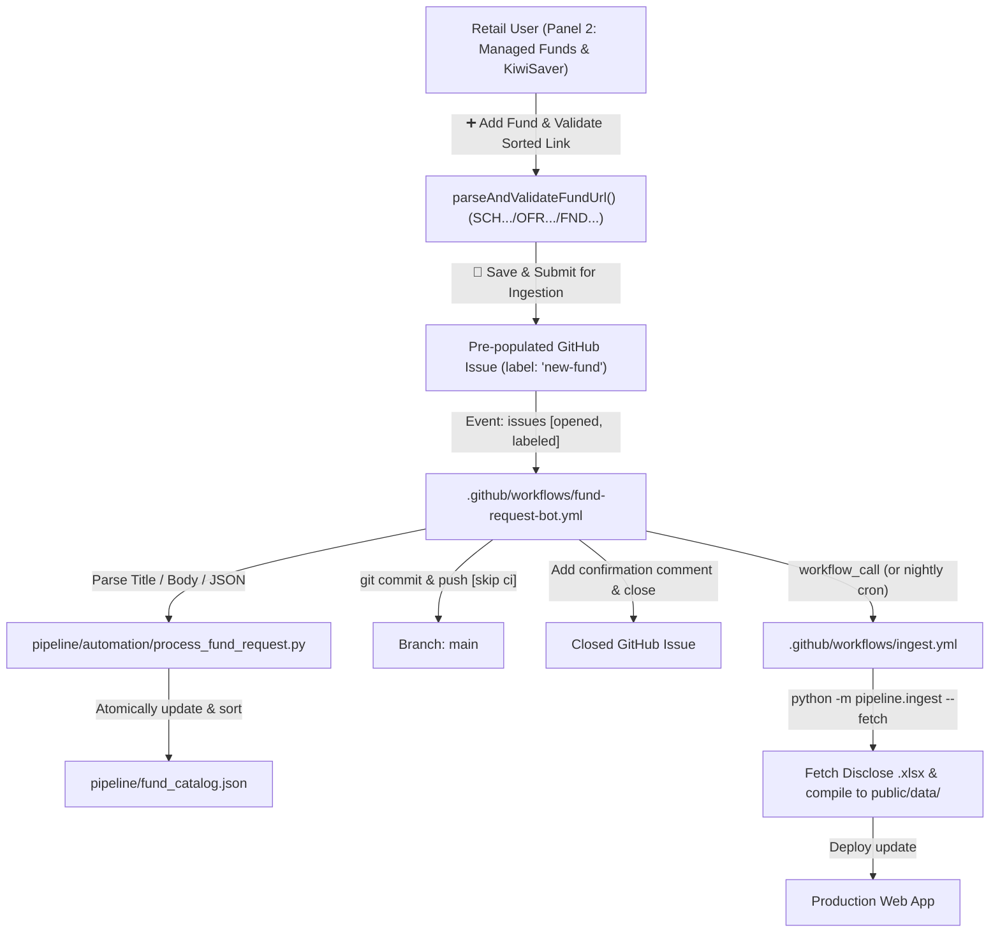

# Administrator & Data Ingestion Guide: Kiwi Portfolio X-Ray

This guide details the periodic operational procedures for sourcing fund disclosures, staging constituent CSVs, resolving mapping anomalies, and publishing static look-through datasets for the Kiwi Portfolio X-Ray.

Run locally using npm run build && npm run preview
Or run the local Admin Console using:
python3 -m pipeline.admin_ui
and then open http://127.0.0.1:8787 in a browser

---

## 1. Upstream Data Sources & Cadence Matrix

The application relies on 5 primary source streams and 2 reference directories. All data is publicly accessible without paid commercial API subscriptions.

| Dataset / Source | Origin / Provider Portal | Staging Target Directory | Format & File Content | Frequency | Purpose |
|---|---|---|---|---|---|
| **Smartshares Direct & Feeder Funds** (`FNZ`, `MDZ`, `NZG`, `OZY`, `ASD`, `TWF`, `USF`, `EUF`, `APA`, `EMF`, `ESG`, `NZB`, `GBF`, `AGG`, etc.) | [Sorted Smart Investor](https://smartinvestor.sorted.org.nz) (Search fund → *Download the full portfolio holdings*) | `data/staging/smartshares/` | XLSX (`*.xlsx`): Asset name, % of fund net assets, Cash & payables | Semi-Annual / Quarterly | Direct NZX/ASX equities, fixed interest, and feeder wrapper cash/hedging buffers |
| **Vanguard US Master ETFs** (`VT`, `VOO`, `VGK`, `VPL`, `VWO`, `VO`, `VB`) | [Vanguard US Advisor Portal](https://advisors.vanguard.com/investments/products/vt/vanguard-total-world-stock-etf) (*Holdings details* → *Export full holdings*) | `data/staging/vanguard/` | CSV (`Holdings_details_<TICKER_OR_FUND>.csv`): Ticker, Holdings/Name, % of funds, Sub-Industry, Country, SEDOL/CUSIP/ISIN | Monthly (around the 15th) | Underlying global equities for Smartshares feeder wrappers & Global Security Master |
| **iShares (BlackRock) Master ETFs** (`IWLD`, `IVV`, `SAEU`, `SASU`) | [BlackRock Australia / US](https://www.blackrock.com/au/products/investment-funds) (Product Holdings CSV) | `data/staging/ishares/` | CSV (`<TICKER>_holdings.csv`): Ticker, Name, Sector, Location, Weight (%) | Monthly / Quarterly | Underlying global equities for Smartshares ESG wrappers |
| **Kernel Wealth Index Funds** (Domestic, Global, Bond & Multi-Asset: `Kernel NZ 50`, `World Ex-US`, `Clean Energy`, `Global ESG`, `Dividend Aristocrats`, `Balanced`, `Conservative`) | [Sorted Smart Investor](https://smartinvestor.sorted.org.nz) (Search fund → *Download the full portfolio holdings*) | `data/staging/kernel/` | XLSX (`*.xlsx`): Asset name, % of fund net assets | Semi-Annual / Quarterly | Constituent holdings for unlisted NZ, AU, bond, and global index funds |
| **BetaShares ASX ETFs** (e.g., `ASIA` — [Asia Technology Tigers ETF](https://www.betashares.com.au/fund/asia-technology-tigers-etf/)) | Product page on [betashares.com.au](https://www.betashares.com.au/fund/asia-technology-tigers-etf/) (*Holdings & allocation* → *Download CSV*) | `data/staging/betashares/` | CSV (`ASIA_Portfolio_Holdings.csv`): Fund metadata (`Fund ASX Code`, `Date`), Ticker, Name, Asset Class, Sector, Country, Weight (%) | Monthly / Quarterly | Look-through holdings for ASX-listed BetaShares ETFs (balances entered in NZD) |
| **KiwiSaver & Domestic Managed Funds** (`Fisher Funds`, `Milford`, `Simplicity`, `Kernel`, `Generate`, `Booster`, `ANZ`, etc.) | [Sorted Smart Investor](https://smartinvestor.sorted.org.nz) (Search scheme → *Download the full portfolio holdings*) | `data/staging/<provider>/` or `data/staging/kiwisaver/` | XLSX (`*.xlsx`): Asset name, % of fund net assets, Cash & payables | Quarterly | Constituent holdings for KiwiSaver schemes and off-market managed funds; ingested dynamically via `GenericDomesticAdapter` |
| **NZX Official Directory** | [NZX Main Board Table](https://www.nzx.com/markets/NZSX) *(maintained CSV — no bulk ISIN download on NZX website)* | `data/staging/directories/` | CSV (`nzx_directory.csv`): Rank, Ticker, Company Name, Country, Sector *(or NZX Code, Company Name, ISIN, GICS Sector)* | Quarterly / As needed | Canonical security master for NZX-listed equities (auto-enriched with Vanguard VT ISINs where available) |
| **ASX Official Directory** | [ASX Listed Companies Directory](https://www.asx.com.au/markets/trade-our-cash-market/directory) (*"All ASX Listed Companies .csv"*) | `data/staging/directories/` | CSV (`ASXListedCompanies.csv`): Company name, ASX code, GICS industry group | Quarterly / As needed | Canonical security master for all ASX-listed equities |

---

## 2. Ingestion Staging Directory Layout

Place downloaded candidate files in the local staging folder matching the table above:

```text
data/
└── staging/
    ├── betashares/
    │   └── ASIA_Portfolio_Holdings.csv
    ├── directories/
    │   ├── nzx_directory.csv
    │   └── ASXListedCompanies.csv
    ├── fisher_funds/ (or kiwisaver/)
    │   └── GROWTH-FUND-FND555-Full-portfolio-holdings-30-September-2026.xlsx
    ├── ishares/
    │   └── IWLD_holdings.csv
    ├── kernel/
    │   └── KERNEL-WORLD-EX-US-FUND-FND58860-Full-portfolio-holdings-30-September-2026.xlsx
    ├── simplicity/
    │   └── SIMPLICITY-GROWTH-FUND-FND1981-Full-portfolio-holdings.xlsx
    ├── smartshares/
    │   ├── SMART-GLOBAL-ESG-ETF-FND14633-Full-portfolio-holdings-30-September-2026.xlsx
    │   └── SMART-NZ-TOP-50-ETF-Full-portfolio-holdings.xlsx
    └── vanguard/
        ├── Holdings_details_Total_World_Stock_ETF.csv
        └── Holdings_details_S&P_500_ETF.csv
```

---

## 3. How Multi-Country Holdings in Funds (like Kernel) are Covered

A key design strength of the ingestion pipeline is that the upstream reference dataset (`security_master.json`) is **not** limited to New Zealand and Australia. 

### Global Security Master Composition:
1. **NZX Official Directory**: ~200 NZ-listed companies (ISIN, Name, Ticker, GICS Sector).
2. **ASX Official Directory**: ~2,200 Australian-listed companies (ISIN, Name, Ticker, GICS Sector).
3. **Vanguard Total World (`VT`) Master Directory**: **~9,840 global equities** spanning over 40 countries (including the US, UK, Japan, Germany, Switzerland, Taiwan, South Korea, China, Scandinavia, etc.), complete with verified 12-character ISINs, country ISO codes, and sector mappings.

### How Kernel's Global & Thematic Funds are Resolved:
* When an unlisted fund like **Kernel S&P World Ex-U.S.**, **Kernel Global Clean Energy**, or **Kernel Global 100** publishes monthly holdings (e.g. Nestlé, ASML, Vestas Wind Systems, Orsted, Samsung, TSMC), their company names and tickers match against the **9,800+ global constituents** already indexed in `security_master.json`.
* **String Normalization**: Corporate legal suffixes (e.g., `A/S`, `AG`, `SA`, `NV`, `Oyj`, `PLC`, `Ltd`) are normalized before fuzzy matching.
* **Residual / Niche Holdings**: If a specialized clean-energy stock is outside Vanguard VT or its name is reported with unusual punctuation by Kernel, the dry-run CLI flags it in `unresolved_entries.json`. The administrator maps it once in `provider_alias_map.json`, and it is permanently resolved for all future months.
* **Bond & Multi-Asset / Balanced Funds**: Stage bond funds (`Smart NZB`, `Smart GBF`, `Smart AGG`, `Kernel NZ Bond`) and balanced/conservative funds (`Kernel Balanced`, `Kernel Conservative`, `Kernel High Growth`) into `data/staging/smartshares/` or `data/staging/kernel/` just like equity funds. Fixed-interest tranches and fund-held term deposits are classified row-by-row via [`bond_normalizer.py`](file:///mnt/c/Users/susan/wsl/kiwi-portfolio-xray/pipeline/enrichment/bond_normalizer.py) and rolled up by canonical institutional key ([`issuer_alias_map.json`](file:///mnt/c/Users/susan/wsl/kiwi-portfolio-xray/pipeline/enrichment/issuer_alias_map.json)) without generating false equity unresolved entries.

---

## 4. The Dry-Run Workflow (First-Time & Routine Runs)

Before committing files or triggering production builds, always run the pipeline locally in **dry-run mode**—either via the Local Admin Web Console or the CLI:

### Option A: Local Admin Web Console (Recommended for CSV Upload & Mapping)
```bash
python3 -m pipeline.admin_ui
```
Open `http://127.0.0.1:8787` in your browser to:
* Drag-and-drop CSV files directly into `data/staging/<provider>/`
* Preview raw CSV headers and test-parse rows with each Tier 1 adapter
* Run `--dry-run` diagnostics and production builds (`public/data/`) with one click
* Search the Global Security Master (`security_master.json`) and save unresolved holdings into `provider_alias_map.json`

### Option B: CLI Dry-Run
```bash
python3 -m pipeline.ingest --dry-run --staging-dir data/staging/
```

### What the Dry-Run Performs:
1. **Schema Check**: Validates that all CSV headers match the expected columns defined in `pipeline/validate/schemas/`.
2. **Master Bypass**: Ingests Vanguard and iShares master files directly, extracting canonical ISINs without running fuzzy matching.
3. **Global Security Master Matching**: Matches Smartshares direct and Kernel (domestic + global) holdings against the 12,000-constituent global `security_master.json`.
4. **Weight Sum Integrity**: Verifies that every fund's constituents sum to $100\% \pm 0.5\%$.
5. **Diagnostics Report**: Outputs a summary directly to the terminal:
   ```text
   ================== INGESTION DRY-RUN REPORT ==================
   [PASS] Schemas validated: 9 / 9 files
   [PASS] Master ETF canonical bypass: VT (9,842), VOO (503)
   [PASS] Feeder unwrapping: TWF -> VT, USF -> VOO
   [PASS] Kernel Global Holdings matched against Global Master: 98.8%
   [WARN] Unresolved holdings detected: 2 items
          - Kernel Clean Energy: "Vestas Wind Systems A/S" (alias needed)
          - Kernel NZ 50: "Chorus Ltd" (no ticker provided)
   [PASS] Weight sum integrity: 100.0% across all 9 funds
   ==============================================================
   ```

---

## 5. Manual Mapping Resolution (`provider_alias_map.json`)

If the dry-run reports unresolved holdings, the CLI outputs formatted JSON snippets ready to copy into `pipeline/enrichment/provider_alias_map.json`.

### Step-by-Step Resolution:
1. Open [`pipeline/enrichment/provider_alias_map.json`](file:///mnt/c/Users/susan/wsl/kiwi-portfolio-xray/pipeline/enrichment/provider_alias_map.json).
2. Add the alias mapping under the specific `Provider:Fund` key using the company's canonical 12-character ISIN:
   ```json
   {
     "Kernel:NZ_50": {
       "Chorus Ltd": "NZCNUE0001S2"
     },
     "Kernel:Clean_Energy": {
       "Vestas Wind Systems A/S": "DK0061539921",
       "Orsted A/S": "DK0060094928"
     },
     "Smartshares:FNZ": {
       "FPH NZ": "NZFPHE0001S2"
     }
   }
   ```
3. Re-run the dry-run command (or click **Run Dry-Run** in the Admin Console):
   ```bash
   python3 -m pipeline.ingest --dry-run --staging-dir data/staging/
   ```
4. Confirm unresolved items are cleared or reduced to immaterial tail positions.

---

## 6. Configuring a New Feeder Pairing (`feeder_registry.json`)

Feeder funds (such as `TWF`, `USF`, `ESG`) hold a single underlying Vanguard or iShares master ETF plus a small NZD/AUD cash buffer and/or FX hedging contracts. Six Smartshares feeders (`TWF`, `USF`, `EUF`, `APA`, `EMF`, `ESG`) are pre-configured.

To add a new feeder fund pairing (for example, adding a hedged variant like `TWH` → `VT`, or `USM` / `BOT` → its underlying ETF):

1. **Inspect the Sorted `.xlsx` Holdings:**
   Upload the fund's Sorted `.xlsx` into `data/staging/smartshares/` and click **Preview** in the Admin Console (`http://127.0.0.1:8787`) to confirm the single master ETF it holds (e.g., `Vanguard Total World Stock ETF (VT)` or `iShares Core S&P 500 ETF (IVV)`). You can click **Use as Feeder** in the preview header to prefill the **Feeder Code** in Panel 4.
2. **Stage the Master ETF CSV:**
   Download the master ETF's constituent CSV from Vanguard (`data/staging/vanguard/`) or BlackRock/iShares (`data/staging/ishares/`).
3. **Add the Pairing in the Admin Console (Recommended):**
   In Panel **4. Feeder Pairings (`feeder_registry.json`)** of the Admin Console (`http://127.0.0.1:8787`), fill in:
   * **Feeder Code** (e.g., `TWH`)
   * **Fund Name** (e.g., `Smart Total World (NZD Hedged) ETF`)
   * **Master Provider** (`Vanguard` or `iShares`)
   * **Master Ticker** (e.g., `VT` or `IVV`)
   Then click **Save Pairing** (existing pairings can also be edited or removed directly from the list).

   Alternatively, you can add the JSON entry manually to [`pipeline/feeder_registry.json`](file:///mnt/c/Users/susan/wsl/kiwi-portfolio-xray/pipeline/feeder_registry.json):
   ```json
   {
     "TWH": {
       "name": "Smart Total World (NZD Hedged) ETF",
       "master_provider": "vanguard",
       "master_ticker": "VT"
     }
   }
   ```
4. **Match the Feeder Code:**
   Ensure the staged `.xlsx` filename includes the feeder code (e.g., `TWH_Full_portfolio_holdings.xlsx`) or matches an alias in `SMARTSHARES_NAME_HINTS` in [`smartshares_direct_adapter.py`](file:///mnt/c/Users/susan/wsl/kiwi-portfolio-xray/pipeline/adapters/smartshares_direct_adapter.py) so the pipeline pairs the wrapper's cash/hedging ratios with `feeder_registry.json`.
5. **Verify Unwrapping:**
   Run **Dry-Run** and confirm `[PASS] TWH` appears with `100.00%` total weight (`Equities + Cash + Hedging`) and the master ETF's constituent count.

---

## 7. Publishing to Production

Once the dry-run passes:
1. Run the production compiler (or click **Build Production (public/data/)** in the Admin Console):
   ```bash
   python3 -m pipeline.ingest --staging-dir data/staging/
   ```
   This generates the optimized static assets in `public/data/`:
   * `funds_registry.json`
   * `constituents.json`
   * `direct_equities.json`
   * `unresolved_entries.json`
2. Commit the updated `public/data/` static files, `feeder_registry.json`, and `provider_alias_map.json`:
   ```bash
   git add public/data/ pipeline/feeder_registry.json pipeline/enrichment/provider_alias_map.json
   git commit -m "data: update fund constituent holdings"
   git push origin main
   ```
3. GitHub Actions automatically executes `.github/workflows/deploy.yml` (building the site, and deploying to GitHub Pages once the repository is public).

---

## 8. Crowdsourced Issue Ingestion Bot & Automated CI/CD Workflows

To eliminate the manual bottleneck of administrators individually discovering, cataloging, and registering every KiwiSaver and off-market managed fund in New Zealand, the platform features a crowdsourced submission bot powered by GitHub Actions.



### A. How the Automated Flow Operates

1. **Client-Side Request Submission:**
   - In **Panel 2 (Managed Funds & KiwiSaver)**, the user enters a Sorted Smart Investor link or Disclose `.xlsx` URL.
   - The UI parses and validates the link in real time (`parseAndValidateFundUrl`) and unlocks **"🚀 Save & Submit for Ingestion"**.
   - Clicking this opens a pre-formatted GitHub issue on the repository with:
     - Issue Title: `[Fund Request] <Fund Name>`
     - Labels: `new-fund`
     - Markdown bullet summary (`Fund Name`, `Provider`, `Fund Code`, `Smart Investor Link`, `Scheme ID`, `Offer ID`, `Fund ID`, `Is KiwiSaver`)
     - An embedded, machine-readable JSON code block containing verified metadata.
   - *In the meantime, the user's browser immediately models the fund using the synthetic 80% Growth Equities / 20% Bonds look-through fallback so their portfolio balance and asset class split remain 100% accurate without waiting.*

2. **Automated Issue Processing:**
   - The GitHub Action `.github/workflows/fund-request-bot.yml` activates on `issues: [opened, labeled]` when `labels contains 'new-fund'`.
   - It executes `python3 -m pipeline.automation.process_fund_request --title "$TITLE" --body "$BODY"`.
   - The parser checks for JSON blocks, falls back to markdown lines and URLs, verifies that a valid `FND...` code exists, and safely adds or updates the entry in `pipeline/fund_catalog.json`.
   - The action commits `pipeline/fund_catalog.json` directly to `main` with a clean commit message (`feat(catalog): register <fund_name> (<fund_code>) via bot`).
   - The bot posts an automated markdown comment acknowledging the addition, closes the issue, and triggers `.github/workflows/ingest.yml`.

3. **Downstream Ingestion & Production Compilation:**
   - `.github/workflows/ingest.yml` runs either via scheduled cron (`0 6 1 * *`), manual `workflow_dispatch`, or when called by the bot (`workflow_call`).
   - It runs `python -m pipeline.ingest --fetch --staging-dir data/staging --output-dir public/data`.
   - `GenericDomesticAdapter` dynamically compiles and unwraps the newly added fund's quarterly holdings into `public/data/funds_registry.json` and `constituents.json`.
   - Once published, any user who holds that fund automatically sees full line-item company look-through instead of the synthetic fallback!

---

### B. Administrator Monitoring: How to Check Bot & Ingestion Runs

Administrators can monitor the health of automated fund processing via standard GitHub interfaces:

1. **Viewing Active and Past Ingestion Runs:**
   - Go to your repository on GitHub: `https://github.com/<owner>/kiwi-portfolio-xray/actions`.
   - Check the two relevant workflows:
     - **Fund Request Bot** (`.github/workflows/fund-request-bot.yml`): Runs on issue submission. Typical execution time: ~15–30 seconds.
     - **Nightly Data Ingestion Pipeline** (`.github/workflows/ingest.yml`): Runs on schedule, manual trigger, or bot call. Typical execution time: ~1–3 minutes.
   - A green checkmark (✓) indicates successful metadata extraction, catalog commit, and ingestion.

2. **Tracking User Fund Requests:**
   - Navigate to the **Issues** tab (`/issues?q=label%3Anew-fund`).
   - **Closed issues**: Successfully processed by the bot with an automated confirmation comment.
   - **Open issues**: Either awaiting bot execution, manually submitted without the `new-fund` label, or encountered a validation error.

---

### C. Troubleshooting Runbook: What to Do When Failures Occur

GitHub sends automated email notifications to administrators when an Action fails (e.g., *"Run failed: Fund Request Ingestion Bot"*). Follow this guide to diagnose and resolve failures rapidly:

#### Scenario 1: Bot Fails with "Validation Error: Could not detect valid FND code"
* **Symptom:** The action fails on the step `Process Fund Request` with exit code 1. The issue remains open without an automated comment.
* **Root Cause:** A user manually opened an issue or modified the issue template, leaving out the Disclose Fund ID (`FND...`) or Sorted Smart Investor link.
* **Resolution:**
  1. Open the failed GitHub Issue.
  2. Search for the scheme on [Sorted Smart Investor](https://smartinvestor.sorted.org.nz) to obtain its canonical URL (e.g., `https://www.smartinvestor.sorted.org.nz/kiwisaver-and-managed-funds/SCH10713/OFR10715/FND555/`).
  3. Edit the issue body to include `- **Smart Investor Link:** <URL>` and the embedded JSON block.
  4. In the issue sidebar, remove the `new-fund` label and re-add `new-fund`. The bot will trigger immediately and process the fund.

#### Scenario 2: Upstream Smart Investor / Disclose Register Fetch Failure (HTTP 404 / 503 / Rate Limit)
* **Symptom:** In `.github/workflows/ingest.yml`, the step `Run Ingestion Pipeline` reports an HTTP error downloading disclosures from `smartinvestor.sorted.org.nz` or `disclose-register.companiesoffice.govt.nz`.
* **Root Cause:** Sorted or Disclose Register is undergoing temporary maintenance or rate-limiting.
* **Protection Built into Architecture:**
  - The pipeline has per-fund **circuit breakers** (`PipelineCompiler.compile()`). A failure on one fund never deletes existing cached data or halts compilation of other valid funds.
  - The front-end automatically retains the synthetic 80/20 look-through fallback so end users never experience broken calculations.
* **Resolution:**
  1. Check if Sorted Smart Investor is accessible in a web browser.
  2. Once the upstream site is back online, navigate to **Actions** → **Nightly Data Ingestion Pipeline** → click **Run workflow** (`workflow_dispatch`).
  3. The pipeline will retry the download, update `public/data/`, and push changes to `main`.

#### Scenario 3: Unresolved Holdings or Schema Mismatch in a Newly Ingested Fund
* **Symptom:** The ingestion pipeline succeeds, but `unresolved_entries.json` contains unmapped company names, or a provider uses non-standard column headers.
* **Resolution:**
  1. Pull the latest `main` branch locally: `git pull origin main`.
  2. Launch the local Admin Console:
     ```bash
     python3 -m pipeline.admin_ui
     ```
  3. Open `http://127.0.0.1:8787` in your browser.
  4. View the unresolved item in the table, search the Security Master for the company's canonical ISIN, and click **Save Alias**.
  5. Click **Build Production (public/data/)**.
  6. Commit and push the updated alias map:
     ```bash
     git add pipeline/enrichment/provider_alias_map.json public/data/
     git commit -m "fix(mapping): resolve holding alias for <fund_code>"
     git push origin main
     ```

#### Scenario 4: Git Concurrency Conflict / Non-Fast-Forward Push
* **Symptom:** The bot fails at step `Commit and Push Catalogue Update` with `error: failed to push some refs to ... (fetch first)`.
* **Root Cause:** Two users submitted fund requests at the exact same second, or an administrator pushed a commit while the bot was executing.
* **Resolution:**
  1. The bot action includes `git pull --rebase` before pushing. If an edge-case rebase conflict occurs:
  2. Re-trigger the failed workflow from the GitHub Actions run page by clicking **Re-run all jobs**.
  3. The action will fetch the fresh `main` branch and cleanly append the entry.

