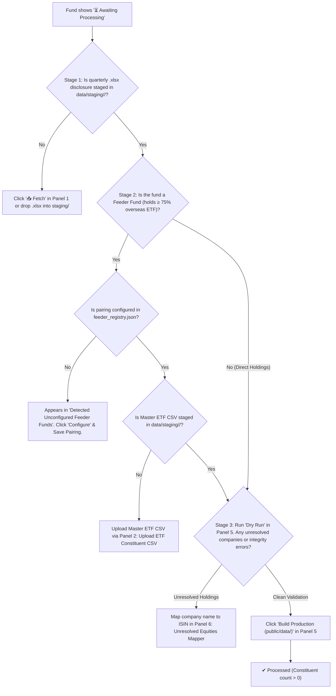
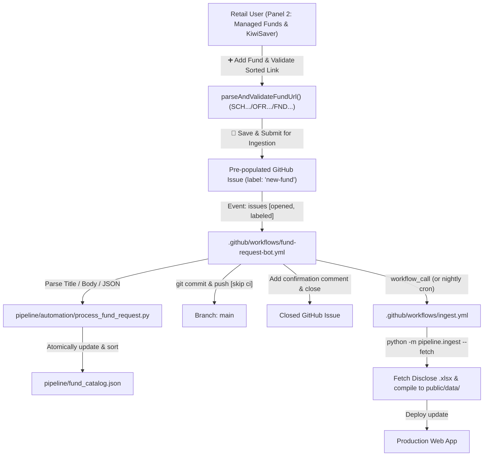

# Administrator & Data Ingestion Guide: Kiwi Portfolio X-Ray

This guide details the operational procedures for sourcing fund disclosures, staging constituent files, unwrapping feeder funds, resolving unmapped companies, and publishing static look-through datasets for the Kiwi Portfolio X-Ray.

```bash
# Run the local frontend preview
npm run build && npm run preview

# Run the local Admin Web Console
python3 -m pipeline.admin_ui
# Open http://127.0.0.1:8787 in your browser
```

---

## 1. System Concepts & Architecture Glossary

This glossary defines the authoritative naming conventions for Kiwi Portfolio X-Ray. It eliminates ambiguous terms (such as "provider" or "security") across the documentation and administrative tooling.

| Canonical Term | What It Means | Examples |
|---|---|---|
| **Fund Manager** *(or Scheme Issuer)* | The New Zealand financial institution issuing and managing the fund for Kiwi investors. Files statutory quarterly disclosures on the Disclose Register. | Kernel Wealth, Smartshares, Fisher Funds, Simplicity, Milford. |
| **Fund** | The investment product held by an investor. Can be a **Listed ETF** (traded on NZX) or an **Unlisted Managed Fund / KiwiSaver Scheme** (priced at NAV). | Smartshares US 500 (`USF`), Kernel S&P 500 (`KERNEL_SP_500_UNHEDGED`), Fisher Growth KiwiSaver. |
| **Constituent Disclosure (`.xlsx`)** | The statutory quarterly portfolio filing published to Sorted Smart Investor under NZ law, containing asset names, percentages, cash, and receivables. | `KERNEL_GLOBAL_DIVIDEND_FND19302_2026-09-30.xlsx` |
| **Direct Holding** | An individual **Company share**, **Bond**, or **Cash deposit** held directly by the Fund Manager. | Infratil, Apple, Microsoft, Spark, NZ Government Bond, ANZ Cash. |
| **Feeder Fund** *(Wrapper Fund)* | A New Zealand fund that does not buy individual stocks directly; instead, it invests **$\ge 75\%$** of its portfolio into a single overseas wholesale Master ETF. | Smartshares Total World (`TWF`, holding 99.8% Vanguard `VT`), Smartshares US 500 (`USF`, holding 99.8% Vanguard `VOO`). |
| **Master ETF** *(Wholesale Target)* | The massive overseas ETF (issued by Vanguard US/AU, iShares / BlackRock, or State Street SPDR) that holds the actual thousands of underlying companies. | Vanguard Total World (`VT`), Vanguard S&P 500 (`VOO`), iShares Global ESG (`IWLD`), SPDR Portfolio Emerging Markets (`SPEM`). |
| **Feeder Unwrapping** | The pipeline process of replacing a single Feeder Fund line item with the Master ETF's thousands of underlying companies, scaled to the feeder's portfolio weight. | `TWF` $\rightarrow$ Vanguard `VT` $\rightarrow$ 9,800+ underlying global companies; `KERNEL_EMERGING_MARKETS` $\rightarrow$ SPDR `SPEM` $\rightarrow$ 3,000+ emerging market companies. |
| **Minor Fund Holding** | A fund constituent holding that represents **$< 75\%$** of a portfolio (e.g. a multi-asset balanced fund allocating 5% to an emerging markets fund). Modeled by broad asset class rather than wholesale unwrapping. | 4% allocation to an international bond fund inside a balanced fund. |
| **Known Companies Register** *(formerly Security Master)* | The master reference dictionary of ~12,000+ public companies globally, providing canonical ISIN, Ticker, Company Name, GICS Sector, and Country. | Built from: NZX Directory + ASX Directory + Vanguard Total World (`VT`) constituent export. |
| **Manual Company Mapping** *(formerly Provider Alias Map)* | A mapping table (`provider_alias_map.json`) configured in the Admin UI that links non-standard company names or unlisted assets to their canonical ISIN in the Known Companies Register. | Mapping `"Arm Holdings plc ADR"` $\rightarrow$ `US0420682058`. |

> [!IMPORTANT]
> ### Crucial Operational Distinction: Automated Ingestion vs. Manual Master ETF Maintenance
> * **NZ Fund Constituent Disclosures (`.xlsx`):** **AUTOMATICALLY DOWNLOADED & UNWRAPPED.** The nightly GitHub Actions pipeline and the Admin UI crawler connect directly to the NZ Disclose Register / Sorted Smart Investor API. They download new filings, unwrap feeders, and compile constituents without administrator intervention.
> * **Overseas Master ETFs (`.csv` from Vanguard, iShares & SPDR):** **NOT AUTOMATICALLY DOWNLOADED.** Because Vanguard (US/AU), iShares (BlackRock), and State Street SPDR are overseas issuers, their full constituent CSV files are **NOT** filed on the NZ Disclose Register. **The administrator must periodically monitor and update Master ETF CSVs manually:** download the latest holdings CSV from their product pages, drop them into `data/staging/vanguard/`, `data/staging/ishares/`, or `data/staging/spdr/` via the Admin Web UI, and trigger a compile.

---

## 2. Upstream Data Sources & Cadence Matrix

The application relies on 5 source streams and 2 reference directories. All data is publicly accessible without paid commercial API subscriptions.

| Dataset / Source | Source Portal | Staging Target Directory | Format & File Content | Frequency | Automation Level | Purpose |
|---|---|---|---|---|---|---|
| **Smartshares Direct & Feeder Funds** (`FNZ`, `MDZ`, `NZG`, `OZY`, `ASD`, `TWF`, `USF`, `EUF`, `APA`, `EMF`, `ESG`, `NZB`, `GBF`, `AGG`, etc.) | [Sorted Smart Investor](https://smartinvestor.sorted.org.nz) | `data/staging/smartshares/` | XLSX (`*.xlsx`): Asset name, % of fund net assets, Cash & payables | Quarterly / Semi-Annual | **Automated** (Nightly bot / Admin UI) | Direct NZX/ASX companies, fixed interest, and feeder wrapper cash/hedging ratios |
| **Kernel Wealth Index Funds** (Domestic, Global, Bond & Multi-Asset: `Kernel NZ 50`, `World Ex-US`, `Clean Energy`, `Global ESG`, `Dividend Aristocrats`, `Balanced`, `Conservative`) | [Sorted Smart Investor](https://smartinvestor.sorted.org.nz) | `data/staging/kernel/` | XLSX (`*.xlsx`): Asset name, % of fund net assets, Cash & payables | Quarterly / Semi-Annual | **Automated** (Nightly bot / Admin UI) | Constituent company holdings for unlisted NZ, AU, bond, and global index funds |
| **KiwiSaver & Domestic Managed Funds** (`Fisher Funds`, `Milford`, `Simplicity`, `Generate`, `Booster`, `ANZ`, etc.) | [Sorted Smart Investor](https://smartinvestor.sorted.org.nz) | `data/staging/<fund_manager>/` or `data/staging/kiwisaver/` | XLSX (`*.xlsx`): Asset name, % of fund net assets, Cash & payables | Quarterly | **Automated** (Nightly bot / Admin UI) | Constituent holdings for KiwiSaver schemes and off-market funds; ingested dynamically via `GenericDomesticAdapter` |
| **Vanguard US Master ETFs** (`VT`, `VOO`, `VGK`, `VPL`, `VWO`, `VO`, `VB`) | [Vanguard US Advisor Portal](https://advisors.vanguard.com/investments/products/vt/vanguard-total-world-stock-etf) (*Holdings details* → *Export full holdings*) | `data/staging/vanguard/` | CSV (`Holdings_details_<TICKER_OR_FUND>.csv`): Ticker, Holdings/Name, % of funds, Sub-Industry, Country, SEDOL/CUSIP/ISIN | Monthly (around the 15th) | **Manual Admin Action Required** | Underlying global companies for Smartshares feeder wrappers & Known Companies Register |
| **iShares (BlackRock) Master ETFs** (`IWLD`, `IVV`, `SAEU`, `SASU`) | [BlackRock Australia / US](https://www.blackrock.com/au/products/investment-funds) (Product Holdings CSV) | `data/staging/ishares/` | CSV (`<TICKER>_holdings.csv`): Ticker, Name, Sector, Location, Weight (%) | Monthly / Quarterly | **Manual Admin Action Required** | Underlying global companies for Smartshares ESG wrappers |
| **SPDR (State Street) Master ETFs** (e.g., `SPEM` — SPDR Portfolio Emerging Markets ETF) | [State Street Global Advisors (SSGA) SPEM Portal](https://www.ssga.com/us/en/intermediary/etfs/state-street-spdr-portfolio-emerging-markets-etf-spem) (*Holdings* → *Daily / Export Holdings CSV*) | `data/staging/spdr/` | CSV (`SPEM_holdings.csv`): Ticker, Name, Weight, Sector, Country | Monthly / Quarterly | **Manual Admin Action Required** | Underlying global emerging markets companies for Kernel Emerging Markets feeder wrapper |
| **BetaShares ASX ETFs** (e.g., `ASIA` — [Asia Technology Tigers ETF](https://www.betashares.com.au/fund/asia-technology-tigers-etf/)) | [betashares.com.au](https://www.betashares.com.au/fund/asia-technology-tigers-etf/) (*Holdings & allocation* → *Download CSV*) | `data/staging/betashares/` | CSV (`ASIA_Portfolio_Holdings.csv`): Ticker, Name, Asset Class, Sector, Country, Weight (%) | Monthly / Quarterly | Manual / Semi-Annual | Look-through holdings for ASX-listed BetaShares ETFs (balances entered in NZD) |
| **NZX Official Directory** | [NZX Main Board Table](https://www.nzx.com/markets/NZSX) | `data/staging/directories/` | CSV (`nzx_directory.csv`): Rank, Ticker, Company Name, Country, Sector | Quarterly / As needed | Semi-Annual | Canonical directory for NZX-listed companies (auto-enriched with Vanguard VT ISINs where available) |
| **ASX Official Directory** | [ASX Listed Companies Directory](https://www.asx.com.au/markets/trade-our-cash-market/directory) | `data/staging/directories/` | CSV (`ASXListedCompanies.csv`): Company name, ASX code, GICS industry group | Quarterly / As needed | Semi-Annual | Canonical directory for all ASX-listed companies |

---

## 3. Ingestion Staging Directory Layout

Staged files are organized into subdirectories by Fund Manager or Master ETF Issuer:

```text
data/
└── staging/
    ├── betashares/
    │   └── ASIA_Portfolio_Holdings.csv
    ├── directories/
    │   ├── nzx_directory.csv
    │   └── ASXListedCompanies.csv
    ├── fisher_funds/ (or kiwisaver/)
    │   └── GROWTH-FUND-FND555-Full-portfolio-holdings-30-September-2026.xlsx
    ├── ishares/                        <-- Manual Admin Download from BlackRock
    │   └── IWLD_holdings.csv
    ├── kernel/                         <-- Automated Download from Sorted Smart Investor
    │   └── KERNEL-WORLD-EX-US-FUND-FND58860-Full-portfolio-holdings-30-September-2026.xlsx
    ├── simplicity/                     <-- Automated Download from Sorted Smart Investor
    │   └── SIMPLICITY-GROWTH-FUND-FND1981-Full-portfolio-holdings.xlsx
    ├── smartshares/                    <-- Automated Download from Sorted Smart Investor
    │   ├── SMART-GLOBAL-ESG-ETF-FND14633-Full-portfolio-holdings-30-September-2026.xlsx
    │   └── SMART-NZ-TOP-50-ETF-Full-portfolio-holdings.xlsx
    ├── spdr/                           <-- Manual Admin Download from State Street (SSGA)
    │   └── SPEM_holdings.csv
    └── vanguard/                       <-- Manual Admin Download from Vanguard
        ├── Holdings_details_Total_World_Stock_ETF.csv
        └── Holdings_details_S&P_500_ETF.csv
```

---

## 4. How Multi-Country Holdings (like Kernel & Simplicity) are Resolved

A key design feature of Kiwi Portfolio X-Ray is that the reference dataset (**Known Companies Register**) is **not** limited to New Zealand and Australia. 

### Known Companies Register Composition:
1. **NZX Official Directory**: ~200 NZ-listed companies (ISIN, Name, Ticker, GICS Sector).
2. **ASX Official Directory**: ~2,200 Australian-listed companies (ISIN, Name, Ticker, GICS Sector).
3. **Vanguard Total World (`VT`) Master Directory**: **~9,840 global companies** spanning over 40 countries (including the US, UK, Japan, Germany, Switzerland, Taiwan, South Korea, China, Scandinavia, etc.), complete with verified 12-character ISINs, country ISO codes, and sector mappings.

### How Global & Thematic Funds are Resolved:
* When an unlisted fund like **Kernel S&P World Ex-U.S.**, **Kernel Global Clean Energy**, or **Kernel Global 100** publishes quarterly holdings (e.g. Nestlé, ASML, Vestas Wind Systems, Orsted, Samsung, TSMC), their company names and tickers match against the **9,800+ global constituents** already indexed in the Known Companies Register.
* **String Normalization**: Corporate legal suffixes (e.g., `A/S`, `AG`, `SA`, `NV`, `Oyj`, `PLC`, `Ltd`) are normalized before fuzzy matching.
* **Residual / Niche Holdings**: If a specialized company is outside Vanguard VT or its name is reported with unusual punctuation, the pipeline flags it in `unresolved_entries.json`. The administrator maps it once in `provider_alias_map.json` via the Admin Web UI, and it is permanently resolved for all future quarters.
* **Bond & Multi-Asset Funds**: Fixed-interest tranches and bank term deposits are classified row-by-row via [`bond_normalizer.py`](file:///mnt/c/Users/susan/wsl/kiwi-portfolio-xray/pipeline/enrichment/bond_normalizer.py) and rolled up by institutional issuer ([`issuer_alias_map.json`](file:///mnt/c/Users/susan/wsl/kiwi-portfolio-xray/pipeline/enrichment/issuer_alias_map.json)) without generating false unresolved company entries.

---

## 5. The Dry-Run Workflow (First-Time & Routine Runs)

Before committing files or triggering production builds, always run the pipeline in **dry-run mode**—either via the Local Admin Web Console or the CLI:

### Option A: Local Admin Web Console (Recommended)
```bash
python3 -m pipeline.admin_ui
```
Open `http://127.0.0.1:8787` in your browser to:
* **Managed Fund Catalogue**: Monitor all registered funds with real-time **Status (`⏳ Awaiting Processing` vs `✔ Processed`)**, **As Of Dates**, constituent counts, and one-click `📥 Fetch` actions. Unprocessed funds are automatically prioritized at the top, followed by oldest disclosure dates first.
* **Filter & Search**: Quickly filter by `⏳ Awaiting Processing`, `Kernel`, or `Smartshares`, with instant search and one-click `✕` query clearing.
* **Upload Master ETF CSVs**: Drag-and-drop downloaded Vanguard or iShares CSVs directly into `data/staging/vanguard/` or `data/staging/ishares/`.
* **Resolve Companies**: Search the Known Companies Register and save unresolved company names into `provider_alias_map.json`.
* **Execute Builds**: Run `--dry-run` diagnostics and production builds (`public/data/`) with one click.

### Option B: CLI Dry-Run
```bash
python3 -m pipeline.ingest --dry-run --staging-dir data/staging/
```

### What the Dry-Run Performs:
1. **Schema Check**: Validates that all CSV/XLSX headers match expected schemas.
2. **Master ETF Bypass**: Ingests Vanguard, iShares, and SPDR master files directly, extracting canonical ISINs without fuzzy matching.
3. **Feeder Unwrapping**: Unwraps all configured Feeder Funds (`TWF`, `USF`, etc.) into their Master ETF company constituents.
4. **Known Companies Register Matching**: Matches direct Smartshares and Kernel holdings against the 12,000+ entry Known Companies Register.
5. **Weight Sum Integrity**: Verifies that every fund's constituents sum to $100\% \pm 0.5\%$.

---

## 6. Diagnosing "Awaiting Processing" Funds: The 3-Stage Diagnostic Checklist

When a fund in **Panel 1 (Managed Fund Catalogue)** shows the badge `⏳ Awaiting Processing` (or constituent count is `0`), it means the fund's constituents have not yet been compiled into `public/data/funds_registry.json`.

Use this diagnostic flow to pinpoint the exact stage where the fund is waiting:



### Stage 1: Constituent Disclosure Download
* **How to tell:** Look at the fund's row in **Panel 1: Managed Fund Catalogue**. Check if a disclosure file and date are listed. Also check if an `.xlsx` file exists in `data/staging/<manager>/`.
* **Action:** Click the `📥 Fetch` button on that fund's row to download the latest statutory filing from Sorted Smart Investor. If the fetch succeeds, the file will be saved to `data/staging/` and displayed. If it fails (e.g. fund has no filing or network timeout), the error modal displays full debug details.

### Stage 2: Feeder Pairing & Master ETF Staging (Feeder Funds Only)
* **How to tell:** 
  1. **Unconfigured Feeder:** If the fund holds $\ge 75\%$ of an overseas ETF and has not been paired, it will appear in the amber warning box: **Panel 3: Detected Unconfigured Feeder Funds**.
  2. **Missing Master ETF CSV:** If the fund is paired in `feeder_registry.json` but the corresponding CSV (e.g. `SPEM_holdings.csv` or `VT.csv`) is missing from `data/staging/spdr/`, `data/staging/vanguard/`, or `data/staging/ishares/`, running **Dry Run** will output:
     `Feeder '<FUND_CODE>' disclosure staged, awaiting master ETF '<TICKER>' in data/staging/<provider>/`.
* **Action:**
  1. If unconfigured: Click **Configure**, select the Master ETF Provider (`vanguard`, `ishares`, or `spdr`), enter the Ticker (e.g. `SPEM`), and click **Save Pairing**.
  2. If missing CSV: Download the holdings CSV from the issuer portal (e.g. SSGA SPEM or Vanguard VT) and upload it via **Panel 2: Upload ETF Constituent CSV**.

### Stage 3: Company Mapping & Pipeline Compilation
* **How to tell:** The `.xlsx` disclosure and any required Master ETF CSV are both staged, but running **Dry Run** reports `Unresolved: N` or integrity warnings.
* **Action:**
  1. Open **Panel 6: Unresolved Equities Mapper**. Search for the unmapped holding name in the Known Companies Register, select its canonical ISIN, and click **Save Alias**.
  2. Once all holdings are resolved, click **Build Production (public/data/)**. The compiler writes look-through records to `public/data/`, the constituent count becomes $> 0$, and the fund's badge updates to `✔ Processed`.

---

## 7. Manual Company Mapping (`provider_alias_map.json`)

If the dry-run reports unresolved company holdings, map them in the Admin Web UI (**Panel 3: Unresolved Holdings Mapper**) or directly in `pipeline/enrichment/provider_alias_map.json`:

```json
{
  "Kernel:KERNEL_NZ_50": {
    "Chorus Ltd": "NZCNUE0001S2"
  },
  "Kernel:KERNEL_CLEAN_ENERGY": {
    "Vestas Wind Systems A/S": "DK0061539921",
    "Orsted A/S": "DK0060094928"
  },
  "Smartshares:FNZ": {
    "FPH NZ": "NZFPHE0001S2"
  }
}
```

---

## 8. Configuring a New Feeder Fund Pairing (`feeder_registry.json`)

### When is this needed?
The 10 standard New Zealand feeder funds are already pre-configured (`TWF` $\rightarrow$ `VT`, `USF` $\rightarrow$ `VOO`, `EUF` $\rightarrow$ `VGK`, `APA` $\rightarrow$ `VPL`, `EMF` $\rightarrow$ `VWO`, `ESG` $\rightarrow$ `IWLD`, `USS` $\rightarrow$ `VB`, `USM` $\rightarrow$ `VO`, `USA` $\rightarrow$ `SASU`, `EUG` $\rightarrow$ `SAEU`).

You **only** need to configure a new feeder pairing if a Fund Manager introduces a **new wrapper fund** that invests $\ge 75\%$ of its assets into an overseas Master ETF.

### Step-by-Step Procedure:
1. **Check the Feeder Fund's Disclosure:**
   In the Admin Console, preview the fund's Sorted `.xlsx` file to identify the underlying Master ETF it holds (e.g., `Vanguard Total World Stock ETF (VT)` or `SPDR Portfolio Emerging Markets ETF (SPEM)`).
2. **Ensure Master ETF is Staged:**
   Verify that the Master ETF's holdings CSV exists in `data/staging/vanguard/`, `data/staging/ishares/`, or `data/staging/spdr/`. If not, download it from Vanguard, BlackRock, or State Street and drop it into the staging folder via the Admin UI.
3. **Register the Pairing:**
   In Admin Console **Panel 4: Feeder Fund Registry**, enter:
   * **Feeder Code** (e.g. `TWH` or `KERNEL_EMERGING_MARKETS`)
   * **Fund Name** (e.g. `Smart Total World (NZD Hedged) ETF` or `Kernel Emerging Markets`)
   * **Master ETF Issuer** (`Vanguard`, `iShares`, or `SPDR`)
   * **Master Ticker** (e.g. `VT` or `SPEM`)
   Click **Save Pairing**.
4. **Run Dry-Run:**
   Confirm that the Feeder Fund unwraps to 100% total weight and shows the Master ETF's underlying company constituents.

---

## 9. Publishing to Production

Once dry-run validation passes with zero critical errors:

```bash
# 1. Compile production datasets into public/data/
python3 -m pipeline.ingest --staging-dir data/staging/ --output-dir public/data/

# 2. Run test suites
npm test
python3 -m unittest discover -s pipeline/tests

# 3. Build frontend bundle
npm run build
```

---

## 10. Crowdsourced Issue Ingestion Bot & Automated CI/CD Workflows

To eliminate the manual bottleneck of administrators individually discovering, cataloging, and registering every KiwiSaver and off-market managed fund in New Zealand, the platform features a crowdsourced submission bot powered by GitHub Actions.



### A. How the Automated Flow Operates

1. **Client-Side Request Submission:**
   - In **Panel 2 (Managed Funds & KiwiSaver)**, the user enters a Sorted Smart Investor link or Disclose `.xlsx` URL.
   - The UI parses and validates the link in real time (`parseAndValidateFundUrl`) and unlocks **"🚀 Save & Submit for Ingestion"**.
   - Clicking this opens a pre-formatted GitHub issue on the repository with:
     - Issue Title: `[Fund Request] <Fund Name>`
     - Labels: `new-fund`
     - Markdown bullet summary (`Fund Name`, `Fund Manager`, `Fund Code`, `Smart Investor Link`, `Scheme ID`, `Offer ID`, `Fund ID`, `Is KiwiSaver`)
     - An embedded, machine-readable JSON code block containing verified metadata.
   - *In the meantime, the user's browser immediately models the fund using the synthetic 80% Growth Equities / 20% Bonds look-through fallback so their portfolio balance and asset class split remain 100% accurate without waiting.*

2. **Automated Issue Processing:**
   - The GitHub Action `.github/workflows/fund-request-bot.yml` activates on `issues: [opened, labeled]` when `labels contains 'new-fund'`.
   - It executes `python3 -m pipeline.automation.process_fund_request --title "$TITLE" --body "$BODY"`.
   - The parser checks for JSON blocks, falls back to markdown lines and URLs, verifies that a valid `FND...` code exists, and safely adds or updates the entry in `pipeline/fund_catalog.json`.
   - The action commits `pipeline/fund_catalog.json` directly to `main` with a clean commit message (`feat(catalog): register <fund_name> (<fund_code>) via bot`).
   - The bot posts an automated markdown comment acknowledging the addition, closes the issue, and triggers `.github/workflows/ingest.yml`.

3. **Downstream Ingestion & Production Compilation:**
   - `.github/workflows/ingest.yml` runs either via scheduled cron (`0 6 1 * *`), manual `workflow_dispatch`, or when called by the bot (`workflow_call`).
   - It runs `python -m pipeline.ingest --fetch --staging-dir data/staging --output-dir public/data`.
   - `GenericDomesticAdapter` dynamically compiles and unwraps the newly added fund's quarterly holdings into `public/data/funds_registry.json` and `constituents.json`.
   - Once published, any user who holds that fund automatically sees full line-item company look-through instead of the synthetic fallback!

---

### B. Administrator Monitoring: How to Check Bot & Ingestion Runs

Administrators can monitor the health of automated fund processing via standard GitHub interfaces:

1. **Viewing Active and Past Ingestion Runs:**
   - Go to your repository on GitHub: `https://github.com/<owner>/kiwi-portfolio-xray/actions`.
   - Check the two relevant workflows:
     - **Fund Request Bot** (`.github/workflows/fund-request-bot.yml`): Runs on issue submission. Typical execution time: ~15–30 seconds.
     - **Nightly Data Ingestion Pipeline** (`.github/workflows/ingest.yml`): Runs on schedule, manual trigger, or bot call. Typical execution time: ~1–3 minutes.
   - A green checkmark (✓) indicates successful metadata extraction, catalog commit, and ingestion.

2. **Tracking User Fund Requests:**
   - Navigate to the **Issues** tab (`/issues?q=label%3Anew-fund`).
   - **Closed issues**: Successfully processed by the bot with an automated confirmation comment.
   - **Open issues**: Either awaiting bot execution, manually submitted without the `new-fund` label, or encountered a validation error.

---

### C. Troubleshooting Runbook: What to Do When Failures Occur

GitHub sends automated email notifications to administrators when an Action fails (e.g., *"Run failed: Fund Request Ingestion Bot"*). Follow this guide to diagnose and resolve failures rapidly:

#### Scenario 1: Bot Fails with "Validation Error: Could not detect valid FND code"
* **Symptom:** The action fails on the step `Process Fund Request` with exit code 1. The issue remains open without an automated comment.
* **Root Cause:** A user manually opened an issue or modified the issue template, leaving out the Disclose Fund ID (`FND...`) or Sorted Smart Investor link.
* **Resolution:**
  1. Open the failed GitHub Issue.
  2. Search for the scheme on [Sorted Smart Investor](https://smartinvestor.sorted.org.nz) to obtain its canonical URL (e.g., `https://www.smartinvestor.sorted.org.nz/kiwisaver-and-managed-funds/SCH10713/OFR10715/FND555/`).
  3. Edit the issue body to include `- **Smart Investor Link:** <URL>` and the embedded JSON block.
  4. In the issue sidebar, remove the `new-fund` label and re-add `new-fund`. The bot will trigger immediately and process the fund.

#### Scenario 2: Upstream Smart Investor / Disclose Register Fetch Failure (HTTP 404 / 503 / Rate Limit)
* **Symptom:** In `.github/workflows/ingest.yml`, the step `Run Ingestion Pipeline` reports an HTTP error downloading disclosures from `smartinvestor.sorted.org.nz` or `disclose-register.companiesoffice.govt.nz`.
* **Root Cause:** Sorted or Disclose Register is undergoing temporary maintenance or rate-limiting.
* **Protection Built into Architecture:**
  - The pipeline has per-fund **circuit breakers** (`PipelineCompiler.compile()`). A failure on one fund never deletes existing cached data or halts compilation of other valid funds.
  - The front-end automatically retains the synthetic 80/20 look-through fallback so end users never experience broken calculations.
* **Resolution:**
  1. Check if Sorted Smart Investor is accessible in a web browser.
  2. Once the upstream site is back online, navigate to **Actions** → **Nightly Data Ingestion Pipeline** → click **Run workflow** (`workflow_dispatch`).
  3. The pipeline will retry the download, update `public/data/`, and push changes to `main`.

#### Scenario 3: Unresolved Holdings or Schema Mismatch in a Newly Ingested Fund
* **Symptom:** The ingestion pipeline succeeds, but `unresolved_entries.json` contains unmapped company names, or a fund manager uses non-standard column headers.
* **Resolution:**
  1. Pull the latest `main` branch locally: `git pull origin main`.
  2. Launch the local Admin Console:
     ```bash
     python3 -m pipeline.admin_ui
     ```
  3. Open `http://127.0.0.1:8787` in your browser.
  4. View the unresolved item in the table, search the Known Companies Register for the company's canonical ISIN, and click **Save Alias**.
  5. Click **Build Production (public/data/)**.
  6. Commit and push the updated alias map:
     ```bash
     git add pipeline/enrichment/provider_alias_map.json public/data/
     git commit -m "fix(mapping): resolve holding alias for <fund_code>"
     git push origin main
     ```

#### Scenario 4: Git Concurrency Conflict / Non-Fast-Forward Push
* **Symptom:** The bot fails at step `Commit and Push Catalogue Update` with `error: failed to push some refs to ... (fetch first)`.
* **Root Cause:** Two users submitted fund requests at the exact same second, or an administrator pushed a commit while the bot was executing.
* **Resolution:**
  1. The bot action includes `git pull --rebase` before pushing. If an edge-case rebase conflict occurs:
  2. Re-trigger the failed workflow from the GitHub Actions run page by clicking **Re-run all jobs**.
  3. The action will fetch the fresh `main` branch and cleanly append the entry.

