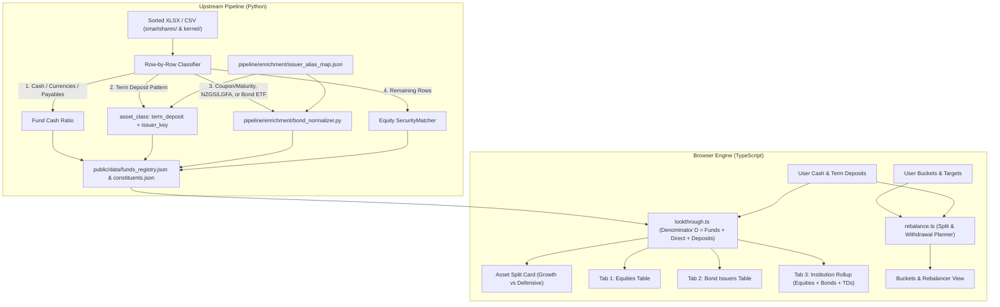

# Asset Split, Term Deposits, Bond Funds & Bucket Rebalancer Design Spec

**Status:** Draft (Pending Goldfish Review)  
**Date:** 2026-11-11  
**Author:** SusanJaneNZ  
**Parent Spec:** [Kiwi Portfolio X-Ray](kiwi-portfolio-xray.md)

---

## 1. Problem Statement

Currently, Kiwi Portfolio X-Ray only models equity funds, direct NZX/ASX shares, and fund-level cash/FX-hedging buffers. In practice, New Zealand retail investors frequently hold and manage portfolios using:
1. **Direct Term Deposits & Notice-Saver / Call Cash** across NZ banks (ANZ, ASB, BNZ, Westpac, Kiwibank, Heartland, Rabobank).
2. **Passive Bond & Multi-Asset / Balanced Funds** (e.g., Smart NZ Bond ETF `NZB`, Smart Global Bond ETF `GBF`, Kernel NZ/US Bond Funds, as well as diversified funds like **Kernel Balanced**, **Kernel High Growth**, **Kernel Conservative**, and **SuperLife Balanced/Growth** whose Sorted `.xlsx` files list equities, bonds, bond ETFs, and deposits in one flat table).
3. **Semi-Annual Bucket Management & Cash-Flow Rebalancing:** Many drawdown or income/growth investors organize their funds and deposits into explicit strategic buckets (for example: **20% Term Deposits**, **20% High Dividend Yield Equities**, **60% Growth Equities**) and review every ~6 months to take cash withdrawals while keeping bucket weights aligned to their target split.

Without these capabilities:
* Investors cannot see their true portfolio **Asset Class Split** (Equities vs. Fixed Interest vs. Term Deposits vs. Cash, or Growth vs. Defensive).
* Passing bond fund holdings from Sorted Smart Investor `.xlsx` exports through the equity `SecurityMatcher` fails to match coupon/maturity tranche strings (e.g., `"New Zealand Government 4.5% 15/04/2027"`) against `security_master.json`, flooding `unresolved_entries.json` with unmappable debt lines.
* Investors cannot see **Cross-Asset Institutional Concentration**—for example, combined exposure to ANZ across `ANZ.NZ` shares, ANZ Term Deposits, and ANZ bank bonds held inside `Smart NZB`.
* Investors must manually export balances to spreadsheets every 6 months to calculate their **current bucket split**, decide **which bucket(s) to draw a withdrawal from**, and compute the **exact NZD buys and sells** required to return to target percentages without triggering unnecessary round-trip turnover.

*(Clarification: Equity-income funds such as Kernel S&P Global Dividend Aristocrats contain underlying equities, not bonds, and remain handled by the existing equity pipeline.)*

---

## 2. Goals & Non-Goals

### Goals
1. **Term Deposits & Direct Cash Input:** Allow users to enter Term Deposits and On-Call Cash accounts in NZD (with bank/institution label, type, optional bank Deposit ID `depositId` that persists across maturity/reinvestment, and optional informational maturity date and interest rate %), persisted seamlessly in `localStorage` (`kiwi_portfolio_xray_v1`) and JSON/CSV exports.
2. **Bond & Multi-Asset Fund Decomposition Without Equity Noise:** Classify disclosures **row-by-row** in Sorted `.xlsx`/`.csv` files so single-sector Bond funds (`Smart NZB`), Equity funds, and Multi-Asset / Balanced funds (`Kernel Balanced` ~60/40, `Kernel High Growth`, `Kernel Conservative`) route bond tranches and deposits cleanly without polluting `unresolved_entries.json`.
3. **Portfolio-Wide Asset Class Split:** Upgrade the top metrics card into an **Asset Split & Liquidity** breakdown showing Equities (NZ/AU vs. International), Fixed Interest (Bonds), Term Deposits, and Cash/FX Hedging, alongside a **Growth vs. Defensive** ratio.
4. **Cross-Asset Institution Rollup:** Provide a unified view rolling up institutional exposure across Equities, Bond Issuers, and Term Deposits/Cash using a lightweight canonical issuer map (`issuer_alias_map.json`).
5. **User-Defined Buckets & Withdrawal-Aware Rebalancer:** Allow users to create custom buckets with target percentages (plus a one-click `20% Term Deposits / 20% High Div Yield / 60% Growth` starter preset), assign each fund, direct share, or Term Deposit/Call Cash entry to a bucket, view the **Current vs. Target Bucket Split**, and calculate—given any optional cash withdrawal $W \ge 0$—the exact **NZD withdrawal per bucket** and remaining **rebalance buys/sells per bucket** needed to restore target percentages with minimum turnover.

### Non-Goals
* **No Yield, Duration, or Mark-to-Market Bond Pricing:** Maturity dates and interest rates are informational user inputs only; no yield-curve pricing, Macaulay duration, or accrued interest calculations will be performed.
* **No Global Bond ISIN Security Master:** There is no free public ISIN master for individual corporate/sovereign debt tranches. Matching operates on normalized issuer names rather than individual bond ISINs.
* **No Recursive Sub-Fund Unwrapping for Underlying Bond ETFs Held Inside Balanced Funds:** When a diversified fund holds an underlying bond ETF wrapper (e.g., `"iShares Core US Aggregate Bond ETF"` inside `Kernel Balanced`), row-by-row classification records that line as a clean `fixed_interest` bond ETF allocation unless the administrator also explicitly configures a feeder pairing.
* **No Tax / Brokerage Optimization or Order Execution:** Rebalancing guidance computes NZD dollar actions at the bucket level (showing assigned funds/TDs inside each bucket for reference); it does not model PIE/FIF tax lots, brokerage fees, or execute trades.

---

## 3. Proposed Architecture

### A. Real Sorted Smart Investor Schema & Row-by-Row Classification
As observed in real Sorted Smart Investor Disclose `.xlsx` exports (`SMART-GLOBAL-ESG-ETF`, `KERNEL-WORLD-EX-US`), the spreadsheets contain **two columns** (`Asset name`, `% of fund net assets`) and omit an `Asset class` column. Furthermore, multi-asset passive funds (such as `Kernel Balanced` or `Kernel Conservative`) list equities, government/corporate bonds, bond ETFs, and bank term deposits together in the same flat table.

Rather than tagging an entire fund as strictly equity or strictly bonds, the pipeline classifies **each holding row** through an ordered 4-way router:



---

### B. Upstream Ingestion & Bond Normalization (`pipeline/`)

#### 1. Row-by-Row Asset Classification (`pipeline/enrichment/bond_normalizer.py` & `pipeline/bond_registry.json`)
Every extracted non-cash row inside `build_output.py` is classified in strict priority order:
1. **Fund-Level Override (Optional `pipeline/bond_registry.json`):** If a fund is explicitly pinned as `"asset_class": "fixed_interest"` or `"equity"` (e.g., to guarantee an equity dividend fund like `Kernel Global Dividend Aristocrats` never hits bond heuristics, or to supply default country metadata for `"NZB"` / `"GBF"`), the override guides classification.
2. **Term Deposit Detection (Inside Funds):** Rows containing `"term deposit"`, `"td "`, or bank deposit maturity strings (common in `Kernel Conservative` or `Cash Plus`) are assigned `asset_class: "term_deposit"` and mapped to their canonical `issuer_key` via `issuer_alias_map.json`.
3. **Bond Tranche & Bond ETF Detection:** Rows matching fixed-interest patterns are routed to `bond_normalizer.py` (`asset_class: "fixed_interest"`):
   * **Coupon + Maturity Pattern:** Contains both a percentage (`\d+(\.\d+)?%`) AND a maturity date/year (`\d{1,2}/\d{1,2}/20\d{2}`, `202[5-9]|20[3-6]\d`, or month-year like `Apr 2027`).
   * **Sovereign / Agency Debt Keywords:** Starts with or contains `"New Zealand Government"`, `"NZGS"`, `"Local Government Funding Agency"`, `"LGFA"`, `"US Treasury"`, `"Treasury Bond"`, `"Treasury Note"`, `"FRN"`, `"Fixed Rate Note"`, or `"Bond ETF"` (such as `"iShares Core US Aggregate Bond ETF"` inside `Kernel Balanced`).
4. **Equity Fallback:** Remaining rows route through the existing `SecurityMatcher` (`asset_class: "equity"`).

* **Automatic Fund-Level Tagging (`funds_registry.json`):** Each fund's `"asset_class"` (`"equity"`, `"fixed_interest"`, or `"mixed"`) is derived automatically from its resolved holdings (e.g., `Kernel Balanced` → `"mixed"` when both equity and fixed-interest weights exceed $5\%$).

#### 2. Bond Tranche Normalization & Issuer Rollup (`pipeline/enrichment/bond_normalizer.py`)
For each row routed to `fixed_interest`:
1. **Strip Tranche Identifiers:** Remove coupon percentages (`4.5%`, `5.250%`), maturity dates (`15/04/2027`, `Apr 2027`, `15-Apr-27`, standalone `2026..2060`), bond structure descriptors (`Senior`, `Unsecured`, `Subordinated`, `Notes`, `FRN`, `Fixed`, `Floating`, `Green Bond`, `Social Bond`, `Series`, `Tranche`), and punctuation.
2. **Classify Issuer Category (Bond Sector):** Map normalized issuer names into one of 5 fixed-interest categories:
   * `Sovereign` (e.g., `New Zealand Government`, `United States Treasury`)
   * `Local Government` (e.g., `Local Government Funding Agency`, `LGFA`, `Auckland Council`)
   * `Financial` (e.g., `ANZ Bank`, `ASB Bank`, `BNZ`, `Westpac`, `Kiwibank`)
   * `Bond ETF` (e.g., `iShares Core US Aggregate Bond ETF`)
   * `Corporate / Other` (e.g., `Transpower`, `Chorus`, `Mercury`, `Genesis`)
3. **Consolidate Maturities Per Fund:** Group all bond tranches belonging to the same normalized issuer inside a fund into a single holding entry (`weight = sum(tranche_weights)`), preserving `tranche_count` metadata. Example: 12 NZ Government bond maturities inside `NZB` or `Kernel Balanced` collapse into 1 entry (`"New Zealand Government"`).
4. **Canonical Institutional Key (`pipeline/enrichment/issuer_alias_map.json`):** Maps banking/corporate subsidiaries to a shared canonical institutional ID for cross-asset rollup:
   ```json
   {
     "ISSUER_ANZ": {
       "display_name": "ANZ Group",
       "aliases": ["ANZ Group Holdings Limited", "ANZ Bank New Zealand", "ANZ Bank", "ANZ"]
     },
     "ISSUER_WBC": {
       "display_name": "Westpac Banking Group",
       "aliases": ["Westpac Banking Corporation", "Westpac New Zealand", "Westpac"]
     },
     "ISSUER_CBA_ASB": {
       "display_name": "Commonwealth Bank / ASB",
       "aliases": ["Commonwealth Bank of Australia", "ASB Bank", "ASB"]
     },
     "ISSUER_NAB_BNZ": {
       "display_name": "NAB / Bank of New Zealand",
       "aliases": ["National Australia Bank", "Bank of New Zealand", "BNZ"]
     }
   }
   ```
5. **Output Schema Extensions:**
   * `funds_registry.json`: Requires `"asset_class": "equity" | "fixed_interest" | "mixed"` on every fund entry.
   * `constituents.json`: Each item carries `"asset_class": "equity" | "fixed_interest" | "term_deposit"`, optional `"issuer_key": "ISSUER_ANZ"`, and `"tranche_count"` (for bonds).
   * `SchemaValidator`: Enforces the existing $100\% \pm 0.5\%$ weight sum integrity across all fund types (`sum(constituents) + cash_ratio + max(0, hedging_ratio)`), validating `sector` against `{"Sovereign", "Local Government", "Financial", "Bond ETF", "Corporate / Other"}` for `fixed_interest` rows and `"Term Deposit"` for `term_deposit` rows.

---

### C. Client Calculation Engine & Persistence (`src/`)

#### 1. Clean Schema & State Persistence (`src/types/portfolio.ts`, `src/storage/localStorage.ts`)
Because the app has not yet launched publicly, state and pipeline schemas can evolve directly without legacy migration shims. Add `CashDepositHolding`, `PortfolioBucket`, and `BucketAssignmentMap`:
```typescript
export interface CashDepositHolding {
  id: string;           // Internal immutable UI/storage row key
  depositId?: string;   // Optional bank-assigned persistent ID (e.g. "TD-04192", "01-0123-0045-01")
  institution: string;  // e.g. "ANZ", "ASB", "Kiwibank"
  label: string;        // e.g. "6-Month Term Deposit"
  type: "term_deposit" | "cash";
  valueNZD: number;
  maturityDate?: string; // YYYY-MM-DD (informational)
  interestRate?: number; // % p.a. (informational)
}

export interface PortfolioBucket {
  id: string;            // Stable slug/UUID (e.g. "bkt_term_deposits", "bkt_high_div", "bkt_growth")
  name: string;          // User-editable name (e.g. "Term Deposits", "High Div Yield", "Growth")
  targetPercent: number; // Desired split % (0-100; sum across buckets = 100)
}

// Key format for bucketAssignments: "fund:<fundCode>" | "direct:<isin>" | "td:<cashDeposit.id>"
export type BucketAssignmentMap = Record<string, string>; // instrumentKey -> bucket.id
```
* **Direct Schema Upgrade (`version: 2`):** Require `cashDeposits: CashDepositHolding[]`, `buckets: PortfolioBucket[]`, and `bucketAssignments: BucketAssignmentMap` directly on `UserPortfolioState` (`version: 2`, key `kiwi_portfolio_xray_v2`) so `loadPortfolioState()`, `exportPortfolioJSON()`, and `importPortfolioJSON()` operate on one uniform shape without defensive fallback shims.

#### 2. Look-Through Math (`src/engine/lookthrough.ts`)
* **Total Portfolio Denominator $D$:**
  $$D = \sum_f B_f + \sum_k H_k^{\text{NZD}} + \sum_t \text{TD}_t^{\text{NZD}}$$
* **Asset Class Split (`AssetSplitBreakdown`):**
  * `nzAuEquitiesNZD`: Equity holdings where country is `"New Zealand"` or `"Australia"`
  * `intlEquitiesNZD`: Equity holdings where country is outside NZ/AU
  * `bondsNZD`: Fixed-interest holdings (`asset_class === "fixed_interest"`)
  * `termDepositsNZD`: Direct `cashDeposits` (`type === "term_deposit"`) + fund-held `term_deposit` constituents
  * `cashAndHedgingNZD`: Direct `cashDeposits` (`type === "cash"`) + $\sum_f B_f \times c_f$ + $\sum_f B_f \times \max(0, h_f)$
  * **Growth %:** $(\text{nzAuEquitiesNZD} + \text{intlEquitiesNZD}) / D \times 100$
  * **Defensive %:** $(\text{bondsNZD} + \text{termDepositsNZD} + \text{cashAndHedgingNZD}) / D \times 100$
* **Separated Outputs + Cross-Asset Issuer Rollup:**
  * `equityHoldings`: Existing consolidated equity array (`% Total = valueNZD / D`, `% Equities = valueNZD / totalEquitiesNZD`).
  * `bondIssuerHoldings`: Consolidated bond issuer array (`asset_class === "fixed_interest"`), summed across all held bond funds.
  * `issuerRollup`: Groups `equityHoldings`, `bondIssuerHoldings`, and `cashDeposits` by canonical `issuerKey` (via normalized institution matching against `issuer_alias_map.json` shipped as `public/data/issuer_aliases.json`), exposing `{ issuerName, equityNZD, bondNZD, depositNZD, totalNZD, portfolioWeight, sources }`.
* **Macro Charts (`StackedBarChart.tsx`):**
  * Equity GICS Sector and Country stacked bar charts continue reflecting **100% of Equities** (preventing `"Sovereign"` bonds from distorting GICS equity sectors). An optional `"Bonds by Sector/Country"` view or Asset Split bar handles Fixed Interest cleanly.

#### 3. Bucket Split & Withdrawal Rebalancer Math (`src/engine/rebalance.ts`)
Let $i = 1, \dots, n$ index user-defined buckets with desired weight fractions $p_i = \text{targetPercent}_i / 100$ ($\sum_i p_i = 1$).
1. **Current Bucket Split (Inclusive of Unassigned):**
   * Sum the NZD balance of every assigned fund (`fund:<code>`), direct share (`direct:<isin>` converted via `audNzdRate`), and cash/term deposit (`td:<id>`) per `bucket.id` to obtain $V_i$, plus any unassigned positions into $V_{\text{unassigned}}$ (Total Portfolio $D = \sum_i V_i + V_{\text{unassigned}}$).
   * Current bucket share is $V_i / D$ (and within assigned buckets, $V_i / T_{\text{curr}}$ where $T_{\text{curr}} = \sum_{i=1}^n V_i$).
2. **Post-Withdrawal Targets & Net Delta (Over $T_{\text{curr}}$):**
   * Given planned withdrawal $0 \le W \le T_{\text{curr}}$, the remaining assigned portfolio is $T_{\text{post}} = T_{\text{curr}} - W$, and each bucket's post-withdrawal target value is:
     $$T_i^* = p_i \cdot (T_{\text{curr}} - W), \qquad \Delta_i = T_i^* - V_i$$
   * Define each bucket's **excess** $E_i = \max(0, V_i - T_i^*)$ and **shortfall** $S_i = \max(0, T_i^* - V_i)$, with totals $E_{\text{total}} = \sum_i E_i$ and $S_{\text{total}} = \sum_i S_i$. Because $\sum_i \Delta_i = -W$, it follows identically that:
     $$E_{\text{total}} - S_{\text{total}} = W \implies E_{\text{total}} = W + S_{\text{total}} \ge W$$
3. **Minimum-Turnover Withdrawal-First Decomposition:**
   Because $E_{\text{total}} \ge W$ unconditionally holds for every $0 \le W \le T_{\text{curr}}$, the entire cash withdrawal $W$ is always funded **exclusively from overweight buckets** ($E_i > 0$), never withdrawing from an underweight bucket only to buy it back:
   * **Bucket Withdrawal ($w_i$):**
     $$w_i = \begin{cases} W \cdot \dfrac{E_i}{E_{\text{total}}} & \text{if } E_{\text{total}} > 0 \text{ and } W > 0 \\ 0 & \text{otherwise} \end{cases}$$
     *(Special cases fall out naturally: when buckets already match target %, $S_{\text{total}} = 0$ and $E_{\text{total}} = W$, so $w_i = E_i = p_i W$ with **\$0 buys/sells**. When $W = 0$, $w_i = 0$ for all buckets and only buys/sells occur.)*
   * **Rebalance Sell / Buy After Withdrawal ($r_i$):**
     * If $E_i > 0$: remaining outflow above the withdrawal is a rebalance sell: $\text{sell}_i = E_i - w_i \ge 0$, $\text{buy}_i = 0$.
     * If $S_i > 0$: shortfall is a rebalance buy: $\text{buy}_i = S_i > 0$, $\text{sell}_i = 0$.
     * Identity check: $V_i - w_i - \text{sell}_i + \text{buy}_i = T_i^*$ for every bucket, $\sum_i w_i = W$, and $\sum_i \text{buy}_i = \sum_i \text{sell}_i = S_{\text{total}}$.
   * **Optional Cash/TD Source Mode & Drift Tolerance:**
     * *No Rebalance Needed Detection:* If $S_{\text{total}} = 0$ (withdrawal alone leaves all buckets on target) **or** the maximum post-withdrawal drift $\max_i | \frac{V_i - w_i}{T_{\text{post}}} - p_i | \le \text{driftTolerancePercent}$ (configurable, default `0%` exact; optional `1%`–`5%` no-trade band), emit `rebalanceRequired = false` and set `buy_i = sell_i = 0` so tiny drift or withdrawal-only steps report *"No rebalancing trades required after withdrawal"*.
     * *Cent Rounding:* Apply largest-remainder rounding to 2 decimal places so displayed withdrawals sum cleanly to $W$ and total buys equal total sells.

---

### D. User Interface Updates (`src/components/`)

1. **`LiquidityCard.tsx` → Asset Split & Summary Banner:**
   * Displays a horizontal stacked **Asset Split Bar** (NZ/AU Equities | International Equities | Bonds | Term Deposits | Cash & Hedging) + **Growth vs. Defensive %** badge, above the 4 summary cards (`Total Portfolio`, `Equities`, `Fixed Interest / Bonds`, `Term Deposits & Cash`).
2. **`PortfolioInputTable.tsx`:**
   * Adds **3. Term Deposits & Call Cash (NZD)** below Direct Shares with quick institution preset suggestions (`ANZ`, `ASB`, `BNZ`, `Westpac`, `Kiwibank`, `Heartland`, `Rabobank`), an optional **Deposit ID** input (`depositId`, displayed as a persistent identifier badge so reinvested TDs are easy to locate and update), Type dropdown (`Term Deposit` / `Call Cash`), NZD balance input, and optional Maturity Date / Rate %.
   * Adds a compact inline **Bucket selector `<select>`** on each Fund row, Direct Share row, and Term Deposit / Call Cash row (hidden or collapsed when no buckets are defined) so users can assign positions directly in place. Deleting a Fund, Direct Share, or TD removes its stale key cleanly.
3. **`HoldingsTable.tsx`:**
   * Adds a 3-way view selector above the table:
     * **`Equities`** (existing look-through table with micro-holding toggle & `% Total` / `% Equities` switch)
     * **`Bond Issuers`** (rolled-up bond issuer table showing Category, Country, Tranche count, Exposure NZD, and expandable fund drill-down)
     * **`Institution Rollup`** (cross-asset concentration showing combined Equity + Bond + Deposit exposure per institution, highlighting where a bank appears in multiple asset classes).
4. **`BucketRebalancer.tsx` → Bucket Split & Withdrawal Rebalancer Panel:**
   * **Bucket Manager:** Create/rename/delete buckets, edit Target `%` inputs (showing live `Sum = 100%` indicator + **Normalize to 100%** button if off), and a one-click **"Apply 20% Term Deposits / 20% High Div Yield / 60% Growth Preset"** button for fast setup.
   * **Current vs. Target Bucket Split Bar:** Stacked bar and summary table showing Current `$`, Current `%` (vs. portfolio & vs. assigned), Target `%`, Drift `%`, and assigned holdings inside each bucket (plus an **Unassigned** callout badge if any holdings lack a bucket).
   * **Withdrawal & Rebalance Planner:** Inputs for **Planned Withdrawal (NZD)** (`$0` default) and optional **Drift Tolerance %** (`0%` default). Outputs an action table per bucket with:
     * `Current Balance ($ / %)`
     * `Withdraw ($)` (highlighted in amber when $> 0$)
     * `Rebalance Action` (`Buy $X`, `Sell $Y`, or `Hold — On Target` badge)
     * `Post-Rebalance Balance ($ / %)`
   * When zero buys/sells are needed after the withdrawal, displays a clear confirmation banner: **"No rebalancing trades required after withdrawal."**

---

## 4. Alternatives Considered

### Alternative 1: Index Individual Bond ISINs in `security_master.json`
* **Mechanism:** Attempt to maintain a canonical security master of all sovereign and corporate bond ISINs and fuzzy-match bond maturity strings.
* **Pros:** Uniform single data structure for stocks and bonds.
* **Cons:** No free public bond ISIN directory exists for NZ/global debt; single funds hold 50–1,000+ discrete maturity tranches that roll over constantly, creating hundreds of permanent unresolved warnings.
* **Reason for Rejection:** Violates the zero-cost / low-maintenance goal and adds unresolvable noise to `unresolved_entries.json`.

### Alternative 2: Opaque Bond Fund Summary (Single Line Per Bond Fund)
* **Mechanism:** Treat `Smart NZB` or `Kernel NZ Bond` as 100% generic `"NZ Fixed Interest"` without parsing the underlying Sorted `.xlsx` spreadsheet.
* **Pros:** Zero bond parsing code required.
* **Cons:** Hides whether a fund holds 40% NZ Government vs. 60% Bank/Corporate debt, and prevents detecting combined institutional risk (e.g., holding ANZ shares + ANZ Term Deposits + ANZ bonds).
* **Reason for Rejection:** Misses the primary analytical value of a look-through X-Ray tool.

---

## 5. Risks & Mitigations

| Risk | Impact | Mitigation |
|---|---|---|
| **Bank Subsidiary Name Drift** (e.g., BNZ is owned by NAB; ASB by CBA) | Cross-asset rollup misses or misattributes bank concentration | Maintain explicit canonical entries for the ~10 major NZ deposit/bond banks in `issuer_alias_map.json`; never auto-fuzzy-merge dissimilar institutional names without an explicit alias. |
| **Row Classifier False Positive on Equity Names** (e.g., equity containing `%` or bank name) | Equity row misrouted to `bond_normalizer.py` | Require *both* coupon `%` AND maturity year/date tokens (or explicit sovereign/bond keywords like `NZGS`, `LGFA`, `Bond ETF`) per row, plus optional fund-level `"asset_class": "equity"` override in `bond_registry.json`. |
| **Malformed Imported JSON** | User imports an incomplete or corrupted JSON backup | Validate `version === 2` and required array/map fields cleanly in `importPortfolioJSON()`, rejecting invalid files with a clear error rather than silent partial state. |
| **GICS Chart Distortion** | Bond issuers appearing inside Equity GICS sector charts | Keep `sectorBreakdown` and `countryBreakdown` strictly scoped to `equityHoldings`, while showing Fixed Interest in the Asset Split bar and `Bond Issuers` tab. |
| **Round-Trip Withdrawal & Rebalance Trades** | Naive pro-rata withdrawal forces withdrawing from an underweight bucket only to buy back into it | Use withdrawal-first minimum-turnover math ($E_{\text{total}} = W + S_{\text{total}} \ge W$), so withdrawals only draw from overweight buckets and zero unnecessary round-trip orders are suggested. |
| **Unassigned Holdings Skewing Rebalance Trades** | Holdings not yet assigned to any bucket distort rebalance buy/sell totals | Compute rebalance actions over assigned bucket totals $T_{\text{curr}}$ while displaying `Unassigned` clearly in the Bucket Split summary and warning banner until assigned. |

---

## 6. Implementation Plan

### Phase 1: Upstream Bond Pipeline & Schema
* **Files to Create:**
  * `pipeline/bond_registry.json`
  * `pipeline/enrichment/issuer_alias_map.json`
  * `pipeline/enrichment/bond_normalizer.py`
  * `pipeline/tests/test_bond_normalizer.py`
* **Files to Modify:**
  * `pipeline/output/build_output.py`: Route each parsed row through the 4-way classifier (Cash -> Term Deposit -> Bond/Bond ETF via `bond_normalizer.py` -> Equity via `SecurityMatcher`), derive fund `asset_class` (`equity` | `fixed_interest` | `mixed`), emit `issuer_key`, and copy `issuer_alias_map.json` to `public/data/issuer_aliases.json`.
  * `pipeline/validate/schema_validator.py` & `pipeline/validate/schemas/funds_registry.schema.json`, `constituents.schema.json`: Validate `asset_class` (`equity`, `fixed_interest`, `mixed`, `term_deposit`) and fixed-interest categories (`Sovereign`, `Local Government`, `Financial`, `Bond ETF`, `Corporate / Other`).
* **Checkpoint:** `python3 -m unittest discover -s pipeline/tests -v` passes with synthetic `Smart NZB` (pure bond), `Kernel Balanced` (mixed equity + bond + Bond ETF), and `Kernel Conservative` (bond + term deposit) `.xlsx` fixtures producing zero false equity unresolved entries.

### Phase 2: Client Calculation Engine, Buckets & Persistence
* **Files to Create:**
  * `src/engine/rebalance.ts`: Implement bucket split rollup (`V_i`, unassigned, current vs. target %) and withdrawal-first rebalance solver (`calculateBucketRebalance`).
  * `src/engine/rebalance.test.ts`: Unit tests covering zero-withdrawal rebalance, partial withdrawal from multiple overweight buckets, withdrawal-only no-rebalance (`S_total = 0`), underweight-bucket protection (zero round-trip buys/sells), drift tolerance band, and cent-rounding invariance (`sum(withdraw) == W`, `sum(buy) == sum(sell)`).
* **Files to Modify:**
  * `src/types/portfolio.ts`: Add `CashDepositHolding`, `AssetSplitBreakdown`, `BondIssuerHolding`, `IssuerRollupEntry`, `PortfolioBucket`, `BucketAssignmentMap`, and `BucketRebalanceResult`.
  * `src/storage/localStorage.ts`: Update `UserPortfolioState` to clean `version: 2` (`kiwi_portfolio_xray_v2`) with required `cashDeposits`, `buckets`, and `bucketAssignments` in load, save, and JSON import/export.
  * `src/engine/lookthrough.ts`: Extend denominator $D$ with `cashDeposits`, compute `assetSplit`, separate `equityHoldings` vs `bondIssuerHoldings`, and compute `issuerRollup` using `issuer_aliases.json`.
  * `src/engine/lookthrough.test.ts`: Add assertions covering TD denominator dilution, Growth/Defensive split, and ANZ cross-asset rollup (Equity + Bond + TD).

### Phase 3: UI Integration & Verification
* **Files to Create:**
  * `src/components/BucketRebalancer.tsx`: Bucket manager (`20/20/60` starter preset + custom buckets), Current vs. Target Bucket Split bar, and Semi-Annual Withdrawal & Rebalance Planner UI.
* **Files to Modify:**
  * `src/App.tsx`: Load `public/data/issuer_aliases.json` and wire `cashDeposits`, `assetSplit`, `buckets`, and `bucketAssignments`.
  * `src/components/LiquidityCard.tsx`: Render Asset Split stacked bar, Growth/Defensive %, and 4 summary cards.
  * `src/components/PortfolioInputTable.tsx`: Add Section 3 (`Term Deposits & Call Cash`) with bank presets, persistent optional `depositId` field, type selector, NZD balance, optional maturity date/rate %, plus inline Bucket `<select>` assignment on funds, direct shares, and deposits.
  * `src/components/HoldingsTable.tsx`: Add `Equities` | `Bond Issuers` | `Institution Rollup` sub-tabs with expandable source drill-downs.
  * `docs/ADMIN_GUIDE.md`: Document staging Bond `.xlsx` files into `smartshares/` and `kernel/`.
* **Checkpoint:** `npm run build` (`tsc && vite build`), client engine unit tests (`rebalance.test.ts` & `lookthrough.test.ts`), and `python3 -m unittest discover -s pipeline/tests -v` pass cleanly.

