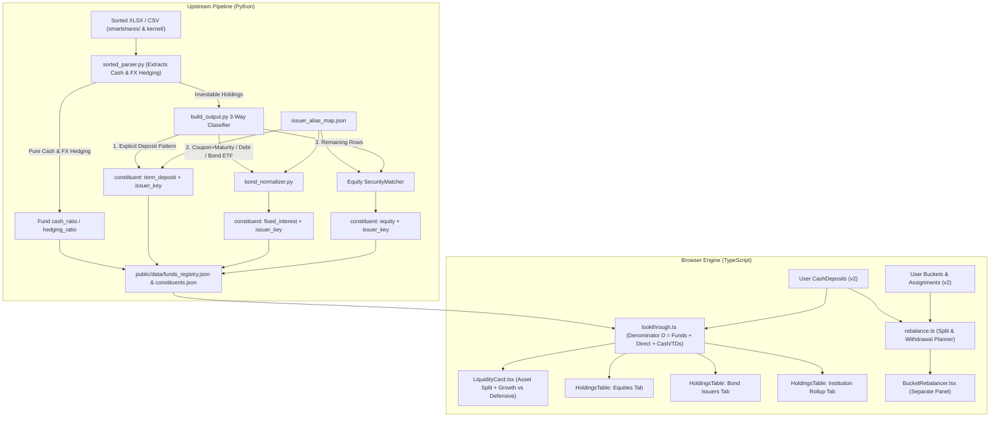

# Asset Split, Term Deposits, Bond Funds & Bucket Rebalancer Design Spec

**Status:** Draft (Post-Goldfish Revision)  
**Date:** 2026-11-11  
**Author:** SusanJaneNZ  
**Parent Spec:** [Kiwi Portfolio X-Ray](kiwi-portfolio-xray.md)

---

## 1. Problem Statement

Currently, Kiwi Portfolio X-Ray only models equity funds, direct New Zealand Stock Exchange (NZX) / Australian Securities Exchange (ASX) shares, and fund-level cash/FX-hedging buffers. In practice, New Zealand retail investors frequently hold and manage portfolios using:
1. **Direct Term Deposits & On-Call / Notice-Saver Cash** across NZ banks (ANZ, ASB, BNZ, Westpac, Kiwibank, Heartland, Rabobank, TSB, SBS).
2. **Passive Bond & Multi-Asset / Balanced Funds** (e.g., Smart NZ Bond ETF `NZB`, Smart Global Bond ETF `GBF`, Kernel NZ Bond Fund, as well as diversified funds like **Kernel Balanced**, **Kernel High Growth**, **Kernel Conservative**, and **Kernel Cash Plus** whose [Sorted Smart Investor](https://smartinvestor.sorted.org.nz/) `.xlsx` fund disclosures list equities, bonds, bond ETFs, and term deposits in one flat table).
3. **Semi-Annual Bucket Management & Withdrawal Rebalancing:** Many income/growth investors organize their funds and deposits into explicit strategic buckets (for example: **20% Term Deposits**, **20% High Dividend Yield Equities**, **60% Growth Equities**) and review every ~6 months to draw cash withdrawals while keeping bucket weights aligned to targets.

Without these capabilities:
* Investors cannot see their true portfolio **Asset Class Split** (Equities vs. Fixed Interest vs. Term Deposits vs. Cash & Hedging, or Growth vs. Defensive).
* Passing bond fund holdings from Sorted `.xlsx` exports through the equity `SecurityMatcher` fails to match coupon/maturity tranche strings (e.g., `"New Zealand Government 4.5% 15/04/2027"`) against `security_master.json`, flooding `unresolved_entries.json` with unmappable debt lines.
* Investors cannot see **Cross-Asset Institutional Concentration**—for example, combined exposure to ANZ across `ANZ.NZ` shares, ANZ Term Deposits, and ANZ bank bonds held inside `Smart NZB`.
* Investors must manually compute spreadsheets every 6 months to see their **current bucket split**, decide **which overweight bucket(s) to withdraw cash from**, and calculate the **exact NZD buys and sells** required to return to target percentages without triggering unnecessary round-trip turnover.

*(Clarification: Equity-income funds such as Kernel S&P Global Dividend Aristocrats contain underlying equities, not bonds, and remain handled by the equity matching path.)*

---

## 2. Goals & Non-Goals

### Goals
1. **Term Deposits & On-Call Cash Input:** Allow users to enter Term Deposits (`type: "term_deposit"`) and On-Call / Notice-Saver Cash (`type: "cash"`) in NZD (with bank/institution label, optional reference tag `depositId`, NZD balance, and optional informational maturity date and interest rate %), persisted in `localStorage` under a direct `version: 2` schema (`kiwi_portfolio_xray_v2`) and JSON backup export/import.
2. **Bond, TD & Multi-Asset Fund Decomposition Without Equity Noise:** Parse fund-held term deposits out of [`sorted_parser.py`](file:///mnt/c/Users/susan/wsl/kiwi-portfolio-xray/pipeline/adapters/sorted_parser.py) as holdings (rather than folding them into cash), and classify every non-cash holding **row-by-row** in [`build_output.py`](file:///mnt/c/Users/susan/wsl/kiwi-portfolio-xray/pipeline/output/build_output.py) (`Term Deposit` → `Bond / Bond ETF / Derivative` → `Equity`) so single-sector bond funds, equity funds, and mixed funds (`Kernel Balanced`, `Kernel Conservative`) route accurately without polluting `unresolved_entries.json`.
3. **Portfolio-Wide Asset Class Split:** Extend [`LiquidityBreakdown`](file:///mnt/c/Users/susan/wsl/kiwi-portfolio-xray/src/types/portfolio.ts#L74-L82) and [`LiquidityCard.tsx`](file:///mnt/c/Users/susan/wsl/kiwi-portfolio-xray/src/components/LiquidityCard.tsx) with an **Asset Split & Liquidity** bar (NZ/AU Equities, International Equities, Fixed Interest / Bonds, Term Deposits, Cash & Hedging) and a **Growth vs. Defensive** ratio.
4. **Cross-Asset Institution Rollup:** Stamp canonical `issuerKey` and `issuerName` upstream in `build_output.py` onto equities, bonds, and fund-held term deposits using [`issuer_alias_map.json`](file:///mnt/c/Users/susan/wsl/kiwi-portfolio-xray/pipeline/enrichment/issuer_alias_map.json), enabling unified Equity + Bond + Deposit institutional concentration views in `HoldingsTable.tsx`.
5. **User-Defined Buckets & Withdrawal-First Rebalancer:** Allow users to create custom buckets with target percentages (including a one-click `20% Term Deposits / 20% High Div Yield / 60% Growth` preset), assign each fund, direct share, or deposit row to a bucket, inspect **Current vs. Target Bucket Split**, and calculate—for any planned cash withdrawal $W \ge 0$—the exact **NZD withdrawal per bucket** and **rebalance buys/sells per bucket** needed to restore targets with zero round-trip trades.

### Non-Goals
* **No Yield, Duration, or Mark-to-Market Bond Pricing:** Maturity dates and interest rates are informational only; no yield-curve pricing, Macaulay duration, or accrued interest math is performed.
* **No Global Bond ISIN Security Master:** There is no free public ISIN (International Securities Identification Number) master for individual debt tranches; bond matching consolidates normalized issuer names rather than individual bond ISINs.
* **No Recursive Sub-Fund Unwrapping for Underlying Bond ETFs Inside Balanced Funds:** When a diversified fund holds an underlying bond ETF line (e.g., `"iShares Core US Aggregate Bond ETF"` inside `Kernel Balanced`), row-by-row classification records it as a `fixed_interest` bond ETF constituent (unless configured as a Smartshares equity feeder in [`feeder_registry.json`](file:///mnt/c/Users/susan/wsl/kiwi-portfolio-xray/docs/designs/kiwi-portfolio-xray.md)).
* **No Tax / Brokerage Optimization or Order Execution:** The rebalancer outputs bucket-level NZD withdrawal, buy, and sell amounts; it does not model NZ PIE/FIF tax lots, brokerage fees, or early-break penalties on unmatured Term Deposits.

---

## 3. Proposed Architecture

### A. System Data Flow
As observed in real Sorted Smart Investor `.xlsx` exports, spreadsheets contain two columns (`Asset name`, `% of fund net assets`) and no `Asset class` column. `sorted_parser.py` extracts pure Currency/Cash/Payables/Hedging into `cash_ratio`/`hedging_ratio` first, passing all investable holdings (including fund-held term deposits) to the **3-way classifier** inside `build_output.py`:



---

### B. Upstream Ingestion & Bond Normalization (`pipeline/`)

#### 1. Parser & 3-Way Row Classification
1. **Emit Fund-Held Term Deposits (`sorted_parser.py`):** Remove `"term deposit"` and `"bank account"` from `CURRENCY_AND_CASH_TOKENS` so bank deposit lines in funds such as `Kernel Conservative` or `Kernel Cash Plus` emit as `RawHolding` entries rather than folding silently into `cash_ratio`. Keep currency balances, `"cash"`, `"payables"`, `"receivables"`, `"net current assets"`, and `"unsettled trades"` in `cash_ratio` (using token/phrase matching so equity names like `"Cash Converters"` are unaffected). Also forward optional CSV/XLSX `asset_class`/`asset_type` metadata onto `RawHolding.raw_metadata`.
2. **Adapter Fund Hints (`smartshares_direct_adapter.py`, `kernel_adapter.py`):** Register bond and multi-asset codes (`NZB`, `GBF`, `KERNEL_NZ_BOND`, `KERNEL_BALANCED`, `KERNEL_HIGH_GROWTH`, `KERNEL_CONSERVATIVE`, `KERNEL_CASH_PLUS`) in the existing `SMARTSHARES_*` and `KERNEL_*` hint dictionaries.
3. **Ordered 3-Way Classifier per Holding (`build_output.py`):** After normalizing weights (`weight_norm_factor` across non-cash/non-hedging rows), route each `RawHolding` in strict priority order:
   * **Rule 1 — Term Deposit Pattern (`asset_class: "term_deposit"`):** Match explicit deposit phrases (`\bterm\s+deposit\b`, `\bcall\s+deposit\b`, `\bnotice\s+saver\b`, `\bcertificate\s+of\s+deposit\b`) or `\bTD\b` paired with a known bank issuer or maturity date (never loose `"td "` substrings that collide with `"Ltd "` or `"TD SYNNEX"`), provided no bond coupon `%` or debt keyword is present. Generate deterministic `isin = "TD:" + issuer_key_or_slug`, `sector = "Term Deposit"`, and `country = "New Zealand"` (for NZ banks) or `"Global"`.
   * **Rule 2 — Fixed Interest, Bond ETF & Rate Derivative Pattern (`asset_class: "fixed_interest"`):** Route rows matching any of:
     * **Coupon + Maturity:** Contains a numeric rate (with `%`, or 3-decimal rate such as `4.125` preceding a date) AND a maturity date/year (`\b\d{1,2}[/-]\d{1,2}[/-](?:20)?\d{2}\b`, `\b\d{1,2}[-\s](?:Jan|Feb|Mar|Apr|May|Jun|Jul|Aug|Sep|Oct|Nov|Dec)[-\s](?:20)?\d{2}\b`, `\b(?:Jan|Feb|Mar|Apr|May|Jun|Jul|Aug|Sep|Oct|Nov|Dec)\s+20\d{2}\b`, or standalone `202[5-9]|20[3-6]\d`).
     * **Sovereign / Agency / Undated Debt:** Matches `\b(?:new\s+zealand\s+government|nzgs|lgfa|local\s+government\s+funding|us\s+treasury|uk\s+gilt|treasury\s+(?:bill|note|bond)|frn|floating\s+rate\s+note|fixed\s+rate\s+note|capital\s+notes?|subordinated\s+notes?|perpetual|rcd|ncd)\b`.
     * **Bond Funds / Derivatives:** Matches `\b(?:bond\s+(?:etf|fund|index)|fixed\s+interest|interest\s+rate\s+swap|bond\s+future)\b`.
     *(A small explicit equity allowlist in `bond_normalizer.py` protects edge-case dividend equity funds if needed, replacing a separate `bond_registry.json` file.)*
   * **Rule 3 — Equity Fallback (`asset_class: "equity"`):** Route remaining rows through [`SecurityMatcher`](file:///mnt/c/Users/susan/wsl/kiwi-portfolio-xray/pipeline/enrichment/fuzzy_matcher.py) and stamp `asset_class: "equity"` plus `issuer_key` / `issuer_name` when matched.
4. **Automatic Fund-Level `asset_class` (`funds_registry.json`):** Let $w_{\text{eq}}$ be total resolved `equity` weight, $w_{\text{def}}$ be total `fixed_interest` + `term_deposit` weight, and $w_{\text{nc}} = w_{\text{eq}} + w_{\text{def}}$. Every entry in `funds_registry.json` emits:
   * `"fixed_interest"` if $w_{\text{nc}} = 0$ or $w_{\text{eq}} / w_{\text{nc}} \le 0.05$ and $w_{\text{def}} \ge w_{\text{eq}}$
   * `"mixed"` if $w_{\text{eq}} / w_{\text{nc}} > 0.05$ and $w_{\text{def}} / w_{\text{nc}} > 0.05$
   * `"equity"` otherwise.

#### 2. Bond Tranche Normalization & Issuer Rollup (`pipeline/enrichment/bond_normalizer.py`)
For each row routed to `fixed_interest`:
1. **Strip Tranche Identifiers (Non-ETF Rows Only):** On individual bond tranches (excluding rows matching `Bond ETF/Fund/Index`), strip coupon percentages (`4.5%`, `5.250`), dates (`15/04/2027`, `15-Apr-27`, `Apr 2027`, standalone `2025..2069`), series/tranche tokens as a unit (`\b(?:series|tranche)\s+[a-z0-9-]+\b`), and debt descriptors (`\b(?:senior|unsecured|subordinated|notes?|frn|fixed|floating|green\s+bond|social\s+bond|perpetual|callable)\b`). Preserve full product names on Bond ETF rows.
2. **Canonical Issuer Key (`pipeline/enrichment/issuer_alias_map.json`):** Expand `issuer_alias_map.json` beyond the initial 4 banking groups (`ISSUER_ANZ`, `ISSUER_WBC`, `ISSUER_CBA_ASB`, `ISSUER_NAB_BNZ`) to cover major NZ deposit/bond issuers (`ISSUER_KIWIBANK`, `ISSUER_HEARTLAND`, `ISSUER_RABOBANK`, `ISSUER_TSB`, `ISSUER_SBS`) plus dual-held NZX corporate issuers (`AIA`, `CNU`, `MCY`, `MEL`, `GNE`, `SPK`, `IFT`, `TPW`). Match normalized strings using `normalize_company_name()` + deterministic alias lookup so `build_output.py` stamps `issuer_key` and canonical `issuer_name` upstream onto `constituents.json` and `direct_equities.json`.
3. **Assign Fixed-Interest `sector` & `country`:**
   * **`sector` (JSON field; rendered as UI column `Category`):** Map to one of 6 canonical categories: `Sovereign`, `Local Government`, `Supranational`, `Financial`, `Bond ETF`, or `Corporate / Other`.
   * **`country` (Full names via [`normalize_country`](file:///mnt/c/Users/susan/wsl/kiwi-portfolio-xray/pipeline/security_master/build_security_master.py#L46-L75)):** Lookup sovereign/agency/NZ corporate issuer table (`New Zealand Government`, `LGFA`, NZ banks/corporates → `"New Zealand"`, `US Treasury` → `"United States"`, `UK Gilt` → `"United Kingdom"`, `ADB`/`IBRD`/`EIB` → `"Supranational"`, global `Bond ETF` / unknown foreign corporate → `"Global"`).
4. **Consolidate Tranches Per Fund & Output Schemas:**
   * Group bonds within a fund by canonical `issuer_key` if present, otherwise normalized stripped issuer slug, summing weights and tracking `tranche_count`. Emit synthetic `isin = "BOND:" + key`.
   * **Feeder & Schema Updates:** Update [`FeederUnwrapper.unwrap()`](file:///mnt/c/Users/susan/wsl/kiwi-portfolio-xray/pipeline/unwrapper/feeder_unwrapper.py#L88-L96) to emit `"asset_class": "equity"` (and stamp `issuer_key` in `build_output.py`). Update [`SchemaValidator`](file:///mnt/c/Users/susan/wsl/kiwi-portfolio-xray/pipeline/validate/schema_validator.py#L37-L162) Python checks (non-canonical `sector` on `fixed_interest` / `term_deposit` emits a validation **error**) and require `"asset_class"` on all funds and constituents.

---

### C. Client Calculation Engine & Persistence (`src/`)

#### 1. Clean `v2` Schema & Persistence (`src/types/portfolio.ts`, `src/storage/localStorage.ts`)
Because the app has not launched publicly, bump directly to **`version: 2`** and **`STORAGE_KEY_V2 = "kiwi_portfolio_xray_v2"`** with required fields (no legacy `v1` shims):

```typescript
export type AssetClass = "equity" | "fixed_interest" | "term_deposit";

export interface Constituent {
  isin: string;
  name: string;
  ticker?: string;
  country: string;
  sector: string;
  weight: number;
  asset_class: AssetClass;
  issuer_key?: string;
  issuer_name?: string;
  tranche_count?: number;
}

export interface CashDepositHolding {
  id: string;            // Immutable UI/storage row key
  depositId?: string;    // Optional non-sensitive bank reference/label (e.g. "TD-04192", NOT full account numbers)
  institution: string;   // Canonical bank preset or free-text label (e.g. "ANZ", "Kiwibank")
  label: string;         // Defaults to institution + " Term Deposit" / "Call Cash" if omitted
  type: "term_deposit" | "cash"; // Notice-Saver accounts use "cash"
  valueNZD: number;
  maturityDate?: string; // YYYY-MM-DD (informational)
  interestRate?: number; // % p.a. (informational)
}

export interface PortfolioBucket {
  id: string;            // Stable slug/UUID
  name: string;          // User-editable label (e.g. "Term Deposits", "High Div Yield", "Growth")
  targetPercent: number; // Desired split % (0-100)
}

// Instrument key: "fund:<fundCode>" | "direct:<isin>" | "td:<cashDeposit.id>"
export type BucketAssignmentMap = Record<string, string>;

export interface UserPortfolioState {
  version: 2;
  timestamp: string;
  audNzdRate: number;
  fundBalances: Record<string, number>;
  directHoldings: DirectHolding[];
  cashDeposits: CashDepositHolding[];
  buckets: PortfolioBucket[];
  bucketAssignments: BucketAssignmentMap;
}
```
* Normalize country strings in `DEFAULT_PORTFOLIO_STATE` (`localStorage.ts`) and test fixtures (`lookthrough.test.ts`) to full names (`"New Zealand"`, `"Australia"`, `"United States"`), matching `build_security_master.py`.
* Validate `version === 2`, non-negative balances/targets, valid `CashDepositHolding.type`, and required arrays/maps cleanly in `importPortfolioJSON()`.

#### 2. Unified Look-Through Math & Institutional Rollup (`src/engine/lookthrough.ts`)
Let $B_f$ be the NZD balance in fund $f$, $H_k^{\text{NZD}}$ be direct share $k$ converted via `audNzdRate`, $\text{CD}_t^{\text{NZD}}$ be direct `CashDepositHolding` $t$ (`term_deposit` or `cash`), and $c_f, h_f$ be fund $f$'s JSON `cash_ratio` and `hedging_ratio` ($\max(0, h_f)$ counts positive hedge reserve assets):
* **Total Portfolio Denominator $D$:**
  $$D = \sum_f B_f + \sum_k H_k^{\text{NZD}} + \sum_t \text{CD}_t^{\text{NZD}}$$
* **Unified `allHoldings` Consolidation (`ConsolidatedHolding`):** Extend `ConsolidatedHolding` with `assetClass: AssetClass`, `issuerKey?: string`, `issuerName?: string`, `trancheCount?: number` (and extend `ContributingSource.sourceType` to `"fund" | "direct" | "deposit"`). Consolidate all fund constituents (`equity`, `fixed_interest`, `term_deposit`) and `directHoldings` in **one loop** by `isin` (using `BOND:<key>` and `TD:<key>` for non-equity lines so identical bond/TD issuers merge across funds). Filter `equityHoldings = allHoldings.filter(h => h.assetClass === "equity")` and `bondIssuerHoldings = allHoldings.filter(h => h.assetClass === "fixed_interest")` without duplicating aggregation code.
* **Extended `LiquidityBreakdown` (Replacing Separate Split Struct):**
  * `nzAuEquitiesNZD`: sum of `equityHoldings` where `country` is `"New Zealand"` or `"Australia"` (accepting `"NZ"` / `"AU"` defensively too)
  * `intlEquitiesNZD`: sum of remaining `equityHoldings`
  * `totalEquitiesNZD`: `nzAuEquitiesNZD + intlEquitiesNZD` *(direct sum rather than subtracting cash/hedging from $D$)*
  * `totalBondsNZD`: sum of `bondIssuerHoldings`
  * `totalTermDepositsNZD`: sum of direct `cashDeposits` (`type === "term_deposit"`) + fund-held `term_deposit` constituents
  * `totalCashNZD`: sum of direct `cashDeposits` (`type === "cash"`) + $\sum_f B_f \cdot c_f$
  * `totalHedgingNZD`: $\sum_f B_f \cdot \max(0, h_f)$
  * **Growth % & Defensive %:** Let $G = \text{totalEquitiesNZD}$ and $F = \text{totalBondsNZD} + \text{totalTermDepositsNZD} + \text{totalCashNZD} + \text{totalHedgingNZD}$. Normalize by $G + F$ when $G + F > 0$ so Growth % + Defensive % always sum cleanly to `100.0%` regardless of the upstream $\pm 0.5\%$ weight tolerance.
* **`issuerRollup` (`IssuerRollupEntry[]`):** Combine all holdings with an `issuerKey` (equities, bond issuers, fund-held TDs) PLUS all direct `cashDeposits` (mapping user bank strings via a lightweight built-in NZ bank alias table so no `issuer_aliases.json` runtime fetch is required). Each entry exposes `{ issuerKey, issuerName, equityNZD, bondNZD, depositNZD, totalNZD, portfolioWeight, assetClassCount, sources }`, sorted by `multiAsset` (`assetClassCount >= 2`) or `totalNZD` descending.
* **Equity-Only Macro Charts (`StackedBarChart.tsx`):** Keep `sectorBreakdown` and `countryBreakdown` scoped strictly to `equityHoldings`, dividing percentages by `totalEquitiesNZD` so GICS (Global Industry Classification Standard) sector and country charts reflect **100% of Equities**.

#### 3. Bucket Split & Withdrawal-First Rebalancer (`src/engine/rebalance.ts`)
Export `calculateBucketRebalance(input: { buckets: PortfolioBucket[]; bucketAssignments: BucketAssignmentMap; fundBalances: Record<string, number>; directHoldings: DirectHolding[]; cashDeposits: CashDepositHolding[]; audNzdRate: number; plannedWithdrawalNZD: number }): BucketRebalanceResult`:

1. **Active Bucket Split & Unassigned Positions:** Iterate strictly over active positions (`fundBalances > 0`, `directHoldings`, `cashDeposits`), skipping any stale keys or deleted `bucket.id` references cleanly into `unassignedNZD`. Let $V_i^{\text{cents}} = \text{round}(V_i \times 100)$, $T_{\text{curr}}^{\text{cents}} = \sum_{i=1}^n V_i^{\text{cents}}$, and $W^{\text{cents}} = \text{round}(\text{plannedWithdrawalNZD} \times 100)$.
2. **Input Validation Guardrails:** Return `{ isValid: false, errorReason, ... }` (no throws, zero `NaN`s) if:
   * `buckets.length === 0` (`"Create at least one bucket"`),
   * $|\sum_i \text{targetPercent}_i - 100| > 0.01$ (`"Target percentages must sum to 100%"`),
   * $W^{\text{cents}} < 0$ or $W^{\text{cents}} > T_{\text{curr}}^{\text{cents}}$ (`"Withdrawal cannot exceed assigned buckets"`), or
   * $T_{\text{curr}}^{\text{cents}} === 0$.
3. **Full-Withdrawal Guard ($W^{\text{cents}} = T_{\text{curr}}^{\text{cents}} \implies T_{\text{post}}^{\text{cents}} = 0$):** Directly emit $w_i^{\text{cents}} = V_i^{\text{cents}}$, $\text{buy}_i^{\text{cents}} = \text{sell}_i^{\text{cents}} = 0$, and `rebalanceRequired = false` without dividing by $T_{\text{post}}$.
4. **Integer-Cent Minimum-Turnover Solver ($T_{\text{post}}^{\text{cents}} > 0$):**
   * Using weights $p_i = \text{targetPercent}_i / 100$, compute integer-cent targets $T_i^{*,\text{cents}}$ via largest-remainder rounding summing identically to $T_{\text{post}}^{\text{cents}} = T_{\text{curr}}^{\text{cents}} - W^{\text{cents}}$ (deterministic tie-breaker: bucket array index $i$).
   * Compute integer-cent overweight excesses $E_i^{\text{cents}} = \max(0, V_i^{\text{cents}} - T_i^{*,\text{cents}})$ and underweight shortfalls $S_i^{\text{cents}} = \max(0, T_i^{*,\text{cents}} - V_i^{\text{cents}})$, giving $E_{\text{total}}^{\text{cents}} = W^{\text{cents}} + S_{\text{total}}^{\text{cents}} \ge W^{\text{cents}}$ identically in integer cents.
   * **Bucket Withdrawal ($w_i^{\text{cents}}$):** Allocate $W^{\text{cents}}$ across overweight buckets ($E_i^{\text{cents}} > 0$) proportional to $E_i^{\text{cents}} / E_{\text{total}}^{\text{cents}}$ via largest-remainder rounding (clamped to $0 \le w_i^{\text{cents}} \le E_i^{\text{cents}}$).
   * **Remaining Rebalance Sell / Buy:** For each bucket, $\text{sell}_i^{\text{cents}} = E_i^{\text{cents}} - w_i^{\text{cents}} \ge 0$ and $\text{buy}_i^{\text{cents}} = S_i^{\text{cents}} \ge 0$. Set `rebalanceRequired = (S_total_cents > 0)`. Every accounting identity ($\sum w_i = W$, $\sum \text{buy}_i = \sum \text{sell}_i = S_{\text{total}}$, and $V_i - w_i - \text{sell}_i + \text{buy}_i = T_i^*$) holds **to the exact cent**. *(Special case: when withdrawal alone restores targets, $S_{\text{total}} = 0$ and `rebalanceRequired = false`.)*

---

### D. User Interface Updates (`src/components/`)

1. **`LiquidityCard.tsx`:** Displays a 5-segment stacked **Asset Split Bar** (`NZ/AU Equities | International Equities | Bonds | Term Deposits | Cash & Hedging`) + **Growth vs. Defensive %** badge above 4 summary cards: `Total Portfolio`, `Equities`, `Fixed Interest / Bonds`, and `Term Deposits & Cash` (where card 4 displays `totalTermDepositsNZD + totalCashNZD` with a sub-line showing fund `hedgingNZD` and account count).
2. **`PortfolioInputTable.tsx` & `FreshnessHeader.tsx`:**
   * Adds **3. Term Deposits & Call Cash (NZD)** with NZ bank presets (`ANZ`, `ASB`, `BNZ`, `Westpac`, `Kiwibank`, `Heartland`, `Rabobank`, `TSB`, `SBS`), an optional non-sensitive **Reference / ID** tag (`depositId`, noting users should use bank certificate/receipt tags rather than full account numbers), Type selector (`Term Deposit` / `Call Cash`), NZD balance (retaining a `$0` row on rollover/edit until explicitly removed with `✕`), and optional Maturity Date / Rate %.
   * Adds inline **Bucket `<select>`** on Fund, Direct Share, and Cash/TD rows whenever `buckets.length > 0` (selecting `"Unassigned"` clears the key).
   * Update `FreshnessHeader.tsx`'s **Clear** button to reset `fundBalances: {}`, `directHoldings: []`, `cashDeposits: []`, and `bucketAssignments: {}` (retaining user-configured `buckets`).
3. **`HoldingsTable.tsx`:** Keep existing `viewMode` (`'total' | 'equities'`) untouched and add a separate `activeTab: "equities" | "bonds" | "institutions"` state:
   * **`Equities`**: Existing look-through equities table.
   * **`Bond Issuers`**: Consolidated `fixed_interest` issuers (`Issuer`, `Category`, `Country`, `Tranches`, `Weight %`, `NZD Value`, expandable fund sources).
   * **`Institution Rollup`**: Cross-asset exposure (`Institution`, `Equities NZD`, `Bonds NZD`, `Deposits/Cash NZD`, `Total NZD`, `Portfolio %`, highlighting multi-asset rows with `assetClassCount >= 2`).
4. **`BucketRebalancer.tsx` (Top-Level Section Below Charts/Inputs):**
   * Explain briefly that **Asset Split** reflects look-through underlying assets (so a mixed fund stays split in Growth vs. Defensive above), whereas **Buckets** track user-grouped holding sleeves (`20/20/60`).
   * **Bucket Manager:** Add/rename/delete buckets (deleting removes the bucket and prunes matching `bucketAssignments`), edit Target `%` with live sum indicator + **Normalize to 100%** (rounds to 2 d.p. with remainder adjusted on largest bucket). The **"Load 20 / 20 / 60 Preset"** option is offered discreetly only when no buckets are configured yet (`buckets.length === 0`), and is hidden once buckets exist to prevent accidental overwrites. All buckets and assignments are continuously saved in the background (`portfolio_backup.json` and `localStorage`).
   * **Bucket Split & Unassigned Table:** Shows Current `$`, Current `%` (of Total Portfolio and of Assigned Buckets), Target `%`, Variance, and assigned holdings list, with an inline quick-assign fallback and an `Unassigned` warning badge if unassigned holdings > `$0`.
   * **Semi-Annual Withdrawal & Rebalance Planner:** Inputs for **Planned Withdrawal (NZD)** (`$0` default). Per bucket renders `Current Balance ($ / %)`, `Withdraw ($)` (amber if $> 0$), `Rebalance Action` (`Buy $X`, `Sell $Y`, or `Hold — On Target`), and `Post-Rebalance Balance ($ / % of T_post)`. Shows explicit reminder that total liquidation from a bucket is `Withdraw + Sell` and notes early-break considerations if `Withdraw + Sell > 0` on a Term Deposit bucket. Displays **"No additional rebalancing buys or sells required after withdrawal."** when `rebalanceRequired === false`.

---

## 4. Alternatives Considered

### Alternative 1: Index Individual Bond ISINs in `security_master.json`
* **Mechanism:** Maintain a security master of sovereign/corporate bond ISINs and fuzzy-match maturity strings.
* **Reason for Rejection:** No free public global bond ISIN directory exists; funds hold 50–1,000+ rotating maturity tranches creating continuous unresolved noise.

### Alternative 2: Opaque Single-Line Bond Fund Summary
* **Mechanism:** Treat `Smart NZB` or `Kernel NZ Bond` as 100% generic `"NZ Fixed Interest"` without parsing Sorted `.xlsx` disclosures.
* **Reason for Rejection:** Omits issuer-level fixed-interest breakdown (e.g., Sovereign vs. Bank debt) and cross-asset institutional concentration.

---

## 5. Risks & Mitigations

| Risk | Impact | Mitigation |
|---|---|---|
| **Bank Subsidiary Name Drift** (e.g., BNZ/NAB, ASB/CBA) | Cross-asset rollup misses or splits institutional concentration | Cover ~9 major NZ deposit/bond banks plus dual-held NZX corporates in `issuer_alias_map.json` and stamp `issuer_key` upstream in `build_output.py`. |
| **Debt / TD / Equity Misclassification** | Loose `"td "` matches `"Ltd "` equities or coupon bonds classify as TDs | Keep `"term deposit"` out of `sorted_parser.py` cash tokens, require explicit deposit phrases without coupon `%` for TDs, require coupon+maturity or debt/swap/bond-index keywords for bonds, and run synthetic unit fixtures in `test_bond_normalizer.py`. |
| **Malformed Imported JSON** | User imports an incomplete or corrupted v2 JSON backup | Validate `version === 2`, non-negative numbers, valid `CashDepositHolding.type`, and required arrays/maps in `importPortfolioJSON()` with an explicit error banner. |
| **GICS Chart Distortion** | Bond issuers skew equity sector/country stacked bars | Scope `sectorBreakdown` and `countryBreakdown` strictly to `equityHoldings` divided by `totalEquitiesNZD`. |
| **Round-Trip Withdrawal Trades & Rounding Drift** | Pro-rata withdrawal withdraws from underweight buckets or `$0.01` rounding discrepancies occur | Run minimum-turnover integer-cent math ($E_{\text{total}} = W + S_{\text{total}}$) over valid `sum(target%) == 100` inputs with `$0` full-withdrawal guards. |

---

## 6. Implementation Plan

### Phase 1: Upstream Bond/TD Pipeline & Schema
* **Files to Create:**
  * `pipeline/enrichment/issuer_alias_map.json`
  * `pipeline/enrichment/bond_normalizer.py`
  * `pipeline/tests/test_bond_normalizer.py` (reusing `create_test_xlsx` from `test_sorted_xlsx.py`)
* **Files to Modify:**
  * `pipeline/adapters/sorted_parser.py`: Remove `"term deposit"` and `"bank account"` from `CURRENCY_AND_CASH_TOKENS`; forward `asset_class`/`asset_type` into `RawHolding.raw_metadata`.
  * `pipeline/adapters/smartshares_direct_adapter.py` & `pipeline/adapters/kernel_adapter.py`: Register `NZB`, `GBF`, `KERNEL_NZ_BOND`, `KERNEL_BALANCED`, `KERNEL_HIGH_GROWTH`, `KERNEL_CONSERVATIVE`, `KERNEL_CASH_PLUS`.
  * `pipeline/unwrapper/feeder_unwrapper.py`: Emit `"asset_class": "equity"` on unwrapped feeder constituents.
  * `pipeline/output/build_output.py`: Run 3-way classifier (`Term Deposit` → `Bond` via `bond_normalizer.py` → `Equity`), derive fund `asset_class` (`equity` | `fixed_interest` | `mixed`), and stamp `issuer_key`/`issuer_name` on constituents & `direct_equities.json`.
  * `pipeline/validate/schema_validator.py`: Require `asset_class` on funds and constituents; validate `fixed_interest` and `term_deposit` `sector` values as errors.
* **Checkpoint:** `python3 -m unittest discover -s pipeline/tests -v` passes with synthetic `Smart NZB`, `Kernel Balanced`, and `Kernel Conservative` `.xlsx` fixtures.

### Phase 2: Client Calculation Engine, Buckets & Persistence
* **Files to Create:**
  * `src/engine/rebalance.ts`: Implement bucket split rollup and integer-cent withdrawal-first rebalance solver (`calculateBucketRebalance`).
  * `src/engine/rebalance.test.ts`: Test zero withdrawal, multi-bucket overweight withdrawal, withdrawal-only `rebalanceRequired = false`, full withdrawal ($W = T_{\text{curr}}$), unnormalized targets (`!= 100%`), deleted bucket/unassigned exclusion, and exact integer-cent invariants.
* **Files to Modify:**
  * `package.json`: Add a runnable TypeScript test runner (e.g., `vitest` + `"test": "vitest run"`) so client unit tests execute cleanly in CLI and CI.
  * `src/types/portfolio.ts`: Add `AssetClass`, `CashDepositHolding`, `PortfolioBucket`, `BucketAssignmentMap`, `BucketRebalanceResult`; extend `Constituent`, `ConsolidatedHolding`, `LiquidityBreakdown`, `ContributingSource`, and `UserPortfolioState` (`version: 2`).
  * `src/storage/localStorage.ts`: Switch to `STORAGE_KEY_V2 = "kiwi_portfolio_xray_v2"`, normalize `DEFAULT_PORTFOLIO_STATE` country names to `"New Zealand"`/`"Australia"`, add `cashDeposits`/`buckets`/`bucketAssignments` with schema validation in `importPortfolioJSON()`.
  * `src/engine/lookthrough.ts` & `src/engine/lookthrough.test.ts`: Update `denominatorD`, unified consolidation loop, `LiquidityBreakdown` Growth/Defensive fields, `totalEquitiesNZD` direct sum, equity-only `sectorBreakdown`/`countryBreakdown`, and `issuerRollup`; wire tests into Vitest with full country names.

### Phase 3: UI Integration & Verification
* **Files to Create:**
  * `src/components/BucketRebalancer.tsx`: Bucket manager (`20/20/60` preset + custom targets), Bucket Split & Unassigned table, and Semi-Annual Withdrawal & Rebalance Planner.
* **Files to Modify:**
  * `src/App.tsx`: Wire `cashDeposits`, `buckets`, `bucketAssignments`, updated `LiquidityCard`/`HoldingsTable` props, and render `BucketRebalancer`.
  * `src/components/FreshnessHeader.tsx`: Update `Clear` action to reset `cashDeposits` and `bucketAssignments` alongside balances/direct shares, and pass `equityHoldings` to `exportHoldingsCSV()`.
  * `src/components/LiquidityCard.tsx`: Render 5-segment Asset Split bar, Growth/Defensive % badge, and 4 summary cards.
  * `src/components/PortfolioInputTable.tsx`: Add **3. Term Deposits & Call Cash** (presets, non-sensitive `depositId`, `$0` retention, date/rate) and inline Bucket `<select>` across all 3 holding types.
  * `src/components/HoldingsTable.tsx`: Keep `viewMode` (`total`/`equities`) and add `activeTab` (`Equities` | `Bond Issuers` | `Institution Rollup`) with multi-asset source drill-downs.
  * `docs/ADMIN_GUIDE.md`: Document staging Bond & Multi-Asset `.xlsx` disclosures into `smartshares/` and `kernel/`.
* **Checkpoint:** `npm test`, `npm run build` (`tsc && vite build`), and `python3 -m unittest discover -s pipeline/tests -v` all pass.
