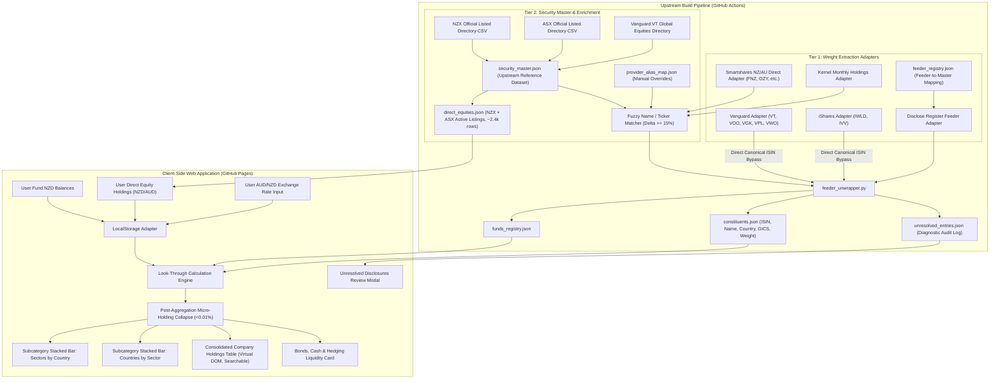
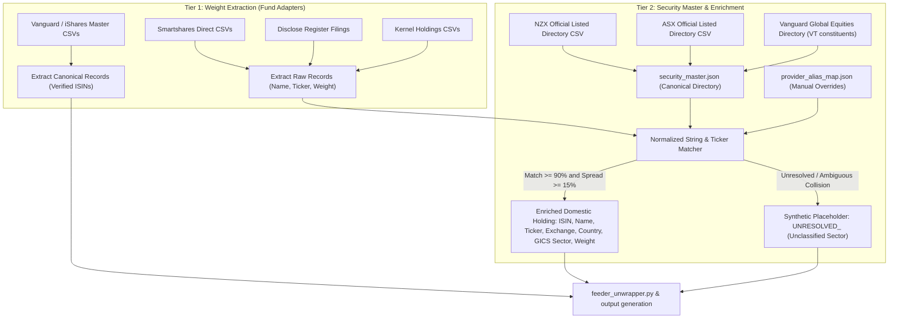

# Kiwi Portfolio X-Ray

* **Author:** SusanJaneNZ
* **Status:** Approved
* **Date:** 2026-11-08

---

## Overview

The Kiwi Portfolio X-Ray is a static, browser-based web application hosted on GitHub Pages. It enables New Zealand retail investors to evaluate their combined portfolio across multiple funds according to their personal dollar allocations, providing a single consolidated look-through of their underlying company, sector, and country exposures.

Fund providers in New Zealand do not provide look-through aggregation even within their own platforms. For example, an investor holding 40% in a Kernel NZ equity fund and 60% in a Kernel Australian equity fund sees their balance divided by fund, but the platform does not combine these holdings to show consolidated company exposures. If aggregated, the investor would discover that dual-listed equities (such as Chorus or major banks) appear in both funds, resulting in higher aggregate company concentration than individual fund reports indicate. This visibility gap exists whether an investor holds funds through a single manager or diversifies across multiple platforms (such as NZX-listed Smartshares ETFs and Kernel unlisted index funds).

Evaluating all holdings weighted by the investor's actual capital allocation provides foundational visibility across the entire portfolio. Where funds wrap overseas master funds (such as Smartshares feeder wrappers holding Vanguard US ETFs) or share common equities across regional borders, the tool unpacks the feeder structures and reconciles overlapping company positions.

This tool resolves multi-fund portfolios by unpacking feeder funds to their constituent holdings, normalizing taxonomies and ticker identifiers to a canonical primary key (ISIN), scaling positions by the user's specific fund balances, and aggregating any shared equities. The calculation engine runs entirely client-side in the browser against build-time pre-compiled static datasets, preserving user privacy with no backend database or account requirements.

---

## Problem Statement

1. **Intra-Provider Aggregation Blind Spots:** Fund managers and investment platforms do not combine underlying constituents across their own funds for a single investor. An investor holding both an NZ index fund and an Australian index fund with the same provider receives per-fund reporting, obscuring aggregated company exposures. Dual-listed companies (such as Chorus or dual-listed banks appearing in both NZ and Australian indices) are duplicated without total visibility, creating hidden single-company concentrations even when investing entirely within a single provider's product line.
2. **Feeder Fund Opacity:** Smartshares global equity funds (such as Total World `TWF` or US 500 `USF`) operate as feeder wrappers around overseas master ETFs (such as Vanguard `VT` and `VOO`). In statutory New Zealand reporting, fund managers list only the wrapper asset as a single line item, obscuring the thousands of underlying company equities.
3. **Fragmented and Disconnected Data Sources:** Fund constituent data is published in inconsistent, non-standardized formats across multiple sources:
   - New Zealand Disclose Register statutory XML/CSV filings.
   - Smartshares direct NZ/AU equity holding CSV exports.
   - Kernel Wealth monthly constituent portfolio tables.
   - Vanguard US master fund holdings CSV files.
4. **Identifier Collisions and Inconsistencies:** Ticker symbols collide across global and local exchanges (e.g., identical tickers on NZX, ASX, and US markets), and dual-listed companies (e.g., Fisher & Paykel Healthcare on NZX and ASX) appear under disparate identifiers without a unified identifier.
5. **Taxonomy Incompatibilities:** Providers classify holdings under conflicting industry sector models (e.g., FTSE ICB [Industry Classification Benchmark] versus S&P Dow Jones GICS [Global Industry Classification Standard]), making sector aggregation inaccurate without systematic mapping.
6. **Denominator Distortion from Cash and Hedging:** Index funds routinely hold between 0.2% and 2.5% in cash reserves, and currency-hedged funds hold forward foreign exchange derivative contracts. Omitting these non-equity assets distorts the 100% portfolio base denominator and misrepresents equity weights.
7. **Browser Performance Bottlenecks:** A single broad global index fund like Vanguard `VT` contains over 9,800 individual stock holdings. Parsing multiple large CSV exports client-side in the browser exhausts device memory and leads to mobile browser crashes.

---

## Goals

* **Recursive Feeder Fund Unwrapping:** Recursively resolve feeder fund wrappers to their underlying master fund constituents, scaling individual equity weights proportionally to the parent fund's allocation.
* **Unified Canonical Identification (ISIN):** Use ISO 6166 International Securities Identification Numbers (ISIN) as the primary key for all company holdings, backed by a static build-time alias dictionary to map local exchange tickers and provider-specific names.
* **Standardized Sector Taxonomy:** Normalize all constituent industry sectors to the 11 standard GICS Level 1 sectors (*Energy, Materials, Industrials, Consumer Discretionary, Consumer Staples, Health Care, Financials, Information Technology, Communication Services, Utilities, Real Estate*) based on the Global Industry Classification Standard (GICS).
* **Denominator Integrity and Asset Segregation:** Preserve total invested New Zealand Dollars (NZD) as the 100% calculation baseline. Segregate liquidity buffers, currency hedging contracts, and cash reserves into a dedicated asset view.
* **Post-Aggregation Micro-Holding Consolidation:** Filter individual positions smaller than $0.01\%$ across the total portfolio into an `"Other Micro-Holdings"` category only after cross-fund aggregation, retaining exact country and sector totals for macro reporting while preserving searchability in the virtualized holdings table.
* **Subcategory Stacked Visualizations:** Render horizontal stacked bar charts showing sector exposures sub-categorized by country, and country exposures sub-categorized by sector, with hover inspection tooltips.
* **Static Client-Side Execution:** Run all aggregation and look-through calculations in-browser via static files generated by a build-time GitHub Actions ingestion pipeline.
* **Direct Equity Holding Integration & Live FX:** Allow users to enter direct NZX and ASX company shareholdings (with per-holding currency selection in NZD or AUD, an automatic live AUD/NZD rate fetched via free public CORS API with manual override, and automatic hiding of exchange rate UI when all holdings are entered in NZD), combining them with fund look-through holdings in the consolidated company table, sector charts, and country charts.
* **Continuous Persistence & Data Portability:** Persist portfolio inputs, term deposits, buckets, and exchange rates in browser `LocalStorage` (v2), mirrored to `IndexedDB`, continuously auto-saved to repo-root `portfolio_backup.json` (git-ignored) with automatic timestamped safety backups created prior to Clear or Sample actions, and explicit JSON backup export/import.

---

## Non-Goals

* **No Server Infrastructure or Cloud Database:** The application will not use server-side runtimes, APIs, user authentication systems, or remote database storage.
* **No Direct-Indexing or Automated Trade Execution:** The tool will not generate trade orders, compute rebalancing purchase sizing, or connect to brokerage APIs.
* **No Tax Calculations:** The tool will not calculate Foreign Investment Fund (FIF) fair dividend rate (FDR), comparative value (CV), or dividend imputation credits.
* **No Real-Time or Intraday Pricing:** Portfolio calculations rely on fund disclosure reporting periods and static holdings datasets, not real-time streaming market prices.

---

## Critical User Journeys (CUJs)

### CUJ 1: Portfolio Input and Look-Through Generation

* **Given**: A user holding Smartshares Total World (`TWF`), Smartshares NZ Top 50 (`FNZ`), and Kernel Global 100.
* **When**: The user enters their NZD investment balances for each fund into the portfolio allocation table.
* **Then**: The system unpacks the underlying holdings with correct fund weighting, aggregates any shared company stocks across funds, updates the horizontal stacked sector/country charts, and populates the searchable company holdings table.

### CUJ 2: Duplicate Exposure and Overlap Inspection

* **Given**: A user holds both Smartshares US 500 (`USF`) and Smartshares Total World (`TWF`), both wrapping Vanguard US funds (`VOO` and `VT`).
* **When**: The user searches for a specific company (e.g., Microsoft or Apple) in the consolidated holdings table.
* **Then**: The table displays the consolidated percentage and NZD exposure for that company, with an expandable breakdown showing the exact contribution originating from `USF` versus `TWF`.

### CUJ 3: Data Export and Restoration

* **Given**: A user has configured their fund allocations on a desktop browser.
* **When**: The user clicks "Export Portfolio", transfers the generated JSON file to a mobile device, and clicks "Import Portfolio".
* **Then**: The mobile browser loads the exact portfolio balances and settings without requiring a user account or network synchronization.

### CUJ 4: Combined Fund, Direct Equity, and ASX Multi-Currency Analysis

* **Given**: A user holds \$20,000 in Smartshares NZ Top 50 (`FNZ`), \$10,000 NZD in Mercury NZ (`NZX:MCY`) shares directly via an NZ broker, and \$5,000 AUD in BHP Group (`ASX:BHP`) shares via an Australian/NZ broker.
* **When**: The user inputs their `FNZ` balance, adds Mercury at \$10,000 NZD, adds BHP at \$5,000 AUD, and enters their current AUD/NZD conversion rate (e.g., 1 AUD = 1.10 NZD) into the revealed exchange rate field.
* **Then**: The system converts the BHP direct holding to \$5,500 NZD, incorporates Mercury at 100% equity weight for the direct allocation, includes both direct positions in the total portfolio denominator ($D$), aggregates Mercury and BHP with any constituent portions inside funds, updates the sector and country allocations, and displays expandable rows showing the exposure breakdown between "Direct Holding" and fund constituents.

---

## Technical Plan (Architecture)

The system consists of two decoupled subsystems: an upstream build-time ingestion pipeline running in GitHub Actions and a static client-side single-page application hosted on GitHub Pages.



### 1. Upstream Build-Time Ingestion Pipeline

The upstream pipeline runs in GitHub Actions on a monthly cron schedule (`0 6 1 * *`) and on commits touching data extraction scripts or mapping dictionaries. It downloads raw disclosures, extracts underlying holdings, normalizes taxonomy and security identifiers, unwraps feeder structures, and outputs static, minified JSON assets committed to the repository's public distribution folder (`public/data/`).

#### A. Two-Tier Ingestion and Enrichment Architecture
Fund disclosures rarely provide complete metadata; providers like Kernel and Smartshares typically report only company names, local ticker symbols, and weights, omitting canonical ISINs, country classifications, and GICS sectors. Conversely, master ETF providers (Vanguard and iShares) already publish verified ISINs, CUSIPs, country codes, and industry sectors.

To avoid circular matching errors and eliminate third-party API dependencies, the pipeline adopts a bifurcated ingestion flow:



#### B. Tier 1: Source Data Weight Extraction Adapters
The pipeline does not require a bespoke parser for each fund. Fund managers and master ETF issuers publish constituent holdings using standardized platform schemas. The pipeline implements modular extraction adapters conforming to a shared `BaseAdapter` interface:

1. **Vanguard US Constituent CSV Adapter:** Parses Vanguard's standard institutional/retail ETF CSV schema (`Holdings_details_*.csv`). Extracts `(raw_name, cusip_or_isin, weight_pct)` where CUSIP refers to the 9-character Committee on Uniform Security Identification Procedures identifier that maps deterministically to US/CA ISINs. Master holdings already contain canonical identifiers and bypass Tier 2 fuzzy matching. Processes:
   - `VT` (Total World)
   - `VOO` (S&P 500)
   - `VGK` (FTSE Europe)
   - `VPL` (FTSE Pacific)
   - `VWO` (FTSE Emerging Markets)
2. **iShares (BlackRock) Constituent CSV Adapter:** Parses BlackRock's standard ETF portfolio export schema (`*_holdings.csv`). Extracts verified ISINs, company names, country codes, and GICS sectors directly, bypassing Tier 2 fuzzy matching. Handles:
   - `IWLD` (iShares Core MSCI World Ex Australia ESG ETF)
   - `IVV` (iShares Core S&P 500 ETF)
3. **Smartshares NZ/AU Direct Funds Adapter:** Ingests monthly statutory holdings CSV exports covering direct NZX and ASX equity funds (`FNZ` NZ Top 50, `MDZ` NZ Mid Cap, `NZG` NZ Dividend, `OZY` Australian Top 20, `ASD` Australian Dividend).
4. **Kernel Wealth Monthly Portfolio Adapter:** Ingests monthly portfolio holding exports for unlisted index funds (`Kernel NZ 50`, `Kernel S&P Australian Leaders`, `Kernel S&P Global 100`, `Kernel High Dividend`). Kernel CSVs omit ISINs; canonical enrichment is performed in Tier 2.
5. **Smartshares Feeder Wrappers (Disclose Register):** Parses statutory scheme disclosure CSV exports from local staging (`data/staging/disclose/`) sourced from the NZ Companies Office Disclose Register. Extracts feeder wrapper allocations to master ETFs, cash buffer ratios, and foreign exchange forward hedging contract ratios.

#### C. Declarative Feeder Configuration (`feeder_registry.json`)
To avoid writing code whenever a new feeder fund is tracked, feeder relationships are declared in a static configuration registry that pairs the local fund code with the master ETF parser:
```json
{
  "TWF": { "name": "Smartshares Total World ETF", "master_provider": "vanguard", "master_ticker": "VT" },
  "USF": { "name": "Smartshares US 500 ETF", "master_provider": "vanguard", "master_ticker": "VOO" },
  "EUF": { "name": "Smartshares Europe ETF", "master_provider": "vanguard", "master_ticker": "VGK" },
  "APA": { "name": "Smartshares Asia Pacific ETF", "master_provider": "vanguard", "master_ticker": "VPL" },
  "EMF": { "name": "Smartshares Emerging Markets ETF", "master_provider": "vanguard", "master_ticker": "VWO" },
  "ESG": { "name": "Smartshares Global Equities ESG ETF", "master_provider": "ishares", "master_ticker": "IWLD" }
}
```
Adding support for additional feeder funds requires only adding a declarative line to `feeder_registry.json` pointing to an existing adapter.

#### D. Tier 2: Security Master Enrichment & Canonical Resolution
Security metadata (ISIN, Country, GICS Sector) is resolved through a multi-tiered lookup engine:
1. **Security Master Reference Dataset (`security_master.json`):**
   Compiled from official, legally permissible open sources:
   - **NZX Official Listed Directory:** Public listings export providing canonical ISIN, company name, NZX ticker, and GICS sector for all NZ-listed equities.
   - **ASX Official Listed Directory:** Public listings export providing ISIN, company name, ASX ticker, and GICS sector for all Australian-listed equities.
   - **Vanguard Global Directory:** Vanguard's global master constituent exports (`VT`) provide verified ISINs, country of origin, and ICB/GICS mappings for ~10,000 global companies.
   - **Client Direct Equities Dataset (`public/data/direct_equities.json`):** A client-optimized subset extracted during build time containing active NZX and ASX listings (~2,400 records, ~120KB uncompressed). Shipped to the frontend for direct share search without loading the 12,000-record global security master.
2. **Normalization & Fuzzy Matching Engine:**
   - **String Normalization:** Cleans corporate legal suffixes (`Limited`, `Ltd`, `Inc`, `Corp`, `PLC`), strips punctuation and non-alphanumeric characters, and converts to uppercase tokens.
   - **Heuristic Matching:** Performs exact ticker match with exchange qualification (e.g., `NZX:FPH` vs `ASX:FPH`). If tickers are absent, runs token-sort Levenshtein distance matching against `security_master.json`.
   - **Disambiguation Guardrails:** High-confidence matches ($\ge 90\%$) are accepted automatically *only if* the candidate shares identical stem tokens and the score difference between top-1 and top-2 candidates is $\ge 15\%$. If multiple candidates share a corporate stem (e.g., `Alphabet Class A` vs `Class C`, `Berkshire Hathaway Class A` vs `Class B`), the item is diverted to `unresolved_entries.json` to prevent false-positive share class collisions.
3. **Manual Override Mapping (`provider_alias_map.json`):**
   Provides an explicit, human-editable override table for idiosyncratic names or unlisted instruments:
   ```json
   {
     "Kernel:NZ_50": {
       "Chorus": "NZCNUE0001S2"
     }
   }
   ```
4. **Synthetic Placeholder Holdings for Unresolved Rows:**
   Any constituent that fails resolution after alias checks and fuzzy matching is emitted into `constituents.json` as a synthetic placeholder holding:
   `{ "isin": "UNRESOLVED_<ticker>", "name": "<raw_name> (Unresolved)", "country": "Unknown", "gics_sector": "Unclassified", "weight": <weight> }`.
   This guarantees that constituent weights sum to $100\% \pm 0.5\%$, enabling automated CI builds to succeed for unaffected funds while populating `unresolved_entries.json` and the client-side `UnresolvedModal.tsx`.

#### E. Sector Taxonomy Normalization
Fund disclosures using alternative classification frameworks (e.g., FTSE ICB in Vanguard disclosures) are mapped to the 11 standard GICS Level 1 sectors:
1. Energy
2. Materials
3. Industrials
4. Consumer Discretionary
5. Consumer Staples
6. Health Care
7. Financials
8. Information Technology
9. Communication Services
10. Utilities
11. Real Estate

#### F. Feeder Unwrapping and Output Generation
* **Master Fund Equity Normalization:** Upstream in Tier 1, master ETF equity weights are normalized to sum to 1.0 of the equity basket ($\sum w_{m, i} = 1.0$) prior to wrapping, eliminating internal master cash leakage ($c_{\text{master}}$).
* **Feeder Equity Scaling:** For feeder funds, the pipeline recursively scales master fund constituents by the wrapper fund's equity proportion, clamping negative hedging liabilities:
  $$\text{Constituent Weight in Feeder} = w_{m, i} \times \min(1.0, 1 - c_f - \max(0, h_f))$$
  Where $c_f$ is the cash buffer ratio and $h_f$ is the currency hedging ratio.
* Pre-calculated static datasets are written to the static distribution folder (`public/data/`):
  * `funds_registry.json`: Metadata for each supported fund (ID, name, provider, asset class, reporting date, cadence, cash ratio, hedging ratio, `is_stale`).
  * `constituents.json`: Key-value map indexing each fund ID to its normalized constituent array (`[{ isin, name, ticker, country, gics_sector, weight }]`).
  * `direct_equities.json`: Compact index of active NZX and ASX listings for client direct equity autocomplete search.
  * `unresolved_entries.json`: Diagnostic list of unresolved disclosure rows for contributor review.

---

### 2. Client-Side Look-Through Calculation Engine

The web application executes all calculations in memory in the client browser using pure mathematical functions without external network calls.

#### A. Calculation Mechanics & Denominator Baseline
Let the user's entered balance for fund $f$ be $B_f$ in NZD. For direct equity holdings $k$ selected from `direct_equities.json`:
- For NZX-listed equities, the user enters their balance directly in NZD: $H_k^{\text{NZD}} = H_k$.
- For ASX-listed equities, the user enters their balance in AUD ($H_k^{\text{AUD}}$), and the engine scales it to NZD using the user-specified conversion rate $R_{\text{AUD/NZD}}$:
  $$H_k^{\text{NZD}} = H_k^{\text{AUD}} \times R_{\text{AUD/NZD}}$$

1. **Total Invested Denominator ($D$):**
   $$D = \sum_{f} B_f + \sum_{k} H_k^{\text{NZD}}$$
   All calculations maintain $D$ as the fixed denominator to prevent equity weight inflation from cash or derivative reserves.

2. **Consolidated Company Exposure ($E_i$):**
   For each unique security $i$ (identified by canonical ISIN):
   $$E_i = \sum_{f} \left( B_f \times w_{f, i} \right) + \begin{cases} H_i^{\text{NZD}} & \text{if security } i \text{ is held directly} \\ 0 & \text{otherwise} \end{cases}$$
   Where $w_{f, i}$ is the normalized proportional weight of company $i$ in fund $f$.

3. **Consolidated Portfolio Weight ($P_i$):**
   $$P_i = \frac{E_i}{D}$$

4. **Liquidity and Currency Hedging Segregation:**
   $$\text{Cash NZD} = \sum_{f} \left( B_f \times c_f \right), \quad \text{Hedging Contracts NZD} = \sum_{f} \left( B_f \times \max(0, h_f) \right)$$
   Where $c_f$ and $h_f$ are the cash and currency-hedging ratios of fund $f$. Direct equity holdings carry $0\%$ cash/hedging ratios ($100\%$ equity).

#### B. Dynamic Post-Aggregation Micro-Holding Consolidation
Broad global index funds introduce thousands of fractional equity holdings. To eliminate visual clutter while preserving searchability:
* **Default Table Collapse:** Holdings representing $P_i < 0.0001$ ($0.01\%$ of total portfolio) are collapsed into an expandable `"Other Micro-Holdings"` summary row in the default table view.
* **In-Memory Retention & Searchability:** All aggregated positions are retained in the virtualized table's client memory index. Searching for any company (e.g., small-cap or dual-listed stocks within a global index) queries the complete underlying dataset dynamically without losing visibility.
* **Macro Aggregation Precision:** For macro country and sector calculations, the exact exposure $E_i$ is credited to company $i$'s designated country $C_i$ and sector $S_i$. Macro allocation charts reflect 100% of the underlying equities without loss of precision.

---

### 3. User Interface & Visualization Architecture

The web application is built as a static single-page application using **React 18+ with TypeScript and Vite**. Visualizations are implemented with native SVG elements and D3 utilities, ensuring zero heavy runtime dependencies and fast mobile rendering.

#### A. Portfolio Input Table
* **Fund Allocations Section:** Numeric input fields for each fund in NZD, displaying individual fund percentages of total entered capital.
* **Direct Equities Section:** Autocomplete search input backed by `public/data/direct_equities.json` (~2,400 active NZX and ASX listings). Users search by ticker or company name.
* **Dynamic AUD/NZD Exchange Rate Field:** If any ASX-listed holdings are added to the portfolio, an editable exchange rate field is displayed (e.g., `1 AUD = 1.10 NZD`). The rate is initialized with a sensible default and can be customized by the user to match their broker's settlement rate.
* **Quick Preset Actions:** Clear all, Load example portfolio, Export JSON/CSV, Import JSON/CSV.

#### B. Horizontal Stacked Subcategory Bar Charts
Rendered using lightweight SVG and D3 color scales:
1. **Sector Allocation Broken Down by Country:** Each horizontal bar represents one of the 11 GICS sectors. The bar length represents total sector percentage, divided internally into colored sub-segments for each contributing country. Both fund constituents and direct shares feed into their respective GICS sector.
2. **Country Allocation Broken Down by Sector:** Each horizontal bar represents a country exposure, divided internally into colored sub-segments for each contributing sector.
3. **Interactive Hover Tooltips:** Hovering over any sub-segment displays an inspection popover showing:
   * Category name and subcategory name.
   * Total dollar exposure in NZD.
   * Percentage of total portfolio and percentage within that parent category.

#### C. Virtualized Company Look-Through Table
* Implemented with DOM virtualization (`react-window`), bounding rendered DOM nodes to 20–30 visible rows regardless of total constituent count.
* Searchable by company name, ticker, or ISIN using native JavaScript string matching.
* Sortable by total NZD value or portfolio percentage.
* Expandable rows: Clicking a row reveals which funds contribute to that company holding, the dollar amount from each fund, the fund-level percentage, and displays a dedicated **"Direct Holding"** source row if held directly.
* Toggle: View allocations as **"% of Total Portfolio"** (inclusive of cash/bonds) or **"% of Equities"**.

---

### 4. Persistence and Data Portability

#### A. Browser Storage (LocalStorage & IndexedDB)
Saves entered fund allocations, direct equity holdings, bank term deposits, rebalancer buckets, bucket assignments, and the AUD/NZD exchange rate under a versioned storage key (`kiwi_portfolio_xray_v2`), with redundant backup key `kiwi_portfolio_xray_v2_backup` and an asynchronous IndexedDB mirror. State is reloaded automatically on subsequent page visits.

#### B. Continuous Background File Sync (`portfolio_backup.json`)
Every portfolio edit triggers a background HTTP POST to `/api/portfolio/save`, immediately persisting the current v2 state to `portfolio_backup.json` at the repository root (excluded from version control via `.gitignore`). If local storage is ever cleared or default, the app automatically restores saved holdings from this root file.
* **Timestamped Safety Backups:** Before destructive operations (`Clear Portfolio` or `Load Sample`), the server endpoint `/api/portfolio/backup` automatically creates a dated snapshot (e.g., `portfolio_backup_2026-11-13_232000.json`) so user configurations are never permanently overwritten.

#### C. JSON & CSV Portability Adapters
* **JSON Export/Import:** Generates and parses a standard v2 JSON schema containing timestamp, schema version (2), fund balance key-value pairs, direct equity arrays (with currency), cash deposits, buckets, bucket assignments, and the AUD/NZD exchange rate:
  ```json
  {
    "version": 2,
    "timestamp": "2026-11-13T10:00:00Z",
    "audNzdRate": 1.1042,
    "fundBalances": { "TWF": 25000, "FNZ": 15000 },
    "directHoldings": [
      { "isin": "NZMCYE0001S8", "ticker": "MCY", "exchange": "NZX", "currency": "NZD", "value": 10000 },
      { "isin": "AU000000BHP4", "ticker": "BHP", "exchange": "ASX", "currency": "AUD", "value": 5000 }
    ],
    "cashDeposits": [
      { "id": "dep-1", "institution": "ANZ", "label": "1-Year TD", "type": "term_deposit", "valueNZD": 20000, "interestRate": 5.2 }
    ],
    "buckets": [
      { "id": "bkt-term-deposits", "name": "Term Deposits", "targetPercent": 20 },
      { "id": "bkt-growth", "name": "Growth Equities", "targetPercent": 80 }
    ],
    "bucketAssignments": {
      "td:dep-1": "bkt-term-deposits"
    }
  }
  ```
* **CSV Export:** Exports a spreadsheet-compatible breakdown of consolidated holdings, sectors, and fund allocations for external analysis.

---

### 5. Administrator Verification & Mapping Tooling (GitHub Actions CI)

#### A. Local CLI Dry-Run Validation
To verify candidate disclosures locally before pushing to production, administrators run the ingestion pipeline in dry-run mode:
```sh
python -m pipeline.ingest --dry-run --staging-dir data/staging/
```
The dry-run parses candidate CSVs, audits schemas, runs fuzzy matching, and reports unresolved rows directly to stdout without writing production assets.

#### B. CI Validation Rules & Diagnostics
When candidate files are committed or the monthly scheduled ingestion workflow (`.github/workflows/ingest.yml`) triggers:
* **Header Schema Check:** Verifies expected column names against known provider schemas in `pipeline/validate/schemas/`.
* **Weight Sum Integrity:** Validates that constituent weights sum to $100\% \pm 0.5\%$, identifying cash or derivative discrepancies.
* **ISIN Resolution Audit:** Flags any company row where the local ticker or name fails to resolve against `provider_alias_map.json`.
* **Taxonomy Validation:** Flags unmapped industry sectors that do not conform to the 11 GICS Level 1 sectors.

#### C. Unresolved Disclosures Remediation
If rows cannot be matched with confidence $\ge 90\%$ and $\ge 15\%$ spread, they are emitted into `public/data/unresolved_entries.json` with formatted JSON snippets to paste into `provider_alias_map.json`. Once committed to the repository, subsequent pipeline runs automatically resolve the affected holdings.

---

### 6. Date & Freshness Management

Because fund managers publish holdings on divergent schedules (e.g., monthly for Vanguard US and Smartshares direct funds, quarterly or semi-annually for statutory Disclose Register filings), constituents across an investor's portfolio will inherently reflect different effective dates. The system tracks and exposes this multi-cadence freshness explicitly at three levels:

#### A. Per-Fund Metadata Schema
Each fund entry in `funds_registry.json` tracks temporal metadata:
* `effective_date`: The official "as of" date of the underlying constituent disclosure (e.g., `2026-10-31`).
* `ingestion_timestamp`: The UTC timestamp when the GitHub Actions pipeline compiled the static dataset.
* `cadence`: Expected reporting cadence (`monthly`, `quarterly`, `semi-annual`).
* `is_stale`: Boolean flag asserted if current date exceeds the expected cadence by more than 45 days.

#### B. Portfolio-Level Freshness Envelope
When the user enters their fund balances, the calculation engine computes the portfolio's freshness envelope across all held funds:
* **As-Of Date Range:** Defined by the oldest constituent reporting date ($\min_{f \in \text{Held}} \text{effective\_date}_f$) and newest constituent reporting date ($\max_{f \in \text{Held}} \text{effective\_date}_f$).
* **Freshness Spread:** The delta in days between the newest and oldest held fund disclosures.

#### C. User Interface Freshness Indicators
* **Global Header Badge:** Displays the consolidated portfolio as-of range (e.g., *"Holdings As Of: 30 Sep 2026 – 31 Oct 2026"*).
* **Fund Allocation Table:** Includes an "As Of" date column adjacent to each fund input, with a visual stale indicator if an individual fund's data exceeds 90 days.
* **Company Look-Through Breakdown:** In the expanded row showing contributing funds for a specific company, each fund line item displays its respective constituent reporting date so the user can verify data alignment.


---

## Alternatives Considered

### Alternative A: In-Browser Raw CSV Parsing (No Build Pipeline)

* **Mechanism**: Users upload raw provider CSV files directly in the browser. JavaScript parses them client-side on each page load.
* **Pros**: No build infrastructure required; users always use the most current disclosure file they have.
* **Cons**: Vanguard `VT` alone contains 9,800+ rows. Parsing multiple large CSVs simultaneously in browser memory causes UI freezing and crashes on mobile devices. Requires users to source, download, and manage raw disclosure files themselves — a significant usability burden. Each provider uses a different CSV schema, pushing format-handling complexity into the browser bundle.
* **Reason for Rejection**: Browser memory and performance constraints make client-side parsing unworkable at global index scale, and placing data sourcing on end-users creates an unreliable dependency.

---

### Alternative B: Google Sheets / Excel Shared Workbook

* **Mechanism**: A shared collaborative spreadsheet performs look-through aggregation via formulas and manual data entry. Users copy their balances into designated cells.
* **Pros**: No software deployment; familiar to non-technical users; easy to share.
* **Cons**: Multi-tier recursive feeder fund unwrapping across thousands of constituents exceeds practical spreadsheet formula limits. Cross-fund ISIN deduplication and taxonomy normalization require VBA macros or App Script that are fragile and unversioned. Cannot handle the ~10,000-row Vanguard `VT` constituent table without major performance degradation.
* **Reason for Rejection**: Cannot handle multi-tier recursive look-through across thousands of constituents from multiple fund managers without reaching formula and performance limits.

---

### Alternative C: Commercial Financial API Integration (Morningstar / Refinitiv)

* **Mechanism**: The build pipeline queries a licensed financial data API (e.g., Morningstar Direct or Refinitiv Eikon) to retrieve fund constituent data, company metadata, ISINs, and GICS sectors in a normalized, pre-enriched format, eliminating the need for Tier 2 security master compilation.
* **Pros**: High data quality; ISINs, sectors, and country metadata supplied directly; no fuzzy matching or alias dictionaries needed; covers unlisted funds.
* **Cons**: Enterprise API licensing costs range from \$15,000 to \$50,000 per year. Data redistribution (publishing pre-compiled outputs to a public GitHub Pages static site) is typically prohibited under commercial API terms of service, requiring legal review for each provider. Introduces a hard cost dependency that eliminates the zero-cost hosting model.
* **Reason for Rejection**: Licensing costs and redistribution restrictions are incompatible with a zero-cost, open-source static hosting model.

---

### Alternative D: StockAnalysis.com or Similar Retail Aggregator Scraping

* **Mechanism**: The GitHub Actions build pipeline scrapes a retail financial aggregator site (e.g., StockAnalysis.com) to extract company country and sector metadata for the security master.
* **Pros**: Free access; broad global coverage including small-cap and emerging market companies; covers country and sector metadata not always present in official exchange directories.
* **Cons**: Retail financial sites do not grant automated crawling or redistribution rights in their terms of service. IP blocking, rate limiting, and HTML structure changes can silently corrupt the security master without build-time detection. Data quality and accuracy cannot be verified against an authoritative primary source.
* **Reason for Rejection**: Unauthorized scraping creates IP and licensing risk for a public open-source project, and silent failure modes in CI data extraction are unacceptable for a financial data tool.

---

### Alternative E: Standalone Local Python Application (No GitHub Pages)

* **Mechanism**: A Python application installed locally (e.g., a Streamlit or Dash app) runs the ingestion pipeline and look-through calculations on the user's machine, reading local CSV files.
* **Pros**: No GitHub Pages hosting constraints; easier to run ad-hoc data updates; Python ecosystem provides mature data wrangling libraries (pandas, rapidfuzz).
* **Cons**: Requires users to install Python and dependencies — a significant barrier for non-technical NZ retail investors. No URL to share; no cross-device access without additional setup. Loss of zero-infrastructure deployment to GitHub Pages.
* **Reason for Rejection**: Installation friction is incompatible with retail investors expecting a browser-accessible tool with no setup. The Python ecosystem is retained for the CI pipeline and administrator tooling only.

---

### Alternative F: Single Monolithic JavaScript Parser (No Modular Adapters)

* **Mechanism**: A single hardcoded ingestion script handles all provider CSVs with conditional branching by filename or provider name, rather than a modular adapter per provider schema.
* **Pros**: Simpler initial implementation; fewer files to maintain.
* **Cons**: Adding a new fund provider or master ETF issuer requires modifying and retesting the entire monolithic parser. Schema drift in one provider's CSV silently corrupts outputs for all other providers if error boundaries are not rigidly enforced.
* **Reason for Rejection**: The modular adapter pattern with a declarative `feeder_registry.json` isolates provider schema changes to a single adapter file and allows new feeders to be registered without code modification.

---

## Risks & Mitigations

### 1. Upstream Provider Schema Drift & Ingestion Resilience
* **Risk**: Fund providers (Smartshares, Vanguard, BlackRock, Kernel) modify CSV column headers, file download URLs, or reporting structures without notice, causing CI ingestion to fail or produce corrupted outputs.
* **Mitigation**: Strict schema validation (`pipeline/validate/schema_validator.py`) runs in CI against schema definitions before any output is committed. If schema validation fails, the workflow posts a detailed failure report to the GitHub Actions Job Summary and terminates non-zero without updating production files, preserving the last known valid dataset on GitHub Pages.

### 2. Multi-Cadence Disclosure Lag & Freshness Discrepancies
* **Risk**: Smartshares statutory filings on the Disclose Register update quarterly/semi-annually, whereas Vanguard master ETF CSVs update monthly. Aggregating holdings across divergent dates may introduce timing skew during periods of heavy index rebalancing.
* **Mitigation**: The system explicitly tracks `effective_date` per fund in `funds_registry.json`. The UI prominently displays a global freshness range badge (e.g., *"Holdings As Of: 30 Sep 2026 – 31 Oct 2026"*), per-fund "As Of" dates, and flags any fund exceeding 90 days with a stale badge.

### 3. Client-Side Memory, Mobile Scaling, & DOM Virtualization
* **Risk**: Parsing large JSON datasets and rendering thousands of company rows in browser DOM can exhaust device memory and cause UI freezing or crashes on mobile devices.
* **Mitigation**: The pipeline pre-compiles and minifies datasets into lightweight assets, and compiles a separate `direct_equities.json` index (~2,400 active NZX/ASX listings, ~120KB) rather than shipping the 12,000-record global security master to the client. The company holdings table implements DOM virtualization (`react-window`), bounding active DOM elements to 20–30 rows regardless of total constituent array size.

### 4. Symbology Disambiguation & Share-Class Collision Guardrails
* **Risk**: Token-sort fuzzy matching can produce false positive matches across distinct share classes that share a corporate stem (e.g., `Alphabet Class A` vs `Class C`, `Berkshire Hathaway Class A` vs `Class B`).
* **Mitigation**: Master ETF constituent adapters (Vanguard, iShares) bypass fuzzy matching entirely and emit verified canonical ISINs directly. For domestic unlisted disclosures, the fuzzy matcher requires a confidence score $\ge 90\%$, a score spread $\ge 15\%$ between top-1 and top-2 candidates, and matching leading stem tokens. Any ambiguous candidate is diverted to `unresolved_entries.json` and assigned a synthetic placeholder (`UNRESOLVED_<ticker>`) with an `"Unclassified"` sector.

### 5. Currency Fluctuation & Manual FX Entry
* **Risk**: Direct ASX shareholdings trade in AUD, while NZ portfolios are evaluated in NZD. Hardcoded static exchange rates become immediately obsolete, while third-party exchange rate APIs introduce external network failure points and rate limits.
* **Mitigation**: When ASX holdings are present, the UI reveals an editable AUD/NZD exchange rate input field (persisted in `LocalStorage`). Users enter ASX share values in AUD, and the client engine dynamically converts them to NZD using the user-specified rate without external API dependencies.

---

## Detailed Implementation Plan

### Target Files to Create/Modify

---

### Milestone 1: Upstream Ingestion & CI Pipeline

---

#### 1. `pipeline/requirements.txt` & `pipeline/requirements-dev.txt` (Create)

* **Type / Scope**: Python dependency manifests
* **Proposed Changes**: Declares pinned dependencies for Python 3.11+:
  * `pipeline/requirements.txt`: `rapidfuzz>=3.8.0`, `requests>=2.31.0`
  * `pipeline/requirements-dev.txt`: `pytest>=8.1.0`, `ruff>=0.3.4`

#### 2. `pipeline/adapters/base.py` (Create)

* **Type / Scope**: Python abstract base class & dataclass definitions
* **Proposed Changes**: Defines normalized data models and adapter interface:
  ```python
  from dataclasses import dataclass
  from pathlib import Path
  from typing import Optional, List
  from abc import ABC, abstractmethod

  @dataclass
  class RawHolding:
      raw_name: str
      raw_identifier: Optional[str]  # ISIN or CUSIP if available
      exchange: Optional[str]
      weight_pct: float              # Expressed as decimal fraction 0.0 to 1.0

  class BaseAdapter(ABC):
      @abstractmethod
      def parse_holdings(self, file_path: Path) -> List[RawHolding]:
          pass
  ```

#### 3. `pipeline/adapters/vanguard_adapter.py` (Create)

* **Type / Scope**: Python module — Tier 1 master ETF extraction adapter
* **Proposed Changes**: Implements `BaseAdapter` for Vanguard institutional CSV exports (`Holdings_details_*.csv`). Extracts verified ISINs/CUSIPs (`raw_identifier`) and company names. Normalizes equity constituent weights to sum to 1.0 of the equity basket ($\sum w_{m, i} = 1.0$), eliminating internal cash leakage. Bypasses Tier 2 fuzzy matching. Processes `VT`, `VOO`, `VGK`, `VPL`, `VWO`.

#### 4. `pipeline/adapters/ishares_adapter.py` (Create)

* **Type / Scope**: Python module — Tier 1 master ETF extraction adapter
* **Proposed Changes**: Implements `BaseAdapter` for BlackRock iShares standard `*_holdings.csv` exports. Extracts verified ISINs, country codes, and GICS sectors directly. Bypasses Tier 2 fuzzy matching. Handles `IWLD` and `IVV`.

#### 5. `pipeline/adapters/smartshares_direct_adapter.py` (Create)

* **Type / Scope**: Python module — Tier 1 domestic direct ETF adapter
* **Proposed Changes**: Implements `BaseAdapter` for Smartshares NZ/AU direct equity fund CSV exports (`FNZ`, `MDZ`, `NZG`, `OZY`, `ASD`). Extracts local exchange tickers, company names, and weights. Output routes to Tier 2 fuzzy matching.

#### 6. `pipeline/adapters/kernel_adapter.py` (Create)

* **Type / Scope**: Python module — Tier 1 unlisted index fund adapter
* **Proposed Changes**: Implements `BaseAdapter` for Kernel Wealth monthly portfolio holding CSVs. Extracts raw company names and weights. Output routes to Tier 2 fuzzy matching.

#### 7. `pipeline/adapters/disclose_register_adapter.py` (Create)

* **Type / Scope**: Python module — Tier 1 feeder wrapper adapter
* **Proposed Changes**: Parses statutory scheme disclosure CSV exports from local staging (`data/staging/disclose/`) sourced from the NZ Companies Office Disclose Register. Extracts feeder wrapper allocations to master ETFs, cash buffer ratios ($c_f$), and foreign exchange hedging ratios ($h_f$) for funds listed in `feeder_registry.json`.

#### 8. `pipeline/feeder_registry.json` (Create)

* **Type / Scope**: JSON declarative feeder-to-master configuration
* **Proposed Changes**: Maps local feeder fund codes to canonical names, master ETF provider adapters, and master tickers:
  ```json
  {
    "TWF": { "name": "Smartshares Total World ETF", "master_provider": "vanguard", "master_ticker": "VT" },
    "USF": { "name": "Smartshares US 500 ETF", "master_provider": "vanguard", "master_ticker": "VOO" },
    "EUF": { "name": "Smartshares Europe ETF", "master_provider": "vanguard", "master_ticker": "VGK" },
    "APA": { "name": "Smartshares Asia Pacific ETF", "master_provider": "vanguard", "master_ticker": "VPL" },
    "EMF": { "name": "Smartshares Emerging Markets ETF", "master_provider": "vanguard", "master_ticker": "VWO" },
    "ESG": { "name": "Smartshares Global Equities ESG ETF", "master_provider": "ishares", "master_ticker": "IWLD" }
  }
  ```

#### 9. `pipeline/security_master/build_security_master.py` (Create)

* **Type / Scope**: Python script — Tier 2 security master compiler
* **Proposed Changes**: Compiles `security_master.json` by merging:
  1. NZX official listed directory CSV export.
  2. ASX official listed directory CSV export.
  3. Vanguard `VT` global constituents export (provides verified ISINs, countries, and GICS sectors for ~10,000 equities).
  Extracts and writes `public/data/direct_equities.json` containing active NZX and ASX listings (~2,400 entries) for lightweight client autocomplete search.

#### 10. `pipeline/security_master/security_master.json` (Create — static reference dataset)

* **Type / Scope**: Upstream reference JSON dataset
* **Proposed Changes**: Canonical dictionary of known securities: `{ isin, name, ticker, exchange, country_iso2, gics_sector }`. Stored upstream in repository for CI enrichment; not shipped to browser client.

#### 11. `pipeline/enrichment/fuzzy_matcher.py` (Create)

* **Type / Scope**: Python module — Tier 2 security enrichment
* **Proposed Changes**: Enriches unmapped domestic holdings (`RawHolding`):
  1. Checks `pipeline/enrichment/provider_alias_map.json` for explicit manual overrides.
  2. Matches exact exchange-qualified tickers (`NZX:FPH` vs `ASX:FPH`).
  3. Executes token-sort Levenshtein matching (`rapidfuzz`) against normalized company names in `security_master.json`.
  4. Enforces disambiguation guardrails: accepts match only if score $\ge 90\%$, score difference between top-1 and top-2 candidates is $\ge 15\%$, and candidates share identical leading stems. Unresolved holdings route to synthetic placeholder generation.

#### 12. `pipeline/enrichment/provider_alias_map.json` (Create)

* **Type / Scope**: JSON manual override dictionary
* **Proposed Changes**: Human-editable dictionary mapping `(provider:fund_code, raw_name) -> canonical_isin`.

#### 13. `pipeline/normalizer/gics_mapping.json` (Create)

* **Type / Scope**: JSON taxonomy mapping table
* **Proposed Changes**: Maps alternative sector labels (FTSE ICB, Kernel labels) to canonical GICS Level 1 sectors.

#### 14. `pipeline/unwrapper/feeder_unwrapper.py` (Create)

* **Type / Scope**: Python module — feeder fund constituent resolution
* **Proposed Changes**: For each feeder fund, resolves master constituents and scales proportional weights:
  $$\text{Constituent Weight in Feeder} = w_{m, i} \times \min(1.0, 1 - c_f - \max(0, h_f))$$

#### 15. `pipeline/validate/schema_validator.py` & Schemas (Create)

* **Type / Scope**: Python validation module and explicit JSON Schema files
* **Proposed Changes**: Validates adapter outputs and weight sum integrity ($100\% \pm 0.5\%$). Creates 5 explicit schema files:
  * `pipeline/validate/schemas/vanguard_schema.json`
  * `pipeline/validate/schemas/ishares_schema.json`
  * `pipeline/validate/schemas/smartshares_schema.json`
  * `pipeline/validate/schemas/kernel_schema.json`
  * `pipeline/validate/schemas/disclose_register_schema.json`

#### 16. `pipeline/output/build_output.py` (Create)

* **Type / Scope**: Python script — static JSON output writer
* **Proposed Changes**: Writes four static JSON assets to `public/data/`:
  * `public/data/funds_registry.json`: Fund metadata including effective date, cadence, cash ratio, hedging ratio.
  * `public/data/constituents.json`: Fund-to-constituent map (`fund_id -> [{ isin, name, ticker, country, gics_sector, weight }]`). Emits synthetic placeholders (`UNRESOLVED_<ticker>`) for unmapped items to preserve 100% weight integrity.
  * `public/data/direct_equities.json`: Filtered index of active NZX/ASX listings (~2,400 rows) for client direct share search.
  * `public/data/unresolved_entries.json`: Diagnostic audit log of unmapped items with formatted JSON snippets for `provider_alias_map.json`.

#### 17. `.github/workflows/ingest.yml` (Create)

* **Type / Scope**: GitHub Actions scheduled & manual ingestion workflow
* **Proposed Changes**: Triggers monthly cron (`0 6 1 * *`) and `workflow_dispatch` (with optional `--dry-run` flag). Checks out repo, sets up Python 3.11, installs `pipeline/requirements.txt`, runs adapters, enrichment, feeder unwrapping, schema validation, and commits updated `public/data/` static assets.

#### 18. Milestone 1 Test Suite & Fixtures (Create)

* **Type / Scope**: Unit tests and sample CSV fixtures:
  * `pipeline/tests/fixtures/vanguard_vt_sample.csv`
  * `pipeline/tests/fixtures/ishares_iwld_sample.csv`
  * `pipeline/tests/fixtures/smartshares_fnz_sample.csv`
  * `pipeline/tests/fixtures/kernel_sample.csv`
  * `pipeline/tests/fixtures/security_master_fixture.json`
  * `pipeline/tests/test_vanguard_adapter.py`
  * `pipeline/tests/test_fuzzy_matcher.py`
  * `pipeline/tests/test_feeder_unwrapper.py`
* **Verification Checkpoint**: `pytest pipeline/tests/` passes with 100% assertion coverage over column parsing, weight normalization, fuzzy disambiguation guardrails, and feeder proportional scaling.

---

### Milestone 2: Client-Side Calculation Engine & Persistence

---

#### 19. `src/types/portfolio.ts` (Create)

* **Type / Scope**: TypeScript type declarations
* **Proposed Changes**: Defines strongly typed contracts across calculation engine and storage:
  ```typescript
  export interface DirectEquityHolding {
    isin: string;
    ticker: string;
    name: string;
    currency: 'NZD' | 'AUD';
    value: number;
  }

  export interface PortfolioInput {
    funds: Record<string, number>; // fund_id -> NZD value
    direct_equities: DirectEquityHolding[];
    aud_nzd_rate: number;          // e.g. 1.10
  }

  export interface AggregatedHolding {
    isin: string;
    name: string;
    ticker: string;
    country: string;
    gics_sector: string;
    total_nzd: number;
    portfolio_pct: number;
    sources: { source_name: string; nzd_value: number; pct: number }[];
  }

  export interface AggregatedPortfolioResult {
    total_denominator_nzd: number;
    holdings: AggregatedHolding[];
    micro_holdings: AggregatedHolding[];
    sectors_by_country: Record<string, Record<string, number>>;
    countries_by_sector: Record<string, Record<string, number>>;
    cash_nzd: number;
    hedging_nzd: number;
    freshness: { min_date: string; max_date: string; is_stale: boolean };
  }

  export interface LocalStorageV1Payload {
    version: 1;
    timestamp: string;
    aud_nzd_rate: number;
    funds: Record<string, number>;
    direct_equities: DirectEquityHolding[];
  }
  ```

#### 20. `src/engine/lookthrough.ts` (Create)

* **Type / Scope**: TypeScript module — core look-through calculation engine
* **Proposed Changes**: Accepts `PortfolioInput`, `funds_registry.json`, and `constituents.json`. Converts AUD direct holdings via `aud_nzd_rate`, computes denominator $D$, aggregates company exposures across funds and direct positions, segregates cash/hedging, and computes macro country and sector breakdown matrices.

#### 21. `src/engine/microfilter.ts` (Create)

* **Type / Scope**: TypeScript module — post-aggregation micro-holding collapse
* **Proposed Changes**: Collapses holdings with $P_i < 0.01\%$ into an `"Other Micro-Holdings"` summary row for default table display while retaining the complete array in memory for client search.

#### 22. `src/engine/freshness.ts` (Create)

* **Type / Scope**: TypeScript module — portfolio freshness calculation
* **Proposed Changes**: Computes `min_date`, `max_date`, and staleness flag across all held funds.

#### 23. `src/storage/localStorage.ts` (Create)

* **Type / Scope**: TypeScript module — browser persistence adapter
* **Proposed Changes**: Reads/writes `LocalStorageV1Payload` to key `kiwi_portfolio_xray_v1`. Implements `exportJSON()`, `importJSON()`, and `exportCSV()` (exporting CSV headers: `ISIN,Ticker,Company Name,Country,GICS Sector,Holding Value (NZD),Portfolio %`).

#### 24. Milestone 2 Test Suite & Fixtures (Create)

* **Type / Scope**: TypeScript unit tests and test portfolio fixture:
  * `src/engine/__fixtures__/test_portfolio.json`
  * `src/engine/lookthrough.test.ts`
* **Verification Checkpoint**: `npm test` passes, verifying denominator baseline preservation, ASX AUD conversion math, company overlap aggregation, and micro-holding collapse.

---

### Milestone 3: UI & Visualizations

---

#### 25. Build Configurations & Root Entry Points (Create)

* **Type / Scope**: Web application scaffolding:
  * `index.html`: Vite HTML entry point with `<div id="root"></div>` and module script link.
  * `src/main.tsx`: React 18 DOM mount entry point (`ReactDOM.createRoot`).
  * `tsconfig.json` & `tsconfig.node.json`: TypeScript compiler configurations.
  * `.eslintrc.cjs`: ESLint static analysis configuration.
  * `vite.config.ts`: Vite build configuration targeting GitHub Pages (`base: '/kiwi-portfolio-xray/'`).
  * `package.json`: Project manifest declaring dependencies (`react`, `react-dom`, `d3-scale`, `react-window`, `@types/react`, `@types/d3-scale`, `typescript`, `vite`).

#### 26. `src/components/PortfolioInputTable.tsx` (Create)

* **Type / Scope**: React component — portfolio entry
* **Proposed Changes**: Renders fund NZD input fields, direct equity autocomplete input backed by `direct_equities.json`, and an editable "AUD/NZD Exchange Rate" field dynamically shown when ASX holdings are present. Includes As-Of dates and stale badges.

#### 27. `src/components/StackedBarChart.tsx` (Create)

* **Type / Scope**: React component — visualization
* **Proposed Changes**: Horizontal stacked subcategory bar chart rendered via native SVG elements and D3 scales for Sectors by Country and Countries by Sector. Interactive inspection popover on segment hover.

#### 28. `src/components/HoldingsTable.tsx` (Create)

* **Type / Scope**: React component — virtualized company look-through table
* **Proposed Changes**: Virtualized list (`react-window`) rendering consolidated holdings with client-side text filtering across company name, ticker, and ISIN. Includes expandable source rows ("Direct Holding" vs contributing funds) and "% of Total" vs "% of Equities" view toggle.

#### 29. `src/components/LiquidityCard.tsx`, `FreshnessHeader.tsx`, `UnresolvedModal.tsx` (Create)

* **Type / Scope**: React presentation components:
  * `LiquidityCard.tsx`: Summarizes cash reserves and hedging contracts NZD.
  * `FreshnessHeader.tsx`: Displays global as-of date range badge.
  * `UnresolvedModal.tsx`: Displays unmapped disclosure rows with instructions to contribute overrides.

#### 30. `src/App.tsx` (Create)

* **Type / Scope**: Root React application component
* **Proposed Changes**: Wires state management between `localStorage.ts`, `lookthrough.ts`, `PortfolioInputTable`, charts, and `HoldingsTable`.

* **Verification Checkpoint**: `npm run build` generates static bundle in `dist/` with zero TypeScript compiler errors or lint warnings.

---

### Milestone 4: Deployment & Integration Verification

---

#### 31. `.github/workflows/deploy.yml` (Create)

* **Type / Scope**: GitHub Actions deployment workflow
* **Proposed Changes**: Triggers on push to `main`. Installs frontend dependencies, executes `npm run build`, and publishes `dist/` to GitHub Pages via `actions/deploy-pages`.

---

### Verification Plan

* **Build**: `npm run build` produces static bundle in `dist/` without TypeScript or lint errors.
* **Pipeline Tests**: `pytest pipeline/tests/` passes with all adapter, fuzzy matcher, feeder unwrapper, and schema tests passing.
* **Client Unit Tests**: `npm test` passes with look-through calculation, AUD/NZD scaling, and persistence tests passing.
* **Static Analysis**: `ruff check pipeline/` and `npm run lint` pass with zero errors.
* **CLI Dry-Run Verification**: `python -m pipeline.ingest --dry-run` runs against sample staging CSVs and validates schema and weight integrity without errors.
* **E2E Browser Verification**: Load GitHub Pages deployment, input a portfolio with `TWF` (\$20k), `FNZ` (\$10k), direct Mercury NZ (\$5k NZD), and direct BHP Group (\$2k AUD with rate 1.10). Confirm:
  - BHP converts to \$2,200 NZD and appears in Materials sector and Australia country.
  - Mercury aggregates direct holding with `FNZ` constituent portion.
  - Cash buffer and hedging contracts are properly segregated in liquidity card.
  - Data exports and re-imports cleanly via JSON and CSV.
