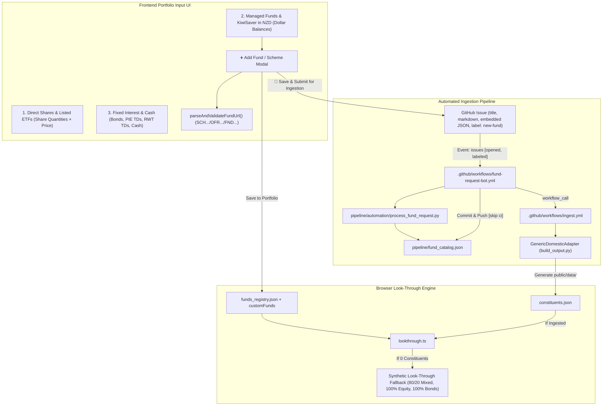

# Technical Design: KiwiSaver, Unified Managed Funds & Crowdsourced Ingestion Bot

**Status:** Implemented & Verified  
**Date:** 2026-11-18  
**Author:** SusanJaneNZ  
**Parent Specs:** [Phase 1 & Phase 2 Automated Ingestion Pipeline](phase1-fixed-interest-phase2-automated-pipeline.md), [Asset Split, Term Deposits, Bond Funds & Bucket Rebalancer](asset-split-bonds-tds.md)

---

## 1. Executive Summary & Problem Context

KiwiSaver represents the largest wealth-accumulation vehicle for retail New Zealanders (~NZ$110B+ AUM across hundreds of schemes). Prior to this update, Kiwi Portfolio X-Ray supported listed Smartshares ETFs and Kernel index funds, but lacked direct support for popular KiwiSaver schemes (such as Fisher Funds Growth, Milford Active Growth, Simplicity KiwiSaver Growth, and Generate).

Furthermore, early iterations segregated off-market index funds and custom funds into disparate panels. From the user's perspective, **unlisted index funds and KiwiSaver schemes are functionally identical**:
- Both are unlisted NZ PIE funds denominated in total NZD dollar balances.
- Both file standardized quarterly holdings disclosures on the Companies Office Disclose Register / Sorted Smart Investor (`SCH.../OFR.../FND...`).
- A "custom fund" is simply an unlisted fund that has not yet been ingested into the static catalogue (`public/data/`).

This specification documents the consolidation into a **clean 3-tier portfolio model**, client-side live link validation, synthetic look-through fallbacks, and a crowdsourced GitHub Actions ingestion bot.

---

## 2. Architecture & Data Flow



---

## 3. Frontend Consolidation: Unified 3-Tier Input Architecture

The application standardizes on 3 mutually exclusive, sequentially numbered input panels:

| Panel Number & Name | Asset Type | Input Mechanism | Underlying Look-Through Resolution |
|---|---|---|---|
| **1. Direct Shares & Listed ETFs (NZX / ASX)** | Exchange-traded equities & ETFs | Discrete share counts × live/overridden market price | Listed ETFs unwrap automatically into underlying constituents; direct shares map to security master. |
| **2. Managed Funds & KiwiSaver (in NZD)** | Unlisted index funds, KiwiSaver schemes, custom funds | Dollar balances in NZD | Unwraps compiled constituents from `constituents.json`, or applies synthetic asset-split fallback if pending ingestion. |
| **3. Fixed Interest & Cash (NZD)** | Direct bonds, PIE/RWT term deposits, cash | Face value / deposit balances in NZD | Direct bonds roll up into issuer exposures; term deposits and cash categorize into defensive liquidity. |

### Key Panel 2 Features ([`FundAllocationsPanel.tsx`](file:///mnt/c/Users/susan/wsl/kiwi-portfolio-xray/src/components/portfolio-inputs/FundAllocationsPanel.tsx)):
1. **Unified Registry:** Merges static registry funds, user custom funds, and popular presets (Fisher Funds Growth, Milford, Simplicity, Kernel, ANZ, Booster, Generate).
2. **Visual Badges:** Distinguishes `KiwiSaver` (emerald badge) vs `Custom` (amber badge) at a glance.
3. **Category Toggle Pills:** Allows instantaneous filtering by `All` | `KiwiSaver` | `Index / Managed`.
4. **Intelligent "Held Only" Default:**
   - When `totalPortfolioNZD > 0`: Defaults to **checked**, hiding unheld `$0.00` funds and presenting a clean, compact portfolio overview.
   - When `totalPortfolioNZD === 0`: Defaults to **unchecked**, allowing immediate exploration of available funds.
   - User manual overrides are strictly preserved during editing.

---

## 4. URL Validation & Decoupled Parsing ([`src/utils/fundUrl.ts`](file:///mnt/c/Users/susan/wsl/kiwi-portfolio-xray/src/utils/fundUrl.ts))

The URL validation logic is decoupled from React components into a dedicated utility:

```typescript
export interface ParsedSmartInvestorUrl {
  isValid: boolean;
  schemeId?: string;
  offerId?: string;
  fundId?: string;
  isDirectXlsx?: boolean;
  message?: string;
}
```

### Supported Patterns:
1. **Direct Holdings Spreadsheet (.xlsx):**
   `https://www.smartinvestor.sorted.org.nz/disclose-document/full-portfolio/FND555/GROWTH-FUND-FND555-Full-portfolio-holdings.xlsx`
2. **Canonical Sorted Scheme / Offer / Fund URL:**
   `https://www.smartinvestor.sorted.org.nz/kiwisaver-and-managed-funds/SCH10713/OFR10715/FND555/`
3. **Standalone Disclose ID:** `FND555`

---

## 5. Synthetic Look-Through Fallback ([`src/engine/lookthrough.ts`](file:///mnt/c/Users/susan/wsl/kiwi-portfolio-xray/src/engine/lookthrough.ts))

Because browser clients cannot make direct cross-origin HTTP calls to `sorted.org.nz` (due to CORS) and users should not have to wait for a nightly ingestion run before seeing portfolio metrics:

- If a fund has `constituents.length === 0`:
  - **`asset_class: "mixed"` (Standard Growth KiwiSaver):** Net exposure (`balance * (1 - cash_ratio)`) is allocated **80% Growth Equities** and **20% Fixed Interest (Bonds)**.
  - **`asset_class: "equity"`:** 100% Growth Equities.
  - **`asset_class: "fixed_interest"`:** 100% Fixed Interest / Bonds.
  - Cash buffers (`balance * cash_ratio`) are preserved in `liquidity.totalCashNZD`.
  - The total denominator `denominatorD` and overall asset split (Growth vs Defensive) remain mathematically complete to the exact cent.

---

## 6. Crowdsourced GitHub Actions Issue Bot

### Components:
1. **Issue Template / Generator:** When the user clicks **"🚀 Save & Submit for Ingestion"**, the UI opens a pre-filled issue URL on GitHub with the `new-fund` label and an embedded JSON code block.
2. **GitHub Workflow (`.github/workflows/fund-request-bot.yml`):**
   - Triggers on `issues: [opened, labeled]`.
   - Runs `python3 -m pipeline.automation.process_fund_request`.
   - Commits updated `pipeline/fund_catalog.json` with `[skip ci]`.
   - Posts a confirmation comment on the issue and closes it.
   - Calls `.github/workflows/ingest.yml` via `workflow_call`.
3. **Parser Script (`pipeline/automation/process_fund_request.py`):**
   - Extracts metadata from JSON blocks, markdown bullets, and URLs.
   - Preserves acronym casing (`ANZ`, `ASB`, `BNZ`, `AMP`).
   - Atomically updates and sorts `fund_catalog.json`.
4. **Dynamic Provider Adapter (`pipeline/output/build_output.py`):**
   - Uses `GenericDomesticAdapter` to compile any arbitrary staged provider folder under `data/staging/<provider>`.

---

## 7. Persistence & Backup Serialization

All custom funds and metadata persist through:
1. `localStorage` (`kiwi_portfolio_xray_v2` and backup key).
2. IndexedDB backup mirror (`kiwi_portfolio_db`).
3. Local disk backup (`backups/portfolio_backup.json` via `/api/portfolio/save`).
4. Standalone JSON export/import (`exportPortfolioJSON` / `importPortfolioJSON`).

`serializePortfolioPayload()` guarantees that `customFunds` (including `isKiwiSaver` flags and `smartInvestorUrl`) are persisted across all backup channels.

---

## 8. Verification & Test Protocol

- **Engine & Storage (`npm test`):**
  - `fundUrl.test.ts`: Verifies canonical Sorted links, direct `.xlsx`, standalone FND codes, and invalid inputs.
  - `localStorage.test.ts`: Verifies custom fund sanitization, persistence, and round-trip export/import.
  - `lookthrough.test.ts`: Verifies denominator integrity and 80/20 equity/bond split for synthetic funds.
- **Python Pipeline (`python3 -m unittest`):**
  - `test_fund_request_bot.py`: Tests JSON extraction, markdown parsing, non-KiwiSaver managed fund categorization, acronym preservation, and catalog atomic updates.
- **Production Build:** `npm run build` compiles cleanly with zero TypeScript errors.
