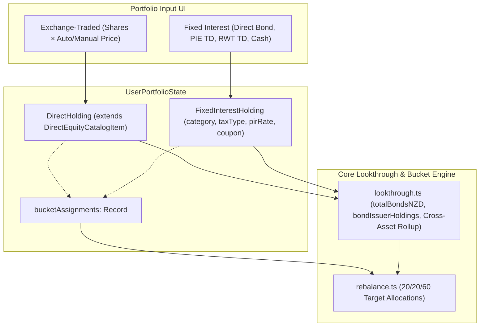

# Technical Design: Phase 1 (Units & Fixed Interest) & Phase 2 (Automated Ingestion Pipeline)

**Status:** Approved Post-Audit (Hardened by Goldfish Review Swarm)  
**Date:** 2026-11-14  
**Author:** SusanJaneNZ  
**Parent Specs:** [Retirement Cashflow, Fixed Interest & Future Roadmap](retirement-cashflow-and-roadmap.md), [Asset Split, Term Deposits, Bond Funds & Bucket Rebalancer](asset-split-bonds-tds.md)

---

## 1. Executive Summary & Scope

To prepare Kiwi Portfolio X-Ray for general live release to passive retirement investors, this specification hardens and details the two primary foundations:

1. **Phase 1 (Frontend & Data Model):**
   * **Mandatory Share Quantities for Exchange-Traded Assets:** Eliminate free-form dollar entry for listed NZX/ASX assets. Investors hold discrete parcels of shares (e.g. 1,500 Contact Energy, 2,000 Smartshares USF); value is strictly computed as `shares * price`. Free-form currency entry is strictly reserved for **Unlisted Managed Funds** (Kernel, Simplicity, KiwiSaver) where deposits are made in round dollars.
   * **Universal Look-Through for Listed ETFs:** Any listed ETF entered as share quantities (e.g. Smartshares `USF`, `FNZ`, `DIV`, or BetaShares `ASIA`) **automatically unwraps into its complete underlying company constituents** in the macro look-through engine. Holding an ETF on a broker never causes loss of constituent visibility.
   * Generalize `CashDepositsPanel` into a unified **Fixed Interest & Cash Panel** supporting:
     * **Direct NZDX Corporate & Government Bonds** (face value, coupon rate %, maturity date, frequency).
     * **Variable-Rate PIE Term Deposits** (with explicit PIR selection: 10.5%, 17.5%, 28%) alongside **Standard RWT Term Deposits**.
   * Fully wire direct bonds into [`lookthrough.ts`](file:///mnt/c/Users/susan/wsl/kiwi-portfolio-xray/src/engine/lookthrough.ts) (`totalBondsNZD`, `bondIssuerHoldings` in `HoldingsTable.tsx`, and `entry.bondNZD` in cross-asset institutional rollups).
   * Maintain the single-source-of-truth normalized `BucketAssignmentMap` across funds, direct shares, and fixed interest.

2. **Phase 2 (Automated Data Ingestion Pipeline - Go-Live Blocker):**
   * Build an automated extraction client (`pipeline/fetchers/smart_investor_fetcher.py`) that queries the public **Sorted Smart Investor Catalog API** and downloads official quarterly FMCA portfolio disclosures (`.xlsx`/`.csv`) directly from the **Companies Office Disclose Register**.
   * Standardize staged filenames, sanitize downloads via atomic temporary file writing, and isolate parsing failures with per-fund circuit breakers.
   * Integrate the crawler seamlessly with [`pipeline/ingest.py`](file:///mnt/c/Users/susan/wsl/kiwi-portfolio-xray/pipeline/ingest.py) (`--fetch`) and [`pipeline/admin_ui.py`](file:///mnt/c/Users/susan/wsl/kiwi-portfolio-xray/pipeline/admin_ui.py) (`POST /api/pipeline/fetch`).

---

## 2. Phase 1: Units, Pricing & Unified Fixed Interest



### A. TypeScript Schema Definitions (`src/types/portfolio.ts`)

#### 1. Exchange-Traded Assets (`DirectHolding`)
Preserves `DirectEquityCatalogItem` inheritance so `isin`, `ticker`, `exchange`, `issuer_key`, `issuer_name`, `country`, and `sector` remain guaranteed for deduplication, institutional rollups, and rebalancing.

**Mandatory Share Quantities:** Users enter discrete share/unit counts. Total currency values are strictly calculated as `shares * price`, avoiding arbitrary dollar approximations for exchange-traded assets.

**Universal Look-Through for Listed ETFs:** When an exchange-traded asset is an ETF (e.g. Smartshares `USF`, `FNZ`, `DIV`, or BetaShares `ASIA`), it links to `fund_holdings.json` via its fund code. The look-through engine multiplies `valueNZD` by the fund's underlying constituent weights, guaranteeing that investors who enter ETFs as share parcels receive the exact same 100% look-through visibility as unlisted funds.

```typescript
export interface DirectHolding extends DirectEquityCatalogItem {
  id: string;                      // Unique row ID
  shares: number;                  // Mandatory discrete units/shares (e.g., 2500)
  price: number;                   // Native currency unit price (NZD or AUD)
  value: number;                   // Computed native worth: shares * price (read-only)
  valueNZD: number;                // Computed NZD valuation: currency === 'AUD' ? (value * audNzdRate) : value
  currency: 'NZD' | 'AUD';
  isEtf?: boolean;                 // Flag indicating this exchange-traded asset is an ETF with underlying constituents
  fundCode?: string;               // Links to fund_holdings.json if isEtf === true (e.g., "USF", "DIV", "ASIA")
}
```

#### 2. Unified Fixed Interest & Cash (`FixedInterestHolding`)
Replaces `CashDepositHolding` in state:

```typescript
export type FixedInterestCategory = 'term_deposit' | 'bond' | 'cash';
export type FixedInterestTaxType = 'rwt' | 'pie';
export type PaymentFrequency = 'monthly' | 'quarterly' | 'semi-annual' | 'annual' | 'maturity';

export interface FixedInterestHolding {
  id: string;                      // Unique row ID
  institution: string;             // Issuer / Bank (e.g. "Contact Energy", "Heartland Bank", "ANZ")
  name: string;                    // Description (e.g., "CEN060 5.80% 2028", "12M PIE Term Deposit")
  category: FixedInterestCategory;
  taxType: FixedInterestTaxType;   // 'rwt' or 'pie' (Bonds are strictly 'rwt')
  pirRate?: 0.105 | 0.175 | 0.28;  // Only applicable when category !== 'bond' && taxType === 'pie' (defaults to 0.28)
  valueNZD: number;                // Face value / principal in NZD
  interestRate?: number;           // Annual coupon or interest rate % (e.g., 5.80)
  maturityDate?: string;           // YYYY-MM-DD
  frequency?: PaymentFrequency;    // Payment cadence
  depositId?: string;              // Optional account / reference code
  issuerKey?: string;              // Optional canonical issuer key (e.g. "ISSUER_CEN") for corporate bonds
}
```

#### 3. Normalized `UserPortfolioState`
Maintains existing proven fields (`timestamp`, `audNzdRate`, `fundBalances`, `buckets`, `bucketAssignments`):

```typescript
export interface UserPortfolioState {
  version: 2;                      // Schema version
  timestamp: string;
  audNzdRate: number;
  fundBalances: Record<string, number>;
  directHoldings: DirectHolding[];
  fixedInterest: FixedInterestHolding[]; // Replaces cashDeposits
  buckets: PortfolioBucket[];
  bucketAssignments: BucketAssignmentMap; // Normalized keys: "fund:<code\>", "direct:<isin\>", "fi:<id\>"
}
```

### B. Look-Through & Rebalancer Engine Integration

#### 1. Look-Through Aggregation (`src/engine/lookthrough.ts`)
* **Input Interface:** `CalculationInput` accepts `fixedInterest: FixedInterestHolding[]` (deprecating `cashDeposits`).
* **Fixed Interest Asset Allocation:**
  ```typescript
  let directBondsNZD = 0;
  let directTermDepositsNZD = 0;
  let directCashNZD = 0;

  for (const fi of fixedInterest) {
    if (fi.valueNZD <= 0) continue;
    if (fi.category === 'bond') directBondsNZD += fi.valueNZD;
    else if (fi.category === 'term_deposit') directTermDepositsNZD += fi.valueNZD;
    else directCashNZD += fi.valueNZD;
  }
  ```
* **Denominator & Asset Split:**
  * `totalBondsNZD = fundBondsNZD + directBondsNZD`.
  * `LiquidityBreakdown` maps:
    * `fixed_interest = totalBondsNZD`
    * `term_deposits = directTermDepositsNZD`
    * `cash = directCashNZD + fundCashNZD`
* **Direct Bonds in `HoldingsTable.tsx`:**
  Direct bonds synthesize into `bondIssuerHoldings: ConsolidatedHolding[]` with `assetClass: 'fixed_interest'`, allowing corporate and government bonds to display cleanly under the "Bonds" tab alongside fund-held debt.
* **Cross-Asset Institutional Rollup (`buildCrossAssetIssuerRollup`):**
  * When `fi.category === 'bond'`, route `fi.valueNZD` to `entry.bondNZD`.
  * Resolve issuer key: if `fi.issuerKey` is provided, use it; otherwise check `issuer_alias_map.json` against `fi.institution`, falling back to `resolveDepositIssuer()`. This guarantees that Contact Energy bonds (`CEN060`) correctly combine with `CEN.NZ` equity under `ISSUER_CEN`.

#### 2. Rebalancing Engine (`src/engine/rebalance.ts`)
* Bucket assignment keys for fixed interest standardize to `"fi:<id>"`.
* Liquidity constraint check: `hasTermDeposits` evaluates to `true` only if an assigned holding in the bucket has `category === 'term_deposit'`.

### C. Retail Investor UX & Guardrails (`egm-kiwi-investor` Domain Hardening)

1. **Fractional Share Support:** Sharesies and Hatch allow fractional share purchases (e.g., `15.4215` units). The `shares` field is typed as `number`, and UI inputs accept decimal values with floating-point precision.
2. **Price Auto-Population & Manual Override:** When a user selects a listed share or ETF, `price` is auto-populated from `security_master.json` / bundled closing price snapshot. The user can adjust the price if their broker's live quote differs. `valueNZD` is strictly read-only (`shares * price * fx`).
3. **Bond Valuation Clarity:** The input field for bonds is explicitly labeled **"Principal / Face Value ($NZD)"** so retirees reading ASB Securities or Jarden statements immediately know which number to enter.
4. **"Tier 0" External Cash Guardrail:** To prevent users from mistakenly entering their external 1–3 year emergency/living spending buffer into the portfolio, the Cash row features an inline tip:
   > *"Tip: Only enter cash allocated to your investment portfolio (dry powder / contrarian reserve). Keep your separate day-to-day living buffer (Tier 0) outside this tool."*
5. **Unified ETF Discovery:** Searching for Smartshares ETFs (`USF`, `FNZ`, `DIV`) in the listed asset picker seamlessly adds them to the Exchange-Traded table with `isEtf: true` and full constituent unwrapping.

---

## 3. Phase 2: Automated Ingestion Pipeline (Disclose Register & Smart Investor)

```mermaid
flowchart LR
    Catalog[Sorted Smart Investor Catalog API] -->|Query Active Funds| Fetcher[smart_investor_fetcher.py]
    Disclose[Companies Office Disclose Register] -->|Download Quarterly XLSX| Fetcher
    Fetcher -->|Atomic Write .tmp -> .xlsx| Staging[data/staging/{provider}/]
    Staging --> IngestCLI[pipeline.ingest --fetch]
    IngestCLI --> Compiler[PipelineCompiler with Per-Fund Circuit Breakers]
    Compiler --> JSON[public/data/fund_holdings.json]
```

### A. Metadata Contracts & Data Types (`pipeline/fetchers/smart_investor_fetcher.py`)

```python
from dataclasses import dataclass
from pathlib import Path
from typing import Optional

@dataclass(frozen=True)
class DiscloseFundMeta:
    fund_id: str             # e.g., "FND1105"
    scheme_id: str           # e.g., "SCH10174"
    manager_name: str        # e.g., "Smartshares Limited"
    fund_name: str           # e.g., "Smartshares NZ Dividend ETF"
    holdings_url: str        # Direct download link to .xlsx / .csv
    filing_date: str         # Effective date (YYYY-MM-DD)
    target_code: str         # Internal app code (e.g., "DIV", "KERNEL_GLOBAL_100")
    provider: str            # "smartshares" | "kernel" | "simplicity"
```

### B. Download Hardening & Path Safety

1. **Atomic File Writes:** Downloads are written to a `.tmp` file first.
2. **File Validation:** Checks minimum byte size (> 1KB) and file magic bytes (`PK\x03\x04` for zip/xlsx, or valid ASCII/UTF-8 text for CSV). Corrupt or HTML error responses (429/503) are rejected immediately and never overwrite existing cached disclosures.
3. **Standardized Filename Convention:** Saved as `data/staging/{provider}/{target_code}_{filing_date}.xlsx`, eliminating provider-specific regex headaches.
4. **Filename Sanitization:** All names and codes are sanitized using `re.sub(r'[^a-zA-Z0-9_\-]', '_', name)`.

### C. Pipeline Fault Isolation (Circuit Breakers)

In [`PipelineCompiler.compile()`](file:///mnt/c/Users/susan/wsl/kiwi-portfolio-xray/pipeline/output/build_output.py):
* Individual fund processing runs inside a dedicated `try/except` boundary.
* If a single workbook is corrupt or unparseable:
  1. The error is logged to `pipeline/logs/build_errors.json`.
  2. The failure is added to `unresolved_entries.json`.
  3. The compiler **continues processing all remaining valid funds**, preventing a single fund from blocking the entire production release.

### D. Unified CLI & Admin UI Entrypoints

1. **CLI Ingestion:**
   ```bash
   # Synchronize disclosures from Disclose Register & build JSON datasets
   python -m pipeline.ingest --fetch --providers smartshares,kernel --output-dir public/data
   ```
2. **Admin Web UI (`pipeline/admin_ui.py`):**
   * New endpoint: `POST /api/pipeline/fetch` triggering the automated crawler asynchronously with live progress reporting.

---

## 4. Edge Cases & Mitigation Matrix

| Component | Risk / Failure Mode | Hardened Mitigation |
| :--- | :--- | :--- |
| **Direct ASX Pricing** | User enters AUD share price; global FX rate changes later. | `DirectHolding` stores native `price` and `currency`. NZD valuation is dynamically derived: `valueNZD = currency === 'AUD' ? value * audNzdRate : value`. |
| **Bond Tax Confusion** | User accidentally selects PIE tax treatment on an NZDX corporate bond. | UI disables PIE selection when `category === 'bond'`. TypeScript strictly types bonds to `'rwt'`. |
| **Disclose API Outage / 429** | Sorted API or Disclose Register rate-limits or is temporarily unreachable. | Fetcher uses 1.0s polite rate limiting. If the network fails, `--fetch` falls back to existing staged files on disk and issues a warning. |
| **Local Storage Key Collision** | Developer has existing `kiwi_portfolio_xray_v2` state with old `cashDeposits` property. | `normalizePortfolioState()` in `localStorage.ts` automatically maps legacy `cashDeposits` into `fixedInterest` on first load. |
| **Zero-Value / Draft Rows** | User creates an empty row in direct shares or fixed interest. | Rows with `valueNZD <= 0` or missing identifiers are filtered out before reaching look-through and rebalance math. |

---

## 5. Verification & Testing Protocol

1. **Engine Unit Tests (`npm test`):**
   * Refactor mock test states to use `fixedInterest: FixedInterestHolding[]`.
   * Verify direct bonds correctly contribute to `totalBondsNZD` and `LiquidityBreakdown.fixed_interest`.
   * Verify corporate bonds correctly roll up into `entry.bondNZD` under the corporate issuer key in `buildCrossAssetIssuerRollup()`.
   * Verify `directHoldingValueNZD` calculates accurate values for both NZD and AUD unit inputs.
   * Verify `rebalance.ts` correctly handles `"fi:<id>"` keys.
2. **Python Pipeline Unit Tests (`.venv/bin/python -m unittest`):**
   * Mock HTTP responses for `SmartInvestorFetcher` verifying atomic download and magic byte validation.
   * Test per-fund circuit breaker in `PipelineCompiler` verifying that a corrupt Excel file does not halt compilation of valid funds.
   * End-to-end integration test compiling downloaded files into `public/data/fund_holdings.json`.
