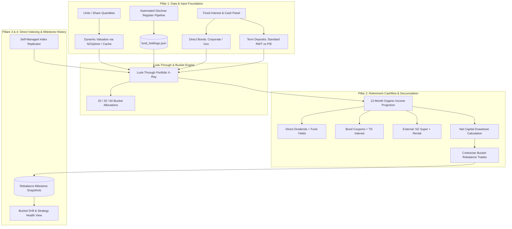
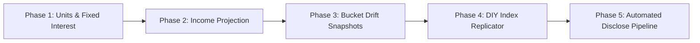

# Retirement Cashflow, Fixed Interest & Future Roadmap Design Spec

**Status:** Proposed  
**Date:** 2026-11-14  
**Author:** SusanJaneNZ  
**Parent Spec:** [Kiwi Portfolio X-Ray](kiwi-portfolio-xray.md)  
**Related Spec:** [Asset Split, Term Deposits, Bond Funds & Bucket Rebalancer](asset-split-bonds-tds.md)

---

## 1. Problem Statement

Kiwi Portfolio X-Ray provides look-through asset allocation, sector/country exposure, and bucket rebalancing across funds, direct shares, and bank term deposits. However, for a passive retirement investor managing a living portfolio in New Zealand, several real-world gaps exist:

1. **Static Dollar Balances vs. Unit Quantities:** The app currently tracks holdings as static dollar values. Without storing **Number of Shares / Units**, the app cannot integrate live market pricing feeds (e.g., [NZXplorer API](https://nzxplorer.co.nz/developers)) nor accurately calculate forward-looking **dividend income**.
2. **Fixed Interest Gaps (Direct Bonds & PIE Term Deposits):**
   * Many retirees hold **Direct NZDX Corporate & Government Bonds** (e.g., Infratil, Contact Energy, Spark, NZ Government stock) alongside bank Term Deposits. Currently, these cannot be entered naturally.
   * Bank Term Deposits in NZ are frequently available as **Variable-Rate PIE Term Deposits** (where tax is capped at the investor's Prescribed Investor Rate: 10.5%, 17.5%, or 28%), distinct from standard **Resident Withholding Tax (RWT)** deposits.
3. **Fund Ingestion Friction (Unmapped Constituents):** When an investor holds a fund not yet parsed into `fund_holdings.json`, the look-through engine shows blind spots. Fund managers (Kernel, Smartshares, Simplicity, etc.) legally file complete quarterly holdings under the Financial Markets Conduct Act (FMCA) on the [Companies Office Disclose Register](https://disclose-register.companiesoffice.govt.nz/), but the app currently relies on manual ingestion.
4. **Organic Income Routing vs. Capital Drawdowns:** In decumulation, dividends and interest are typically diverted directly into a day-to-day spending account (or living buffer) rather than reinvested. At rebalancing time, the investor only needs to liquidate the **net shortfall** between their annual living budget and their organic income.
5. **Fee Leakage in Top-Heavy Dividend Indices:** Focused dividend funds (e.g., Smartshares `DIV` with a 0.54% MER) have 75–80% of their assets concentrated in the top 8–10 holdings. For passive retirees, holding these top companies directly eliminates perpetual management fee drag and passes through full **28% company imputation credits** directly to the investor (enabling cash tax refunds from Inland Revenue for those on 10.5% or 17.5% marginal rates).
6. **Performance Graph Traps vs. Practical Bucket Drift:** Commercial platforms often implement daily/weekly squiggly performance line charts that require complex transaction-by-transaction accounting (TWR/MWR) and induce behavioral stress. For a passive bucket investor, the true need is a simple, zero-maintenance **Rebalance Milestone History** that tracks bucket drift (Target vs. Actual) over time.

---

## 2. Goals & Non-Goals

### Goals
1. **Mandatory Share Quantities for Exchange-Traded Assets & Universal Look-Through:** Listed NZX/ASX equities and listed ETFs require discrete share counts (value strictly derived as `shares * price`), reserving currency input for unlisted funds (Kernel, Simplicity). Listed ETFs (Smartshares `USF`, `FNZ`, `DIV`, BetaShares `ASIA`) entered as share quantities automatically unwrap into their underlying constituents.
2. **Fixed Interest & Cash Expansion:** Broaden the defensive panel to support:
   * Direct Corporate, Local Authority, and Government Bonds (value, coupon rate %, maturity date, frequency).
   * Term Deposits categorized as **Standard RWT** or **Variable-Rate PIE** (with PIR rates 10.5%, 17.5%, 28%).
3. **Organic Retirement Income Projection:** Project estimated 12-month forward income from dividends and fixed interest, and automatically calculate the **Net Capital Drawdown** needed at rebalancing:
   $$\text{Net Capital Withdrawal} = \text{Annual Living Budget} - \text{Total Organic Income}$$
4. **KiwiSaver Dedicated Portfolio Allocation (Roadmap Addition):** Account for KiwiSaver as a segregated portfolio asset:
   * **Accessibility Constraint:** Locked until age 65 (distinguishing liquid retirement capital available for bucket rebalancing from locked KiwiSaver capital).
   * **Ongoing Accumulation:** Optional modeling of ongoing contributions (e.g. 3% / 3.5% employee + employer match).
   * **Full Look-Through Integration:** Unlisted KiwiSaver schemes (Kernel, Simplicity, Milford, Fisher, Booster, SuperLife) fully unwrap into underlying company and bond constituents alongside liquid assets in macro sector/country breakdowns.
5. **Self-Managed Index Replicator:** Provide a lightweight tool to replicate top-heavy indices (like `DIV`) directly with 5–10 shares, displaying target weights and simple rebalancing guidance to avoid recurring fund fees.
6. **Automated Fund Ingestion Pipeline:** Automate extraction of fund constituents directly from the Companies Office Disclose Register / Sorted Smart Investor filings.
7. **Bucket Drift & Rebalance Snapshots:** Automatically record a clean snapshot at each rebalance milestone, allowing investors to inspect bucket evolution and verify contrarian rebalancing over time without daily transaction bookkeeping.

### Non-Goals
* **No Daily/Weekly Squiggly Line Performance Tracking:** No complex transaction ledger, TWR, or MWR accounting. Focus is exclusively on milestone snapshots.
* **No Intrusive Tax Optimizers or Warning Panels:** Tax details (such as the $50,000 FIF de minimis historical cost rule or PIE vs. RWT rates) are treated as prudent set-and-forget portfolio configuration, not noisy warning widgets.
* **No Automated Brokerage Trade Execution:** The app outputs clear, human-readable trade instructions; it does not connect to brokerage APIs or place orders.

---

## 3. Architecture & Functional Specifications



---

### A. Pillar 1: Units, Pricing & Expanded Fixed Interest

#### 1. Dual-Input Model (Units vs. Dollar Value)
Extend direct holdings and fund allocations to support both input modes:
```typescript
interface DirectHolding {
  ticker: string;
  name?: string;
  inputMode: 'shares' | 'value';
  shares?: number;             // e.g., 2500
  priceNZD?: number;           // Latest price from API or manual
  valueNZD: number;            // shares * priceNZD OR direct input
  purchaseCostNZD?: number;    // Optional historical cost basis
  country: string;
  sector: string;
  bucketId?: string;
}
```

#### 2. Fixed Interest & Cash Panel
Broaden `CashDeposit` in `src/types/portfolio.ts` into a unified `FixedInterestHolding`:
```typescript
interface FixedInterestHolding {
  id: string;
  name: string;                // e.g., "Contact Energy CEN060", "Heartland Bank PIE TD"
  category: 'term_deposit' | 'bond' | 'cash';
  taxType: 'rwt' | 'pie';
  pirRate?: 0.105 | 0.175 | 0.28;
  valueNZD: number;
  interestRate: number;        // e.g., 5.10 (%)
  maturityDate?: string;       // YYYY-MM-DD
  frequency?: 'monthly' | 'quarterly' | 'semi-annual' | 'maturity';
  bucketId?: string;
}
```

---

### B. Pillar 2: Organic Retirement Income & Cashflow Projection

In retirement, living expenses are funded first from natural portfolio cashflow. The app calculates:
1. **Annual Projected Dividend Income:** $\sum (\text{Shares}_i \times \text{DPS}_i)$ or $(\text{Value}_i \times \text{DividendYield}_i)$.
2. **Annual Projected Interest Income:** $\sum (\text{Principal}_j \times \text{CouponRate}_j)$.
3. **External Guaranteed Income (Optional):** Annual NZ Superannuation + Net Rental income.
4. **Net Rebalance Withdrawal:**
   $$\text{Capital Withdrawal Required} = \max(0, \text{Target Budget} - \text{Total Organic Inflows})$$

This net figure feeds directly into the **Buckets & Withdrawal Rebalancer**, ensuring investors never liquidate more equities than strictly necessary during down markets.

---

### C. Pillar 3: Self-Managed Index Replicator (DIY Direct Indexing)

For top-heavy indices like the NZ Dividend Index (`Smartshares DIV`), investors can eliminate the 0.54% MER by holding the top 8–10 companies directly:
* **Index Definition:** Top holdings with target weights (e.g., Spark 10%, Contact 10%, Meridian 10%, Auckland Airport 9%, Chorus 8%, etc.).
* **Alignment Analysis:** Compares current direct shareholdings against target weights.
* **Trade Generator:** Generates the exact buy/sell adjustments needed to track the index within an acceptable band (e.g., $\pm 2\%$).
* **Tax & Fee Summary:** Displays annual management fees saved and direct imputation credits captured.

---

### D. Pillar 4: Bucket Drift & Rebalance Milestone History

Instead of high-frequency time-series graphs, the app persists a lightweight timestamped snapshot whenever a rebalancing event is executed:
```typescript
interface RebalanceSnapshot {
  timestamp: string;           // ISO 8601
  totalPortfolioValue: number;
  buckets: {
    bucketId: string;
    bucketName: string;
    targetPercentage: number;
    actualPercentage: number;
    valueNZD: number;
  }[];
  organicIncomePastYear?: number;
  capitalWithdrawn?: number;
}
```

**UI Display:** A clean "Bucket Drift" card showing starting weights vs. current weights since the last rebalance, visually confirming when an overweight bucket should fund an underweight bucket.

---

### E. Pillar 5: Automated Disclose Register Ingestion Pipeline

To eradicate unmapped fund holdings:
1. **FMCA Periodic Scraper:** A Python utility that downloads quarterly scheme disclosure files (XML/CSV) from the Companies Office Disclose Register.
2. **Parser & Normalizer:** Maps constituent ISINs and security names against `security_master.json`.
3. **Feed Updating:** Updates `fund_holdings.json` automatically, ensuring funds like Kernel, Smartshares, and Simplicity remain continuously fresh.

---

## 4. Implementation Phasing



| Phase | Scope | Deliverables |
| :--- | :--- | :--- |
| **Phase 1** | **Units & Fixed Interest Expansion** | • Add `shares` and dynamic valuation support to direct shares.<br>• Expand Cash/TD panel to "Fixed Interest & Cash" supporting Direct Bonds and PIE/RWT classification. |
| **Phase 2** | **Organic Income Projection** | • Compute 12-month forward dividend and interest cashflow.<br>• Integrate net capital drawdown math into the Bucket Rebalancer.<br>• Add optional inputs for NZ Super and Rental income. |
| **Phase 3** | **Bucket Drift & Snapshots** | • Persist rebalance milestone snapshots.<br>• Render bucket drift comparisons (Target vs. Actual) since last rebalance. |
| **Phase 4** | **Self-Managed Index Replicator** | • Preset index models (e.g. NZ Top Dividend Leaders).<br>• Drift analysis and simple trade generation to track indices without MER fee drag. |
| **Phase 5** | **Automated Disclose Pipeline** | • Disclose Register XML/CSV ingestion script.<br>• Auto-generation of up-to-date `fund_holdings.json`. |

