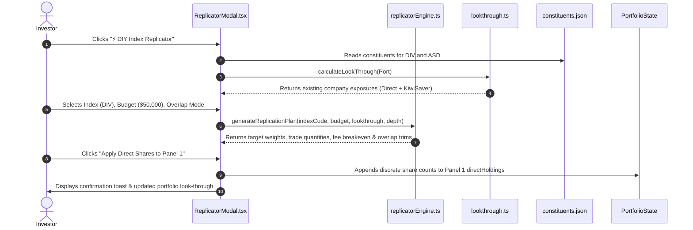

# Technical Design: Self-Managed Index Replicator (DIY Direct Indexing)

**Document:** `docs/designs/self-managed-index-replicator.md`  
**Status:** Proposed  
**Date:** 2026-11-19  
**Author:** SusanJaneNZ  
**Parent Specs:** [Retirement Cashflow, Fixed Interest & Future Roadmap](retirement-cashflow-and-roadmap.md), [Kiwi Portfolio X-Ray Core Architecture](kiwi-portfolio-xray.md)  

---

## 1. Executive Summary & Problem Context

Retail investors in New Zealand looking for dividend income often turn to thematic exchange-traded funds such as **Smartshares NZ Dividend ETF (`DIV`)** and **Smartshares Australian Dividend ETF (`ASD`)**. While convenient, both funds levy an ongoing **0.54% per annum Management Expense Ratio (MER)**. 

Both indices exhibit extreme concentration:
- In **`DIV`**, the top 8 companies account for **58.8%** of total assets; the top 10 account for **66.6%**, and the top 12 account for **73.3%**.
- In **`ASD`**, the top 8 companies account for **63.3%** of total assets, and the top 10 account for **74.4%**.

Paying 54 basis points each year on a capital sum to essentially hold 8–10 blue-chip dividend payers represents unnecessary structural fee drag. Furthermore, Kiwi investors face a distinct tax environment:
1. **NZ Equities (`DIV`):** No Foreign Investment Fund (FIF) tax. Direct company dividends pass through **28% imputation credits** directly to the investor's tax return, creating cash tax refunds for investors with marginal rates of 10.5% or 17.5% (whereas PIE funds cannot pass through cash refunds below 10.5% or refund excess credits across tax years in the same way).
2. **Australian Equities (`ASD`):** Under the **Trans-Tasman FIF Exemption** (qualifying ASX-listed companies on the ASX All Ordinaries index), NZ investors are **completely exempt from FIF rules** (neither the 5% Fair Dividend Rate nor the Comparative Value method applies). Investors only pay tax on declared cash dividends.

The **Self-Managed Index Replicator** empowers investors to construct and maintain an optimized, low-turnover, direct-holding sleeve of top index constituents with discrete share quantities, eliminating the 0.54% MER, avoiding FIF compliance, and capturing direct imputation benefits.

---

## 2. Core Constraints & Specific Challenges

### 2.1 Overlap & Whole-Portfolio Exposure Awareness
A critical problem with naive direct indexing tools is that they assume the replicated sleeve exists in a vacuum. In practice:
* An investor wanting to replicate `DIV` may already own shares of **Contact Energy (`CEN.NZ`)** or **Meridian Energy (`MEL.NZ`)** directly in Panel 1.
* Or they may hold an unlisted KiwiSaver growth fund (e.g., Kernel NZ 20, Simplicity KiwiSaver Growth, or Fisher Funds) that already allocates 8–10% of its equity assets to those same utility giants.

If the replicator instructs the investor to buy another $5,000 of `CEN.NZ` without considering other holdings, the investor unintentionally creates an alarming concentration risk in a single counterparty.

The Replicator therefore provides two selectable operating modes:
1. **Isolated Sleeve Mode:** Replicates the index within a segregated budget allocation ($X) as an exact mini-fund.
2. **Look-Through Aware Mode (Recommended):** Inspects the investor's **entire look-through portfolio** (Panel 1 Direct Shares + Panel 2 KiwiSaver & Fund look-throughs). If an index constituent is already over-weighted across the investor's total wealth, the replicator suppresses or scales down the buy order for that constituent, diverting capital to the remaining top index members to achieve balanced overall exposure.

### 2.2 Low Turnover vs. Tracking Efficiency
Replicating all 25 holdings in `DIV` or all 50 holdings in `ASD` is counter-productive: buying 50 individual Australian shares generates substantial brokerage friction and dividend administration headaches for negligible tracking benefit (the bottom 25 holdings in `ASD` average just 0.5% weight each).

The Replicator optimizes for the **Pareto Frontier**:
* **Top 8 to 10 constituents** capture **70%–80%** of total index return and dividend yield.
* Weights are re-normalized to sum to 100% of the direct sleeve.
* Rebalancing enforces an **inactivity drift tolerance band (e.g., $\pm 2.5\%$)**: no buy/sell trades are recommended unless a stock drifts outside its target corridor or a new dividend stock enters the top tier.

---

## 3. Financial Economics & $$ Breakeven Analysis

### 3.1 Passive Fund Management Drag (0.54% MER)
Smartshares charges 0.54% p.a. deducted daily from fund Net Asset Value (NAV). Over time, this fee scales directly with capital:

| Capital Invested | Annual 0.54% MER Fee | 5-Year Fee Drag (No Growth) | 10-Year Compounded Cost (6% Return) |
|---|---|---|---|
| **$20,000** | $108 / year | $540 | $1,472 |
| **$50,000** | $270 / year | $1,350 | $3,680 |
| **$100,000** | $540 / year | $2,700 | $7,360 |
| **$250,000** | $1,350 / year | $6,750 | $18,400 |

### 3.2 DIY Direct Brokerage Friction
In New Zealand, retail brokerage has dropped dramatically:
- **NZX Direct Shares (e.g. Sharesies, ASB Securities, Jarden Direct):**
  - Sharesies: 1.9% capped at $5 NZD per order (or $3/month plan). 8 trades cost **$24–$40 NZD total**.
  - ASB Securities: $15.00 flat per trade up to $1,000, then 0.30%. 8 trades cost **$120 NZD total**.
- **ASX Direct Shares (e.g. Interactive Brokers, Stake, Sharesies):**
  - Interactive Brokers (IBKR): AUD $3.00 flat per trade (or 0.08%). 8 trades cost **~AUD $24.00 (~$27 NZD) total**.
  - Stake: AUD $3.00 flat per trade up to $30,000. 8 trades cost **~AUD $24.00 total**.

### 3.3 Breakeven Horizon Analysis

```
Cumulative Cost Comparison ($50,000 Portfolio, 8-Stock Replicated Sleeve)

$ Costs
  ▲
$800│                                                / Smartshares ETF (0.54% MER)
$700│                                               /  [$810 over 3 yrs]
$600│                                              /
$500│                                             /
$400│                                   ---------/
$300│                        -----------
$200│             ----------
$100│ ────────────────────────────────────────── DIY Direct (IBKR/Sharesies)
  0 └──────┬────────────┬────────────┬────────────┬───────────► Time (Months)
         0 (Setup)     6 mos        12 mos       24 mos
                     ▲
            BREAKEVEN (~1.5 to 2 Months)
```

**Quantitative Breakeven Thresholds:**
* **At $15,000 capital:**
  - Setup cost: ~$35 (8 trades @ $4–$5).
  - Annual ETF MER: $81/year.
  - **Breakeven: 5.2 months.**
* **At $50,000 capital:**
  - Setup cost: ~$40 (8 trades).
  - Annual ETF MER: $270/year.
  - **Breakeven: 1.8 months.** (Net savings in Year 1: **+$230**; 5-year savings: **+$1,310**).
* **At $100,000 capital:**
  - Setup cost: ~$50.
  - Annual ETF MER: $540/year.
  - **Breakeven: Less than 5 weeks.** (Net savings in Year 1: **+$490**; 5-year savings: **+$2,650**).

---

## 4. Model Portfolios: Top Constituents & Re-normalization

The pipeline already parses complete statutory disclosures for `DIV` and `ASD` into `public/data/constituents.json`. The replicator extracts and re-normalizes the top holdings:

### 4.1 Preset 1: DIY NZ Top Dividend Leaders (`DIV` Core 8)
*Current Disclose Filing: 30 September 2026*

| Ticker | Company Name | Sector | Original Index Weight | Re-normalized Sleeve Weight | 5-Year Imputation Status |
|---|---|---|---|---|---|
| **MEL.NZ** | Meridian Energy | Utilities | 9.69% | **16.5%** | 100% Fully Imputed |
| **MCY.NZ** | Mercury NZ | Utilities | 9.30% | **15.8%** | 100% Fully Imputed |
| **CEN.NZ** | Contact Energy | Utilities | 9.30% | **15.8%** | 100% Fully Imputed |
| **CNU.NZ** | Chorus | Communication | 8.84% | **15.0%** | 100% Fully Imputed |
| **PCT.NZ** | Precinct Properties | Real Estate | 6.25% | **10.6%** | Excluded / Partial |
| **FCG.NZ** | Fonterra Co-op | Consumer Staples | 5.43% | **9.2%** | Fully Imputed |
| **GNE.NZ** | Genesis Energy | Utilities | 5.07% | **8.6%** | 100% Fully Imputed |
| **KPG.NZ** | Kiwi Property Group | Real Estate | 4.89% | **8.3%** | Excluded / Partial |
| **Total** | *Top 8 Holdings* | — | **58.77%** | **100.0%** | **High NZ Imputation** |

*(Optionally expand to Top 10 by including `TWR.NZ` Tower 4.3% and `SKL.NZ` Skellerup 3.5%, covering 66.6% of original index).*

### 4.2 Preset 2: DIY ASX High Dividend Yield (`ASD` Core 8)
*Current Disclose Filing: 30 September 2026*

| Ticker | Company Name | Sector | Original Index Weight | Re-normalized Sleeve Weight | Trans-Tasman FIF Status |
|---|---|---|---|---|---|
| **TLS.AX** | Telstra Group | Telecom | 10.14% | **16.0%** | FIF Exempt (ASX All Ordinaries) |
| **WES.AX** | Wesfarmers | Discretionary | 8.87% | **14.0%** | FIF Exempt |
| **TCL.AX** | Transurban Group | Industrials | 8.84% | **14.0%** | FIF Exempt |
| **CBA.AX** | Commonwealth Bank | Financials | 8.13% | **12.8%** | FIF Exempt |
| **ORG.AX** | Origin Energy | Utilities | 7.04% | **11.1%** | FIF Exempt |
| **COL.AX** | Coles Group | Consumer Staples | 6.33% | **10.0%** | FIF Exempt |
| **NAB.AX** | National Australia Bank | Financials | 5.80% | **9.2%** | FIF Exempt |
| **STO.AX** | Santos Limited | Energy | 5.76% | **9.1%** | FIF Exempt |
| **Total** | *Top 8 Holdings* | — | **63.31%** | **100.0%** | **100% FIF Exempt** |

*(Top 10 includes `WBC.AX` Westpac 5.67% and `ANZ.AX` ANZ 5.49%, lifting index coverage to 74.4%).*

---

## 5. Mathematical Algorithm

### 5.1 Re-normalization of Top $K$ Weights
For a selected top $K$ constituent count (default $K=8$ or $K=10$):
$$W_{\text{sum}} = \sum_{i=1}^{K} w_{i, \text{index}}$$
$$\hat{w}_i = \frac{w_{i, \text{index}}}{W_{\text{sum}}} \quad \text{such that} \quad \sum_{i=1}^{K} \hat{w}_i = 1.0$$

### 5.2 Look-Through Overlap Adjustment
Let $V_{\text{target}}$ be the total capital allocated to this DIY replicated sleeve.
Under **Look-Through Aware Mode**:
1. Compute the investor's current whole-portfolio exposure to company $i$ from existing direct shares and unlisted/KiwiSaver funds:
   $$E_{\text{existing}, i} = V_{\text{direct}, i} + \sum_{f} \left( V_f \times w_{f, i} \right)$$
2. Compute the baseline target dollar value for company $i$ within the sleeve:
   $$V_{\text{sleeve}, i}^* = V_{\text{target}} \times \hat{w}_i$$
3. Compute the adjusted target:
   $$\text{Excess}_i = \max(0, E_{\text{existing}, i} - V_{\text{sleeve}, i}^*)$$
   If an investor already holds more of company $i$ than the sleeve targets, set sleeve target to $0$ and re-distribute the remaining budget proportionally across the un-owned or under-owned constituents:
   $$V_{\text{adjusted}, j} = \left( V_{\text{target}} \right) \times \frac{\hat{w}_j}{\sum_{k \notin \text{Overweight}} \hat{w}_k}$$

### 5.3 Discrete Share Count Trade Calculation
For each constituent $i$ with live market price $P_i$ (converted to NZD via live FX rate for ASX shares):
$$\text{Target Units}_i = \text{round}\left( \frac{V_{\text{adjusted}, i}}{P_i} \right)$$
$$\Delta \text{Units}_i = \text{Target Units}_i - \text{Current Units}_i$$
$$\Delta \text{Value NZD}_i = \Delta \text{Units}_i \times P_i$$

### 5.4 Inactivity Band (Drift Suppression)
To prevent micro-trades:
$$\text{If } \left| \frac{\text{Current Value}_i}{\text{Target Value}_i} - 1.0 \right| \le 2.5\% \implies \Delta \text{Units}_i = 0$$

---

## 6. User Interface & Screen Layouts

The feature integrates into the application as a modal tool accessible from Panel 1 (Direct Shares & Listed ETFs) via a dedicated button: **⚡ DIY Index Replicator**.

```
┌────────────────────────────────────────────────────────────────────────────────────────┐
│  ⚡ Self-Managed Index Replicator (DIY Direct Indexing)                         [ ✕ ]  │
├────────────────────────────────────────────────────────────────────────────────────────┤
│  Eliminate the 0.54% MER fee drag by replicating top-heavy dividend indices directly   │
│  with 8–10 blue-chip shares. NZX and ASX shares are 100% FIF tax-exempt.               │
├────────────────────────────────────────────────────────────────────────────────────────┤
│  STEP 1: SELECT INDEX MODEL & CAPITAL ALLOCATION                                       │
│                                                                                        │
│  Target Index: [ 🏛️ Smartshares NZ Dividend (DIV) ▼ ]   Holding Depth: [ Top 8 (59%) ▼]│
│  Target Budget: [ $ 50,000 NZD       ]   Replication Mode: (●) Whole-Portfolio Aware   │
│                                                            ( ) Standalone Sleeve       │
├────────────────────────────────────────────────────────────────────────────────────────┤
│  📊 ANNUAL SAVINGS & BREAKEVEN ANALYSIS                                                │
│  ┌──────────────────────────┬──────────────────────────┬─────────────────────────────┐ │
│  │ Annual Passive Fee Drag  │ Est. One-Off Brokerage   │ Breakeven Payoff Time       │ │
│  │ $270.00 / year (0.54%)   │ ~$35.00 NZD (8 trades)   │ 1.5 Months (⚡ High Benefit) │ │
│  └──────────────────────────┴──────────────────────────┴─────────────────────────────┘ │
├────────────────────────────────────────────────────────────────────────────────────────┤
│  STEP 2: PORTFOLIO LOOK-THROUGH OVERLAP CHECK                                          │
│  ℹ️ Contact Energy (CEN.NZ) detected in Fisher KiwiSaver ($4,200). Buy order adjusted.  │
│                                                                                        │
│  Constituent           Target %   Target $   Existing Hold  Target Shares   Action     │
│  ────────────────────────────────────────────────────────────────────────────────────  │
│  Meridian (MEL.NZ)       17.2%    $8,600        $0.00           1,433       BUY 1,433  │
│  Mercury (MCY.NZ)        16.5%    $8,250        $0.00           1,250       BUY 1,250  │
│  Contact (CEN.NZ)        11.0%    $5,500       $4,200 (Kiwi)      150       BUY 150*   │
│  Chorus (CNU.NZ)         15.8%    $7,900        $0.00             898       BUY 898    │
│  Precinct (PCT.NZ)       11.2%    $5,600        $0.00           4,667       BUY 4,667  │
│  Fonterra (FCG.NZ)        9.8%    $4,900        $0.00           1,167       BUY 1,167  │
│  Genesis (GNE.NZ)         9.1%    $4,550        $0.00           2,068       BUY 2,068  │
│  Kiwi Property (KPG.NZ)   9.4%    $4,700        $0.00           5,529       BUY 5,529  │
│  ────────────────────────────────────────────────────────────────────────────────────  │
│  Total Sleeve Budget:   100.0%   $50,000       $4,200           —           8 Trades   │
├────────────────────────────────────────────────────────────────────────────────────────┤
│  STEP 3: GENERATE TRADES & APPLY TO PORTFOLIO                                          │
│                                                                                        │
│  [ 📋 Copy Trade Orders to Clipboard ]       [ ➕ Apply Direct Shares to Panel 1 ]     │
│                                                                                        │
│  *Trade List:*                                                                         │
│  1. BUY 1,433 MEL.NZ @ ~$6.00 NZD (~$8,598 NZD)                                        │
│  2. BUY 1,250 MCY.NZ @ ~$6.60 NZD (~$8,250 NZD)                                        │
│  3. BUY   150 CEN.NZ @ ~$8.67 NZD (~$1,300 NZD)  [Trimmed: $4.2k held in KiwiSaver]     │
│  4. BUY   898 CNU.NZ @ ~$8.80 NZD (~$7,902 NZD)                                        │
│  5. BUY 4,667 PCT.NZ @ ~$1.20 NZD (~$5,600 NZD)                                        │
│  6. BUY 1,167 FCG.NZ @ ~$4.20 NZD (~$4,901 NZD)                                        │
│  7. BUY 2,068 GNE.NZ @ ~$2.20 NZD (~$4,550 NZD)                                        │
│  8. BUY 5,529 KPG.NZ @ ~$0.85 NZD (~$4,700 NZD)                                        │
└────────────────────────────────────────────────────────────────────────────────────────┘
```

---

## 7. Component Architecture & Data Flow



---

## 8. File Structure & Implementation Plan

| Action | Path | Description |
|---|---|---|
| **Create** | `src/engine/replicator.ts` | Mathematical engine: top-K weight re-normalization, overlap adjustment, discrete unit trade sizing, and fee breakeven math. |
| **Create** | `src/engine/replicator.test.ts` | Unit tests verifying re-normalization, overlap detection, trade rounding, and breakeven horizons. |
| **Create** | `src/components/modals/ReplicatorModal.tsx` | React modal UI with preset selector, breakeven KPI cards, look-through overlap table, and one-click order application. |
| **Modify** | `src/components/portfolio-inputs/DirectHoldingsPanel.tsx` | Adds trigger button `⚡ DIY Index Replicator` in header actions. |
| **Modify** | `docs/designs/SITEMAP.md` | Indexes this specification into the architecture sitemap. |

---

## 9. Verification & Test Plan

1. **Re-normalization Accuracy:**
   - Verify that for any selected index (`DIV`, `ASD`) and depth ($K=8, 10, 12$), sum of target weights $\sum \hat{w}_i \equiv 1.0000 \pm 10^{-6}$.
2. **Whole-Portfolio Overlap Guard:**
   - Set up test case where portfolio holds $10,000 of Contact Energy in KiwiSaver. Verify Replicator reduces the `CEN.NZ` buy order accordingly and distributes residual budget across remaining constituents without exceeding the target sleeve budget.
3. **Breakeven Payoff Calculations:**
   - Verify breakeven formula: $\text{Months} = \frac{\text{Brokerage Cost}}{\text{Capital} \times (0.0054 / 12)}$ accurately matches test vectors at $15k, $50k, and $100k.
4. **Discrete Share Rounding:**
   - Verify that generated trade quantities are integers, live share prices are applied, and total executed value does not exceed the user's allocated budget.
5. **Trans-Tasman FIF Exemption Flagging:**
   - Verify that Australian shares (`ASD`) display the "FIF Exempt" badge in the UI to give Kiwi investors confidence regarding IRD compliance.
